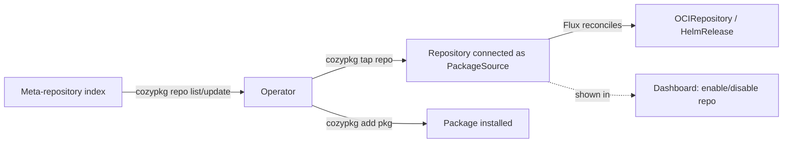

# Cozymarketplace: a community marketplace of External-Apps repositories

- **Title:** `Cozymarketplace — a meta-repository index of community External-Apps repositories`
- **Author(s):** `@kvaps`
- **Amended:** `2026-10-20`: reconciled with the shipped implementation; see Decisions.

## Decisions

Newest first. Each record is a settled question with its reasoning; the record is frozen once merged, this proposal keeps evolving.

- [`0002`: There is no in-cluster index and no default index](decisions/0002-no-in-cluster-index-and-no-default-index.md)
- [`0001`: Tapped repositories keep their own names, and identity comes from a label](decisions/0001-tapped-repositories-keep-their-names-identity-from-a-label.md)

## How these proposals relate

This feature is described across two proposals. `#18` (this one) defines the meta-index, the repository-as-unit model, and the `cozypkg` repository commands; the index, the repository contract, naming, and the connect and disconnect lifecycle are answered here. The supplementary `#23` answers the in-cluster backend shape, private-repository credentials, and publication validation. They cross-link, and consolidating them into a single proposal is planned as a follow-up.

## Overview

Cozymarketplace is a community marketplace that lets anyone publish — and lets any Cozystack operator discover and install — curated repositories of External Apps. The central idea is that the unit an operator installs into Cozystack is **a repository of packages, not an individual package**. Cozystack's value is a ready, tested configuration of components known to work together, and a thematic repository is the natural carrier of that guarantee.

The mechanism is deliberately thin and mirrors `krew` (the kubectl plugin manager): a single **meta-repository** holds an index of available External-Apps repositories. Anyone — Aenix as a maintainer, or any third party — can list their repository in that index. An operator browses the index, taps a repository onto their cluster, and installs the packages it offers. The CLI is `cozypkg`, extended with repository-level operations.

This is Phase 1: the meta-repository index, the repository-as-unit model, and the `cozypkg` repository commands. Richer concerns (per-package version pinning, cross-repository dependency resolution, publication CI, private repositories) are deferred — see Non-goals and Open questions.

## Context

### How Cozystack ships apps today

Cozystack already has the primitives this marketplace builds on:

- **External Apps** are packaged as Helm charts and registered through a small set of CRDs. An `ApplicationDefinition` (cluster-scoped) is the catalog entry the dashboard renders — application `Kind`, the OpenAPI schema used for API validation, singular/plural names, the release `chartRef`, and dashboard metadata. See `api/v1alpha1/applicationdefinitions_types.go`.
- A **`PackageSource`** describes a source of charts and one or more **variants**; each variant lists `components`, `libraries`, and `dependsOn`. See `api/v1alpha1/packagesource_types.go`.
- A **`Package`** selects a variant from a `PackageSource` and can override or disable individual components. See `api/v1alpha1/package_types.go`.
- The operator translates `PackageSource`/`Package` into Flux **`HelmRelease`** objects; the platform creates an `OCIRepository` named `cozystack-packages` from which package sources are served.
- **`cozypkg`** (`cmd/cozypkg`) is the CLI for managing packages today, with `add`, `del`, `list`, and `dependencies`.
- A reference layout for third-party apps already exists in `cozystack/external-apps-example`.

Cozystack already knows how to take a repository of manifests, connect it via Flux as a package source, and let an operator install packages from it. The marketplace adds **discovery** on top of that, plus a way to publish the index of such repositories.

### The problem

There is no shared, browsable place that answers "which External-Apps repositories exist, and how do I connect one?" An operator who wants community apps has to know the repository URL out of band and wire it up by hand — no curated entry point, no way for the community to publish a repository for others to find, and no in-product surface showing what is available. The goal is for Cozystack to ship as an empty distribution / framework, with the marketplace as how operators light it up with thematic, pre-tested bundles of apps.

## Goals

- **A single meta-repository (index) of External-Apps repositories.** Maintainers — Aenix or anyone — submit a small descriptor (a YAML entry, `krew-index`-style) declaring that their repository exists and is available.
- **The repository is the installable unit.** The marketplace lists available repositories, optionally showing the packages inside each, but the thing an operator connects is the repository.
- **The repository is the versioned unit.** A repository *is* an OCI artifact bundling all of its applications, and that artifact carries a version/tag. The versioned, installable thing is the repository as a whole — not individual packages. This is free: External Apps already ship as versioned OCI artifacts, so a repository inherits versioning by construction. Per-package version pinning remains out of scope (see Non-goals).
- **`cozypkg` repository commands.** Extend `cozypkg` so an operator can list repositories from the index, refresh the index, and tap (connect) a chosen repository — after which the existing `cozypkg list` / `cozypkg add` flow installs packages from it.
- **Reuse the existing External-Apps mechanism.** A tapped repository becomes a Flux-connected `PackageSource` exactly like other External Apps — served from the OCI/Flux pipeline, with no new runtime machinery.
- **Surface the catalog in Cozystack itself**, so operators can install apps from there. Connecting a repository and installing an app are two separate acts. Connecting registers the repository's apps as catalog metadata and is administrative; installing is a later explicit act that creates a `Package` (via `cozypkg add` or a user resource), reachable from the dashboard too. The shipped split is recorded in the supplementary proposal's decision 0001.
- **Room for a flatter view.** Nothing prevents also rendering one cross-repository list of which packages exist in which repositories, as a view on top of the index.

### Non-goals

- **Per-package version pinning.** Pinning an *individual package* to a concrete version is out of scope for Phase 1; there is no per-package pinning today and the design proceeds without it. This is distinct from repository-level versioning, which is **in** scope: a repository is a single versioned OCI artifact, so the repository as a whole is versioned even though its individual packages are not separately pinnable.
- **A commercial / operator marketplace** (Red Hat Marketplace-style, with paid operators). This is a separate, later marketplace, not designed here. The intent is two marketplaces — a community one first (this proposal), a commercial one later.
- **Automatic cross-repository dependency resolution** between arbitrary community packages. `PackageSource` already supports `dependsOn` within the platform's own sources; generalized community-wide resolution is not part of Phase 1.
- **A bespoke marketplace install flow.** Installation reuses the existing `Package`-creation path, the same one that installs any app, rather than a separate marketplace installer. Connecting a repository is the admin step; creating a `Package` from it (through `cozypkg add` or the normal dashboard app-creation flow) is the install step. Connecting is not inert, though: it writes one tap-managed registration `Package` per source that installs the repository's registration chart (its `-rd` components, the only install-marked ones; the app components carry no install block), so the apps appear in the catalog before anyone installs them. That chart is arbitrary Helm the publisher wrote, it runs as Flux's cluster-admin identity, and only `privileged` components wait for confirmation. Why connecting installs anything at all, under which identity, and what the privilege gate covers is a security question that is not settled; it is laid out under Proposed guarantees and Open questions rather than claimed as decided here. The computed-`Tap` backend that materializes all this is the supplementary proposal's decision 0001.

## Design

Three parts — the meta-repository (index), the repository contract, and the `cozypkg` repository commands — each mapping onto an existing Cozystack primitive.

### 1. The meta-repository (index)

A single git/OCI-hosted index repository, analogous to `krew`'s `krew-index`, with one descriptor per published External-Apps repository. A descriptor declares a name/identifier, where the repository lives (its OCI reference **including the artifact tag/version**), and human-facing metadata (title, description, maintainer) for listings. Because a repository is a single versioned OCI artifact, the index entry's source references a tag. A tag names a version but does not freeze one: OCI tags are mutable, and the connected Flux source follows whatever the tag currently resolves to, re-checking on its sync interval. So a tag selects a version, it does not pin content. As built, `cozypkg tap` sets the source's `spec.ref.tag` and rejects a digest reference outright, so there is no content pin today; digest pinning is left as later work. The connected source then polls every 5 minutes and uses `latest` when no tag is given, so a publisher moving the tag changes what the cluster runs with no admin action. Following the tag this way is a known gap, not a deliberate guarantee (see Proposed guarantees and [#4979](https://github.com/cozystack/cozystack/issues/4979)). Reconnecting a repository through the aggregated API replaces the source spec wholesale, while the CLI re-tap applies with server-side apply.

```yaml
# index entry — illustrative shape, not a fixed schema
apiVersion: marketplace.cozystack.io/v1alpha1
kind: RepositoryIndexEntry      # exact kind/CRD TBD
metadata:
  name: aenix-apps
spec:
  source:
    # An External-Apps repository served the same way as today's platform
    # sources (OCIRepository / package-source pipeline). The repository is one
    # versioned OCI artifact bundling all its apps; the tag names the version.
    url: oci://ghcr.io/aenix-io/cozystack-apps
    tag: v1.5.0          # repository-artifact version (the versioned unit)
  maintainer: Aenix
  description: Curated infrastructure and LLM apps maintained by Aenix
```

Anyone, including Aenix, publishes a repository by adding such an entry to the index.

### 2. The repository contract

Each published repository follows the shape Cozystack already uses for External Apps: a `packages/core`-style set of manifests describing the package source — a `PackageSource` plus the `ApplicationDefinition`s and charts it offers, connected into the cluster by Flux. Tapping a repository wires it up as a package source (the same `OCIRepository` → `PackageSource` → Flux `HelmRelease` pipeline used for first-party apps); the operator then installs individual packages from it.

This is the point of "repository as the unit": the components inside a thematic repository are authored and tested together, so tapping the whole repository gives a configuration known to work as a set — comparable to a distribution's package repository (e.g. an Ubuntu PPA, or WAPT).

### 3. `cozypkg` repository commands

Extend the existing `cozypkg` CLI (`add`, `del`, `list`, `dependencies`) with repository-level operations, reusing a tap-style syntax:

- **list repositories** — read the index and show available repositories.
- **refresh the index** — re-pull the index.
- **tap `<repository>`** — connect a chosen repository to the current cluster, creating the package source. Tapping can target a **specific repository version** (the OCI artifact tag); upgrading means moving to a newer version, rollback means re-selecting a previous tag.
- then the existing flow: `cozypkg list` shows packages from tapped repositories, `cozypkg add <package>` installs one.

```text
# illustrative — verb names to be finalized against existing cozypkg UX
cozypkg repo list                 # list repositories from the meta-index
cozypkg repo update               # refresh the index
cozypkg tap aenix-apps            # connect a repository (latest tag) to this cluster
cozypkg tap aenix-apps@v1.5.0     # select a specific OCI artifact version (a tag, which can move)
cozypkg list                      # packages available from tapped repos
cozypkg add <package>             # install a package
```

### Flow



## User-facing changes

- **CLI (`cozypkg`):** new repository-level commands (list/update the index, tap a repository) on top of the existing `add`/`del`/`list`/`dependencies`.
- **Dashboard:** a marketplace view listing available repositories, where an administrator connects or disconnects a repository. Installing an app from a connected repository uses the normal app-creation flow, the same as any other app; there is no separate marketplace install action.
- **New public artifact:** the meta-repository index itself, which the community publishes into.
- **No change** to how tenants consume already-installed apps; this is an admin-facing discovery/installation surface.

## Upgrade and rollback compatibility

Additive. The marketplace builds on the existing `PackageSource` / `Package` / `OCIRepository` / Flux pipeline and the `cozypkg` CLI; clusters that never tap a community repository behave exactly as before. Tapping creates standard package-source manifests, so removing the feature degrades to "wire up a package source by hand," which already works. Disabling or removing a tapped repository disables its package source (dashboard control or `cozypkg del`).

Because a repository is a single versioned OCI artifact, upgrade and rollback are repository-level operations: upgrading points a tapped repository at a newer artifact version (tag), rollback re-selects a previous tag, which restores the previous content only if that tag has not been moved. There is no per-package upgrade/rollback in Phase 1 — the whole repository moves as a unit, consistent with the "tested together" guarantee.

## Security

- **New trust boundary:** tapping a third-party repository runs that repository's charts in the operator's cluster. The index is a discovery surface, not an endorsement — listing does not imply Aenix vouches for a repository's contents, and the UI must make that explicit.
- **Authority model, as built:** connecting and disconnecting a repository creates and deletes a cluster-scoped `Tap`, which requires cluster-admin. Reading the catalog does not: the `taps` resource is granted `get`/`list`/`watch` to the tenant base roles, so any authenticated user can browse what is connected. Installing an app is the normal app-creation path under its usual authority. So the mutating surface is admin-only; the catalog surface is not.
- **Catalog metadata is cluster-wide readable, and there is no per-tap visibility control.** Because `taps` is cluster-scoped and tenant-readable, the catalog metadata of every connected repository, including a private one, is visible to every authenticated user: names, descriptions, tags, the privileged badge. Only the pull credential is protected, as a `secretRef` that read responses never return. The supplementary proposal describes a `visibility: private` marker to restrict sensitive metadata; it is not built. Treat the package names and descriptions of any connected repository as cluster-wide visible. This gap sits next to the privilege-model work tracked in the 1.7 marketplace epic.
- **Connecting verifies no signature.** Tapping checks the artifact's structure and its content digest, but does not verify a cosign signature; `spec.verify` is not set on the connected source. Signature verification lives at publication time instead, in `cozypkg validate --require-signature` and the index CI gate, not on the connect path. A cluster-admin connecting a repository is trusting its publisher directly.
- **Private repositories / credentials:** supported through a pull `Secret` the admin pre-creates, referenced by `secretRef` on the connected Flux source at tap time (see the supplementary proposal). The credential stays inside Flux's RBAC and is never returned by the API; only the catalog metadata is exposed, per the bullet above.

## Proposed guarantees and what holds today

These are the security-relevant properties the design aims to hold. They are proposed here, not yet confirmed by a maintainer, and the right column is an honest read of how far the shipped code meets each. "Holds today" is read from `main`; a row that depends on runtime behaviour not exercised on a cluster says so, so follow-up fixes can point at this table.

| Proposed guarantee | Holds today |
| --- | --- |
| Connecting a repository installs nothing without admin confirmation | Partly. Connecting is admin-only, but it does install: the operator creates one tap-managed registration `Package` per source, which installs the repository's registration chart (its `-rd` components, arbitrary Helm the publisher wrote, meant to render the `ApplicationDefinition`s but not limited to them) as Flux's default (cluster-admin) identity, with no `serviceAccountName` set. Only components marked `privileged` wait for `--allow-privileged`; the rest install on connect with no separate confirmation. The privilege model here is not settled ([#4358](https://github.com/cozystack/cozystack/issues/4358), [#4359](https://github.com/cozystack/cozystack/issues/4359), [#4978](https://github.com/cozystack/cozystack/issues/4978)). |
| Disconnecting does not break running apps | Partly. User-installed apps are left running. But disconnect deletes the registration `Package` first, which garbage-collects its HelmReleases and the `ApplicationDefinition`s they rendered; once an `ApplicationDefinition` is gone, that kind is dropped from the aggregated apps API on the next cozystack-api rollout, so existing tenant instances of that kind lose their API. The same happens when a publisher revision drops a `PackageSource` and the materializer prunes it. Read from code, not run on a cluster ([#4980](https://github.com/cozystack/cozystack/issues/4980)). |
| A tap cannot take over platform objects (names, kinds, releases) | Partly. An exact `PackageSource` name clashing with a core component is refused. Not caught: artifact names collapse `.` to `-` (so `cozystack.x` and `cozystack-x` map to one `ExternalArtifact`), a component release name can clash with a platform `HelmRelease`, and kind ownership is first-come, so a tap that registers a kind before the platform keeps it ([#4975](https://github.com/cozystack/cozystack/issues/4975), [#4977](https://github.com/cozystack/cozystack/issues/4977); kind ownership in [#4981](https://github.com/cozystack/cozystack/issues/4981)). |
| Content stays put until an admin moves it | No. The connected source follows a moving tag on a 5-minute interval and defaults to `latest` when no tag is given, so whatever the publisher pushes to that tag is pulled automatically; a digest reference is rejected. Reconnecting through the aggregated API also replaces the source spec wholesale, while the CLI re-tap uses server-side apply. Digest pinning is open ([#4979](https://github.com/cozystack/cozystack/issues/4979)). |

None of these is a hard guarantee yet. Treat the gaps as the marketplace's current security posture, tracked under the 1.7 marketplace epic ([#4981](https://github.com/cozystack/cozystack/issues/4981)).

## Failure and edge cases

- **Index entry points at an unreachable / invalid source →** tap fails; the resulting `PackageSource` / Flux source surfaces the error on its status, like a broken External App today.
- **Repository chart fails to template or install →** Flux `HelmRelease` reports the failure; no different from a normal External App install failure.
- **Operator disables a repository that has installed packages →** user-installed `Package`s are left running and become unmanaged until explicitly removed (`cozypkg del`) or the repository is tapped again; they carry no owner reference back to the source, so garbage collection never reaches them. Tenant instances are a separate matter: disconnect deletes the tap-managed registration `Package` first, which garbage-collects its HelmReleases and the `ApplicationDefinition`s they rendered, so the app's kind is dropped from the aggregated apps API on the next cozystack-api rollout and existing instances of that kind lose their API until the repository is tapped again. The same cascade runs when a publisher revision drops a `PackageSource` and the materializer prunes it. This tenant-instance effect is read from code, not run on a cluster, and is not settled ([#4980](https://github.com/cozystack/cozystack/issues/4980)). Teardown is ordered by the `apps.cozystack.io/tap-materializer` finalizer on the tap's Flux `OCIRepository`, not on the `PackageSource`.
- **Two repositories expose a package with the same name →** a tapped repository keeps its own declared `PackageSource` names, with no `community.` prefix, and identity is carried by the `apps.cozystack.io/marketplace-tap` label rather than by a name prefix. An exact `PackageSource` name colliding with a core component or another repository's source is refused at connect time. That exact-name check does not cover the `.`-to-`-` artifact-name collapse or a component release name clashing with a platform `HelmRelease`. See decision 0001, which scopes the check and lists those gaps ([#4977](https://github.com/cozystack/cozystack/issues/4977), [#4975](https://github.com/cozystack/cozystack/issues/4975)).

## Testing

- **Unit:** `cozypkg` index parsing; `repo list` / `update` / `tap` behavior against a fixture index.
- **Integration / e2e:** publish a fixture External-Apps repository into a test meta-index, tap it on a test cluster, install a package, confirm the resulting `PackageSource` → Flux `HelmRelease` reconciles to Ready. (Reuses existing External-Apps e2e patterns.)
- **Manual:** dashboard enable/disable of a tapped repository.

## Rollout

- **Phase 1 (this proposal):** meta-repository index, repository-as-unit model (repository = versioned OCI artifact, so repository-level versioning is included), `cozypkg` repository commands, admin-only dashboard enable/disable, reuse of the existing package-source pipeline. No per-package version pinning, no private-repo credentials, no publication CI gate.
- **Later phases:** per-package version pinning; private repositories with pull secrets; a publication/validation CI gate for submitted repositories; an AUR-style "anyone can create a repository" entry as just another entry in the index; and eventually a commercial operator-style marketplace.

## Open questions

Several questions this proposal opened are now settled; they are recorded as decisions rather than left here.

- **Connected-repository shape.** Settled: the connected repository reuses `PackageSource`, and the `Tap` that represents it is a read-only computed view, not stored state. See the supplementary proposal's decision 0001.
- **`cozypkg` verb naming.** Settled: the repository-level subcommands shipped as `tap` and `untap`.
- **Namespacing / identity for repositories.** Settled: identity is a label, not a name prefix, and name collisions are refused. See decision 0001.
- **The index itself.** Settled for now: there is no in-cluster index and no default index repository; the publication side exists only as a CI template. See decision 0002.

Still open:

- **Per-package versioning.** Repository-level versioning is settled (a repository is a versioned OCI artifact, in scope). Whether to add *per-package* pinning is still open, deferred unless a concrete case appears.
- **Content pinning by digest.** A tag selects a version but does not freeze content; connecting by digest is rejected today. Whether to support a digest pin is open.
- **Dependencies across community packages.** Whether and how `dependsOn`-style dependencies generalize beyond a single repository.
- **Per-tap metadata visibility.** Catalog metadata is cluster-wide readable today, and there is no `visibility` control. Whether to add one, and how it relates to the marketplace privilege model, is open (see Security).
- **Privilege model on connect.** Connecting installs the registration components as Flux's cluster-admin identity, and only `privileged` components gate on `--allow-privileged`. What the gate should cover, whether catalog registration should install anything before an explicit install, and whether a handed-over package can escalate on a later revision, are open ([#4978](https://github.com/cozystack/cozystack/issues/4978), [#4358](https://github.com/cozystack/cozystack/issues/4358), [#4359](https://github.com/cozystack/cozystack/issues/4359)).

## Alternatives considered

- **Marketplace of individual packages (package-centric, AUR-style).** Publish individual packages with a web form / JSON descriptor pointing at a git repo, collected into one flat catalog. This is a "repository of packages" rather than a "repository of repositories"; it could itself be one more entry in the index rather than the primary model, since the repository-as-unit gives a "tested together" guarantee a loose package catalog does not.
- **Standalone SaaS marketplace (Artifact Hub-style) vs. in-product.** A separate hosted site where users browse packages and copy install instructions, versus surfacing the marketplace inside Cozystack. This proposal prioritizes the in-product/CLI path so operators install directly; the two are not mutually exclusive — an external browsable view can sit on top of the same index.
- **Per-package version-pinned dependency graph up front.** Building per-package versioning and dependency resolution into Phase 1. Rejected: per-package pinning does not exist today and the design can proceed without it; adding it now expands scope before the core repository-index model is proven. Repository-level versioning is still adopted (a repository is a single versioned OCI artifact, selected, upgraded and rolled back as a whole).
