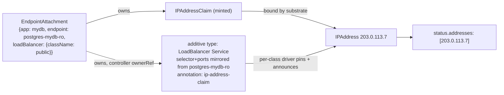

# Managed-application endpoints and `EndpointAttachment`: attaching dedicated addresses to applications

- **Title:** `Managed-application endpoints and EndpointAttachment: attaching dedicated addresses to applications`
- **Author(s):** `@lllamnyp`

## Overview

A Cozystack managed application is reachable through the Services its operator or chart already creates: Postgres has a `-rw` primary Service and a `-ro` replica Service, Redis has a master Service, a virtual machine has its one Service. These are the application's **endpoints**. Today the only way to publish one outside the cluster is the chart-level boolean `external: true|false`. It publishes one chart-chosen endpoint, on one address, from no particular pool, through five different render mechanisms across fourteen charts.

This proposal adds **`EndpointAttachment`** (`local.sdn.cozystack.io/v1alpha1`, namespaced). A tenant creates one to attach one dedicated external address to one tenant-facing Service of one managed application. The controller renders one additive `type: LoadBalancer` Service that mirrors the endpoint Service, and draws its address from the address substrate of community#35 (`IPAddressClass` / `IPAddressClaim` / `IPAddress`): it mints a claim from a class, or binds a claim the tenant reserved earlier. A tenant attaches as many addresses to an application as it needs, each with its own lifecycle. The application's Services, values and Helm release are never touched. Deleting the application collects its attachments.

The mechanism is a union with one member, **`loadBalancer`**. The name **`gateway`** is reserved for a second member, which routes an endpoint by hostname through the tenant Gateway; [community#144](https://github.com/cozystack/community/pull/144) proposes it.

`external: true` keeps working unchanged. Its removal waits on an address-preserving migration.

## Scope and related proposals

- **Builds on** community#35 (IP addresses as a first-class resource), implemented by [cozystack/address-controller](https://github.com/cozystack/address-controller) in the same API group. #35 owns what an address is: held, moved, quota'd, enumerated. This proposal owns what an address is attached to. The two meet at the Service annotation `local.sdn.cozystack.io/ip-address-claim` and at the class's `status.loadBalancerClass` (*Claim*). N addresses on one application are N attachments, each rendering its own Service that consumes its own claim, which is the one-claim-one-consumer rule of #35 §5.
- **Beside** community#20 (external database exposure via Gateway API TLS passthrough). #20 puts several databases on the tenant Gateway's one address, routed by SNI. An attachment gives one endpoint an address of its own: for a client that allow-lists an IP, a protocol that cannot carry SNI, or an address the tenant holds and moves. This proposal changes nothing in #20.
- **Extended by** [community#144](https://github.com/cozystack/community/pull/144), the `gateway` member.
- **Succeeds** community#29 (structured, additive external exposure), closed. #29's mechanism, one additive Service rendered by each chart, does not work for engines whose Services are operator-owned. This proposal renders the Service in a controller that mirrors the operator's Service instead.
- **Answers** the *Revisit if* of #20's decision 0001, which removed `ServiceExposure` in cozystack/cozystack#3218. *Alternatives considered* states what an attachment does beyond selecting a class and naming a pool.
- **References** `SecurityGroup` (cozystack/cozystack#2922) for source-IP ACL, and the cozy-proxy and cozyplane datapaths for virtual machines.
- **Implemented in** cozystack/cozystack#4324, with the user guide in cozystack/website#825.

## Decisions

None yet.

## Context

### What exists today

**The endpoints exist.** Each managed application's operator or chart creates in-cluster Services with stable, role-bearing names: CloudNativePG's `<app>-rw` / `-ro` / `-r`, mariadb-operator's `<app>-primary` / `-secondary` (when replicated), spotahome's `rfrm-<app>` master, Kamaji's `kubernetes-<name>` API Service, vm-instance's single Service (headless, with a sentinel port `65535`, until exposed). The lineage webhook stamps two label families on them:

- the identity labels `apps.cozystack.io/application.{group,kind,name}`, on every object that resolves to a managed HelmRelease;
- the marker `internal.cozystack.io/tenantresource`: `"true"` on the Services the kind's `ApplicationDefinition.spec.services` selects, `"false"` on the rest.

**The address substrate exists.** address-controller provides `IPAddressClass` (admin, per pool), `IPAddress` (cluster-scoped inventory) and `IPAddressClaim` (namespaced). A claim survives the workload it was attached to. A LoadBalancer Service consumes a claim through one annotation, which a per-class driver translates into the backend's pin. The substrate never creates Services.

**The bridge between them is `external: true|false`:**

- Fourteen charts carry the boolean. It renders through five mechanisms: a chart-owned extra LoadBalancer Service, an in-place ClusterIP↔LoadBalancer type flip, an operator-CR field with a different path per operator, a Strimzi listener, and two charts where it does not gate a LoadBalancer at all.
- Kubernetes rejects some Service type transitions. Only vm-instance guards its type flip with a delete-and-recreate hook; two other charts carry the same flip unguarded.
- It publishes one endpoint per application. Postgres `external: true` publishes the primary; nothing publishes the replicas, the primary on two addresses, or an address from a chosen pool. A VM gets one external address.
- It has no address selection: no `loadBalancerClass`, no pool, no reserved address. Turning `external` off and on can change an address a customer has allow-listed.
- In various charts the boolean also sets the TLS default, the certificate SANs and dashboard RBAC.
- Every change is a Helm upgrade of the whole release.

### The problem

A tenant cannot say "attach a public address to my Postgres replicas", "attach the address I reserved last month to my new database's primary", "give this VM a public address from the partner pool", or "take that address away next week without redeploying anything". The endpoints exist and the addresses exist as resources; nothing connects them.

## Goals

- A tenant attaches an external address to any tenant-facing Service of a managed application, with as many attachments per application as it needs, each with its own lifecycle.
- A tenant attaches a public address to a virtual machine, by port list or whole-IP (1:1 NAT), on the cozy-proxy datapath and on a cozyplane VPC.
- An attachment mints an address from a named or default `IPAddressClass`, or binds a reserved `IPAddressClaim`.
- A reserved address survives detachment. A minted claim is deleted with its attachment.
- The fields that select an address are immutable.
- Attaching and detaching never mutate the application's Services, values or Helm release.
- Deleting the application collects its attachments and everything they own.
- One controller serves every engine, with no per-chart render logic and no chart schema change.
- `external: true|false` keeps its behaviour until an address-preserving migration exists.

### Non-goals

- **Routing by hostname.** The `gateway` member, community#144.
- **In-cluster (ClusterIP) exposure.** The endpoints already are ClusterIP Services.
- **Source-IP ACL.** `SecurityGroup` owns who may connect (*Security*).
- **Address write-back into engines** that advertise peer addresses in-protocol (*Engines with in-protocol discovery*).
- **Several datapath-delegated Services on one backend pod.** cozy-proxy keeps one address mapping per pod (*VM datapath modes*).
- **Per-tenant authorization of class selection.** Deferred; *Security* states the current behaviour.
- **Address allocation.** The substrate's (#35).

## Design

### The resource

```yaml
apiVersion: local.sdn.cozystack.io/v1alpha1
kind: EndpointAttachment
metadata:
  name: mydb-replicas-public
  namespace: tenant-a
spec:
  applicationRef:            # immutable; the application, in this namespace
    group: apps.cozystack.io # optional; the default
    kind: Postgres
    name: mydb
  endpoint:
    serviceName: postgres-mydb-ro
  loadBalancer:              # the only mechanism member; exactly one is required
    className: public        # mint a claim from this IPAddressClass (omit both for the default class)
    # claimName: held-ip     # ...or bind a reserved IPAddressClaim (exclusive with className)
    # family: IPv4           # IPv4 | IPv6 | Dual
    # ports: [5432]          # a subset of the endpoint's ports
    # method: WholeIP        # WholeIP | PortList, the VM datapath modes
    # allowICMP: true        # PortList only
status:
  observedGeneration: 1
  phase: Attached            # Pending | Attached | Detached
  serviceName: mydb-replicas-public-x7ktq
  claimName: mydb-replicas-public-k2m9p
  addresses: ["203.0.113.7"]
  conditions: [...]          # Resolved, Provisioned
```

`spec` is required. `spec.endpoint` is a struct so that a named-endpoint vocabulary can be added beside `serviceName` later.

The CRD enforces the static rules in CEL:

- exactly one mechanism member is set, written as a list over the members so that `gateway` joins it without restructuring;
- the member that is set cannot change;
- `applicationRef`, `className`, `claimName` and `family` are immutable, including being set or unset after creation;
- `className` and `claimName` are mutually exclusive;
- `method: PortList` requires `ports`, and `allowICMP` applies to `PortList` only.

The immutable fields select the address. Changing one under a live attachment could re-mint or release an address a client has allow-listed. Changing the address source is delete-and-recreate, and a reserved claim keeps the address across it. `endpoint`, `ports`, `method` and `allowICMP` stay mutable.

Everything that depends on other objects is a condition, not admission.

### What the controller does

One engine-agnostic reconciler in cozystack-controller drives each attachment through four steps.

**1. Resolve.** The controller finds the application's HelmRelease by the three lineage labels, defaulting `group` to `apps.cozystack.io`. On first resolution it gives the attachment a non-controller owner reference to that HelmRelease, by UID, and stamps the lineage labels on the attachment itself, so tooling lists an application's attachments with the selector that finds its other objects. It then reads `spec.endpoint.serviceName` in the attachment's namespace and requires:

- the lineage labels matching `applicationRef` on group, kind and name;
- `internal.cozystack.io/tenantresource: "true"`;
- that no `EndpointAttachment` controls the Service;
- that the Service lacks `cluster.x-k8s.io/tenant-service-name`, the label a tenant Kubernetes cluster's cloud-controller-manager writes on the LoadBalancer Services it creates for Services inside that cluster. Those carry the cluster's lineage and the marker, because the Kubernetes `ApplicationDefinition` selects Services by the `cluster.x-k8s.io/cluster-name` label.

The tenant-facing set is dynamic (a MariaDB `-secondary` Service exists only while `replicas > 1`), so a failure is `Resolved=False` and the attachment waits.

**2. Claim.** With `claimName`, the controller reads that claim in the same namespace and writes nothing to it. Otherwise it mints an `IPAddressClaim` with `generateName`, under its controller owner reference, passing `className` and `family`; an absent `className` draws from the default class. The controller then reads the claim's resolved class and takes its `status.loadBalancerClass`, which the class's driver reports (#35 §5, decision 0003). A Service's `loadBalancerClass` is immutable, so the controller reads it before creating the Service. The value counts only while the class's `Accepted` condition is true for the class's current generation; until then an empty value means "not reported yet", and the controller renders nothing new, neither Service nor FloatingIP, and reports `ClassNotAccepted` with the driver's condition. A Service or FloatingIP already published stays if the class later loses `Accepted` (a refused pool, for one), and the attachment reports `ClassNotAccepted` meanwhile. An empty accepted value means the cluster's default load-balancer implementation, and the Service then carries none. A claim whose `IPAddress.status.associatedTo` names another live Service is in use: the attachment reports it and withdraws its own Service, so two attachments that both rendered before either association was recorded leave one Service asking for the claim. The substrate kinds are read as unstructured, so the controller carries no module or CRD dependency on address-controller.

**3. Render.** The controller creates one additive `type: LoadBalancer` Service with `generateName`, from a prefix derived from the attachment's name and bounded to what the apiserver accepts. The attachment's name therefore never collides with the Service it publishes. The Service:

- mirrors the endpoint's selector, and its ports or the `ports` subset;
- carries `local.sdn.cozystack.io/ip-address-claim: <claim>`;
- carries the class's `loadBalancerClass`;
- carries the claim's families: `ipFamilyPolicy: SingleStack` with the claim's family for `IPv4` or `IPv6`, `RequireDualStack` with both for `Dual`;
- sets `externalTrafficPolicy: Local`, and `allocateLoadBalancerNodePorts: false` unless the platform declares a load balancer that forwards through node ports (Hetzner RobotLB);
- copies no labels or annotations from the endpoint, so it is never read as a second tenant-facing endpoint.

The controller identifies its Service by the controller owner reference alone. The `cozystack.io/endpoint-attachment` label on the Service is diagnostic: a Service carrying it without the owner reference is ignored, never adopted. When the cache shows no owned Service, the controller rechecks through the API before creating one, and collapses duplicates to the oldest. Watches on Services, EndpointSlices, HelmReleases and, where served at startup, claims make re-mirroring event-driven; a one-minute requeue covers a substrate that was not served at startup.

An endpoint with no selector has its endpoints managed by hand, and a mirror carries the selector, not the endpoints; it is refused. The VM placeholder (headless, the one port `65535`) has nothing to mirror, so an attachment to it must set `ports` or `method`.

**Mirroring assumes the operator expresses instance role as pod labels under a static Service selector.** CloudNativePG does: the `-rw` selector is static and the operator relabels pods on switchover. An operator that rewrites the Service selector on failover leaves the mirror stale until the watch-driven reconcile, and in that window external writes can land on a demoted primary.

**4. Report.** `status.addresses` mirrors the claim's bound addresses, and `status.serviceName` and `status.claimName` name the objects. `Provisioned=True` asserts that the claim is bound and the rendered Service carries every claimed address. It does not assert reachability, which also depends on the CNI's own policy objects (SecurityGroups, NetworkPolicies, a VPC gateway's ingress setting); the condition's message says so.



### VM datapath modes

`method` renders the cozy-proxy Service contract of the vm-instance chart's `externalMethod`, and adds nothing beside it:

- `WholeIP`: the label `service.kubernetes.io/service-proxy-name: cozy-proxy`, the annotation `networking.cozystack.io/wholeIP: "true"`, and the sentinel port when `ports` is absent. Every port is published through 1:1 NAT.
- `PortList`: the same label, `networking.cozystack.io/wholeIP: "false"`, and `networking.cozystack.io/allowICMP` from `allowICMP` (true when unset). The listed ports are published.

The controller renders these only when the platform declares a cozy-proxy deployment, through the controller flag `--cozy-proxy-contract-implemented`. The system bundle sets it exactly where it deploys cozy-proxy. Without it a `method` attachment renders no Service, because a load balancer would still attract the address while every proxy skipped the Service.

cozy-proxy v0.4.0 keeps one address mapping per backend pod, in both modes: a second delegated Service on the same pod replaces the first mapping in both directions. The controller therefore counts every delegated Service that selects one of the endpoint's backend pods, whether an attachment, a chart Service rendered with `external: true`, or a hand-made one:

- a delegation no attachment renders always wins, since nothing would withdraw it, even when it appears after the attachment;
- between attachments the oldest wins, ties broken by name;
- the loser renders nothing.

cozy-proxy does not enforce this itself; the controller's refusal is the only check.

`WholeIP` maps one external address to one interface, so it presumes one backend. While the endpoint resolves to more than one ready pod, the attachment keeps its Service and its claim and points the selector at a label no pod carries. A rolling update or a live migration passes through this state and recovers without changing the address.

Only a backend pod says whether a VM sits in a VPC, so a `method` attachment that has published nothing yet waits for one. An attachment created before its VM starts never pins its claim to a cozy-proxy Service first.

cozy-proxy v0.4.0 programs IPv4 only. A `method` attachment on the cozy-proxy path whose claim is `IPv6` or `Dual` renders no Service, so the address is not attracted, and reports `FamilyUnsupportedByDatapath`. On a cozyplane VPC an `IPv6` claim is served (*VMs in a cozyplane VPC*).

### VMs in a cozyplane VPC

On the kube-ovn VPC a VM keeps its pod-network interface and joins VPC subnets through additional interfaces, so the modes above apply unchanged. On a cozyplane VPC the VM's only interface is in the VPC, and the launcher pod address cozy-proxy maps to never reaches it.

A backend pod carrying the VM chart's `sdn.cozystack.io/vpc` annotation is in a cozyplane VPC. For it, a `WholeIP` attachment owns a cozyplane `FloatingIP` in its namespace instead of a Service:

- `vpcRef` from the annotation, `target` from the `sdn.cozystack.io/vpc-ip` address cozyplane's CNI stamps on the pod, `addressClaimName` the attachment's claim, and the class's `loadBalancerClass`;
- `Provisioned` turns true once the FloatingIP is `Ready`, wears the claim's address, and its `status.observedGeneration` matches its generation, so a re-pointed FloatingIP is not reported on the old target's status;
- `status.serviceName` stays empty.

The FloatingIP is read as unstructured and used only where the cluster serves it. The generation check needs cozyplane v0.1.5 or later. The source and target launcher pods of a live migration share the VM's VPC address and stay one target. A stopped VM keeps its FloatingIP. The claim has one consumer at a time: when an attachment moves between a Service and a FloatingIP, the controller withdraws the old consumer and waits for it to disappear before creating the new one.

The refusals on this path follow from what a FloatingIP is:

| Case | Reason |
|---|---|
| `method: PortList`: a FloatingIP binds every port, and cozy-proxy cannot reach the VPC address | `MethodUnsupportedInVPC` |
| A `Dual` claim: a FloatingIP wears one address | `DualStackUnsupportedInVPC` |
| The VPC belongs to another namespace: a FloatingIP references a VPC and a claim in its own namespace | `VPCNotInNamespace` |
| Backends hold different VPC addresses, or mix VPC and non-VPC pods; the claim keeps the address | `MultipleBackends` |
| A VPC backend has no `sdn.cozystack.io/vpc-ip` yet | `WaitingForVPCAddress` |
| The cluster does not serve `FloatingIP`; no Service is rendered | `DatapathContractUnavailable` |

To publish chosen ports of a VM in a cozyplane VPC, the tenant omits `method` and lists `ports`. The plain LoadBalancer Service reaches VPC pods through cozyplane's load-balancer datapath once the VPC's gateway admits LoadBalancer ingress.

### Lifecycle and garbage collection

- **Attachment deleted** → its Service or FloatingIP and its minted claim are collected. A referenced claim is untouched and keeps its address.
- **Minted claim collected** → the `IPAddress` follows the class's `reclaimPolicy` (#35 §2), which defaults to `Retain`: the address stays `Released`. With `releaseDelay` set it returns to `Available` after the delay, unless annotated `ipaddress.local.sdn.cozystack.io/held: "true"`; without it, it stays until an admin clears its `claimRef`. A class with `reclaimPolicy: Delete` returns it at once.
- **Endpoint does not resolve** after something was published (the Service is gone, the application is gone, or the Service fails the checks of *Resolve*) → the rendered Service or FloatingIP is withdrawn, the claim and its address are kept, and the phase is `Detached`. The attachment reattaches with the same claim when the endpoint resolves again. A MariaDB scaled from three replicas to one, losing `-secondary`, takes this path.
- **Application deleted** → native garbage collection deletes the attachments through their owner reference to the HelmRelease, and with them their Services and minted claims.
- **Application recreated under the same name** → the new HelmRelease has a new UID. The attachment keeps its owner reference to the old one, reports `ApplicationIncarnationChanged`, withdraws its Service, and is collected with the old HelmRelease. It never re-targets the successor; adopting by name would let a recreated application inherit exposure it never asked for. Two platform paths recreate a tenant application's HelmRelease: `postRestoreRename` in the backup controller creates a HelmRelease under the target name and deletes the one Velero restored, and migration 28 renamed MySQL applications to MariaDB. An attachment bound to a deleted HelmRelease is collected with it, together with its minted claims; reserved claims survive, and the tenant re-attaches them to the new application. Whether a restore brings attachments back depends on what the backup includes, which this proposal does not change.

### Conditions and phase

`Resolved` and `Provisioned` follow `metav1.Condition` semantics: one entry per type, with `reason`, `message`, `lastTransitionTime` and `observedGeneration`. `status.phase` is a projection, never stored independently:

- `Attached`: both conditions true for the current generation;
- `Detached`: `Resolved=False` and `Provisioned` reports `EndpointDetached`, meaning something had been published or a claim was held;
- `Pending`: otherwise.

| Condition | Reason | Meaning |
|---|---|---|
| `Resolved=False` | `ApplicationNotFound` | No HelmRelease carries the lineage labels |
| | `ApplicationIncarnationChanged` | The application was recreated; this attachment belongs to the old one |
| | `EndpointNotFound` | No Service of that name in the namespace |
| | `EndpointLineageMismatch` | The Service belongs to another application |
| | `EndpointNotTenantFacing` | No tenant-facing marker, rendered by an attachment, or created by a tenant cluster's cloud-controller-manager |
| `Provisioned=False` | `EndpointDetached` | The endpoint stopped resolving; the address is held |
| | `NothingToPublish` | The endpoint has no selector, or nothing to mirror and neither `ports` nor `method` |
| | `DatapathContractUnavailable` | `method` without a declared cozy-proxy, or a VPC backend without `FloatingIP` |
| | `FamilyUnsupportedByDatapath` | `method` on the cozy-proxy path with an `IPv6` or `Dual` claim |
| | `WaitingForBackend` | A `method` attachment whose endpoint has no backend pod yet |
| | `BackendAlreadyDelegated` | Another delegated Service holds the backend pod |
| | `MultipleBackends` | `WholeIP` on more than one backend or VPC target; the address is held |
| | `ClaimNotFound` | The referenced claim does not exist |
| | `ClaimPending` | The claim is unbound, its class unresolved, or the substrate not installed |
| | `ClassNotAccepted` | The claim's class has no accepted `status.loadBalancerClass` for its current generation |
| | `ClaimInUse` | The claim's address is associated to another Service |
| | `FamilyConflict` | `family` differs from the referenced claim's |
| | `WaitingForAddress` | The Service has not been assigned every claimed address |
| | `RenderFailed` | The apiserver refused the Service, or the live Service's `loadBalancerClass` or primary family differs from what the class and claim now require |
| | `WithdrawalPending` | The previous consumer of the claim is still being removed |
| | `MethodUnsupportedInVPC`, `DualStackUnsupportedInVPC`, `VPCNotInNamespace`, `WaitingForVPCAddress`, `FloatingIPNotReady` | The cozyplane VPC path |

### What this replaces, and coexistence with `external`

An attachment does what `external: true` does, publishing one endpoint on one address, and what it cannot: choose the endpoint, choose the pool, use a reserved address, attach N addresses, detach without a Helm upgrade.

`external` keeps its exact behaviour in every chart. Rewriting the five legacy render paths in place would change Service identity, and with it addresses under existing users. Attachments never touch the Services the legacy paths render. On a VM, a chart Service rendered with `external: true` holds the backend pod's cozy-proxy mapping, and an attachment with a `method` yields to it (*VM datapath modes*). The deprecation sequence:

1. `EndpointAttachment` ships, and `external` is documented as legacy.
2. An address-preserving migration lands: the legacy Service's address is imported into the substrate as an `IPAddress` with a claim, through #35's adoption path; an attachment binding that claim is created; only then is the legacy Service released.
3. After a deprecation window, `external` is removed from each chart's schema with a validation error pointing at attachments, once attachments cover that chart's semantics. Discovery engines keep it until their write-back has an owner.

`external` does not leave a chart before step 2 exists.

### Engines with in-protocol discovery

An attachment publishes the L4 reachability of a Service. That suffices for engines whose clients connect to the address and speak the protocol: Postgres, MariaDB, Redis master, MongoDB `mongos`, OpenSearch. Two cases need more:

- **Discovery engines** (Kafka, MongoDB replica sets, NATS) hand clients other addresses in-protocol: advertised listeners, `rs.conf` members, `connect_urls`. A working external endpoint needs the attached address written back into the engine's configuration and the pods rolled. An attachment does not rewrite engine configuration, and the user guide says so.
- **The managed Kubernetes API** on a dedicated address needs the address in the API server's certificate SANs, a post-allocation write-back. The talos-reconcile job, which re-patches certSANs with the live ClusterIP, is in-tree precedent.

### Future work (non-binding sketches)

- **A named endpoint vocabulary.** A small endpoint declaration templated by the application chart, naming endpoints (`ro`, `rw`, `api`) with a protocol per port. The chart knows at render time which endpoints exist, which also covers conditional endpoints such as MariaDB's `-secondary`. `spec.endpoint` is a struct so that `{name: ro}` can join `{serviceName: ...}` without a break.
- **Endpoints in application status.** Application reads are projections over HelmReleases, and each cross-object lookup in that projection makes reads and lists slower. If applications gain their own storage, a connection list (attachments, in-cluster Services, legacy exposures) belongs there. Until then the lineage labels on attachments are the enumeration surface.

## User-facing changes

- Tenants gain one kind, `EndpointAttachment`. They name an application, one of its tenant-facing Services, and optionally a class or a reserved claim, and read the address from `status.addresses`.
- RBAC: `cozy:tenant:base` grants every verb on `endpointattachments`, `cozy:tenant:view:base` grants `get`, `list` and `watch`, and `cozy:tenant:admin:base` grants `create`, `update`, `patch` and `delete`. Tenants get no access to `ipaddressclaims` through this change.
- `ApplicationDefinition.spec.services` now also decides which Services tenants can attach an address to. Adding a Service to `include` lets tenants publish it.
- `count/endpointattachments.local.sdn.cozystack.io` works with a stock `ResourceQuota`, because the kind is CRD-served by the kube-apiserver, where ResourceQuota admission runs. The bare `sdn.cozystack.io` group is served by the aggregated `cozystack-api`, as `SecurityGroup` is, and never sees ResourceQuota admission; the `local.` prefix marks the CRD-served half of the sdn family. Garbage collection by owner reference needs the same real storage. Addresses remain bounded at the claim.
- Admins configure nothing new beyond #35's classes and pools. Each class's driver reports the class's `loadBalancerClass`.
- Nothing changes for any existing application, chart value or `external` user.

## Upgrade and rollback compatibility

The change is additive: a new CRD, a new reconciler in cozystack-controller, new RBAC rules, no migration. It needs address-controller and metallb-iad v0.3.0, in which the MetalLB driver reports each class's `status.loadBalancerClass` and `Accepted` condition and associates only Services that carry that `loadBalancerClass`. The system bundle passes the cozystack-controller two values, `endpointAttachments.cozyProxyContractImplemented` and `endpointAttachments.allocateLoadBalancerNodePorts`, so the first upgrade restarts the controller once; neither changes anything until attachments exist. Rollback is removing the controller and the CRD: rendered Services, FloatingIPs and minted claims are owned by attachments and go with them, and reserved claims and everything `external` renders are untouched.

## Security

- **What may be published is what `ApplicationDefinition.spec.services` declares.** An attachment reaches only a Service in its own namespace whose lineage labels match `applicationRef` on all three fields and which carries `internal.cozystack.io/tenantresource: "true"`. The lineage labels alone also cover operator-internal Services (Kafka and ClickHouse declare one Service each), so the marker is the gate. The marker records the `spec.services` selection; it was introduced for visibility, and no separate declaration says a Service may be published. Some kinds select internal or headless Services, which are therefore attachable: OpenBao's `-internal`, Qdrant's `-headless`, and for a managed Kubernetes cluster every Service carrying its `cluster.x-k8s.io/cluster-name` label. A tenant can publish only Services of its own applications. The LoadBalancer Services a tenant cluster's cloud-controller-manager creates carry the cluster's label and the marker, and the controller refuses them by their `cluster.x-k8s.io/tenant-service-name` label. All references (`applicationRef`, `serviceName`, `claimName`) are same-namespace.
- **Class selection is not authorized per tenant.** The controller mints claims under its own ServiceAccount and copies `className` into them, so a tenant who may create an attachment draws from any class it names. Tenant roles have no access to `ipaddressclaims`, so an attachment is a tenant's only way to mint. #35 leaves the question of which classes a namespace may name to an admission policy or to platform machinery that mints claims on a tenant's behalf, and neither exists: a policy keyed on the requesting user would see the controller, so it would have to key on the namespace. Authorizing class selection per tenant is deferred (*Rollout*, item 5).
- **Publishing a database does not enable or enforce its TLS.** The controller mirrors a Service and knows nothing about engines, and an attachment never sets `external`, on which charts key their TLS defaults and on which the platform keys its plaintext guards. Postgres serves TLS but accepts plaintext unless `tls.required` is on, and `tls.required` defaults to the value of `external`. The admission policy that refuses plaintext external Redis (#20 decision 0002) matches `spec.external == true`. A database with `external: false` and an attachment is therefore reachable in plaintext on a public address. The user guide tells tenants to set `tls.required: true` on Postgres before attaching. No chart adds an IP SAN to a server certificate, so a client dialing an attached address verifies by hostname only if DNS points a name in the certificate at the address.
- **Who may connect** is `SecurityGroup`'s question (cozystack/cozystack#2922). Publication carries no default-deny.
- **ACL granularity is per application.** `SecurityGroup` stamps membership labels on an application's pods, so two addresses on one VM share one rule set. `ports` narrows exposure but is port filtering, not source-IP ACL. A per-address model would need `SecurityGroup` to target an attachment; attachments are namespaced, stably named and lineage-labelled, so they can serve as targets.
- **The controller writes only objects it owns**: the rendered Service, the FloatingIP, the minted claim, and owner references and lineage labels on attachments. It never modifies an application's Services, so a fault in it cannot break in-cluster connectivity.

## Failure and edge cases

- **The application or the Service does not exist yet** → `Resolved=False`; the attachment resolves once both appear.
- **A Service of another application, an unmarked Service, or a tenant cluster's cloud-controller-manager Service** → `Resolved=False` with `EndpointLineageMismatch` or `EndpointNotTenantFacing`; nothing is rendered.
- **An address-selecting field is changed** → refused at admission.
- **`className` and `claimName` both set** → refused at admission.
- **The class is exhausted or the claim never binds** → `Provisioned=False` with `ClaimPending`; the Service exists and waits.
- **The referenced claim is associated to another Service** → `Provisioned=False` with `ClaimInUse`; this attachment's Service is withdrawn.
- **`family` conflicts with the referenced claim's** → `Provisioned=False` with `FamilyConflict`; nothing is rendered.
- **A `Dual` attachment on a cluster without a dual-stack Service range** → the apiserver refuses the Service; `RenderFailed`.
- **The endpoint's selector or ports change** → re-mirrored on the watch-driven reconcile.
- **An endpoint without a selector** → `NothingToPublish`.
- **A VM endpoint with only the sentinel port, and neither `ports` nor `method`** → `NothingToPublish`.
- **A second delegated Service for one VM backend pod** → the later attachment reports `BackendAlreadyDelegated` and renders nothing; an `external: true` chart Service always wins.
- **`WholeIP` while the endpoint has several ready backends** → the Service and claim stay, the selector matches nothing, `MultipleBackends`; it recovers when one backend remains.
- **A `method` attachment without a declared cozy-proxy** → `DatapathContractUnavailable`; no Service.
- **A `method` attachment on the cozy-proxy path with an `IPv6` or `Dual` claim** → `FamilyUnsupportedByDatapath`; no Service.
- **The class is not accepted by its driver** (not yet reported, or a refused pool) → `ClassNotAccepted`; nothing new is rendered, and anything already published stays.
- **The endpoint stops resolving** → `Detached`; the claim is kept, and the attachment reattaches when the endpoint returns.
- **The attachment is deleted mid-provisioning** → owned objects are collected; a minted claim's address follows the class's reclaim policy.
- **A Service carries the ownership label but not the attachment's controller owner reference** → ignored; never adopted.
- **Two attachments, one endpoint, different classes** → both work.

## Testing

- **Admission:** `crdcel_test.go` compiles the shipped CRD and pins the create and update matrix, including removing and restoring `spec`.
- **Unit (fake client):** the resolve and deny matrix over both label families; mirroring and port subsetting; minted and referenced claims; the two contract sequences (a labelled but unowned Service is ignored, and a same-name recreated application is not re-acquired; a reserved claim holds across detachment and moves to another application); detach and reattach; the sentinel-port rule; the cozy-proxy declaration gate; both modes; `WholeIP` with several backends; per-pod exclusivity; the substrate absent; family conflict; a `Dual` claim provisioned only once the Service carries both addresses; names up to 253 characters.
- **Unit, cozyplane path:** `floatingip_test.go` covers the FloatingIP spec and readiness, switching between a Service and a FloatingIP, a kube-ovn-shaped backend, each refusal, live migration, a stopped VM, re-pointing, detach and name bounds.
- **Chart:** the platform declaration on every bundle variant, and the FloatingIP RBAC rule.
- **e2e, `hack/e2e-chainsaw/endpointattachment`:** an attachment naming one application and another's Service is refused; a minted address publishes one Postgres's replicas and goes with its attachment; a reserved claim is attached to one Postgres's primary, detached, keeps its address, and is attached to another Postgres's primary, which the same address then serves; deleting an application collects its attachment and leaves the reserved claim. On a VM: `PortList` publishes one port, `WholeIP` publishes every port, and a second whole-IP attachment is refused with `BackendAlreadyDelegated` while the first keeps serving.
- **e2e, `hack/e2e-chainsaw/endpointattachment-vpc`:** whole-IP through a FloatingIP, `PortList` and `Dual` refused. The suite is disabled because no e2e lane installs the cozyplane networking variant.

## Rollout

1. address-controller and metallb-iad v0.3.0 (cozystack/address-controller#19, cozystack/metallb-iad#13), with the driver-reported `status.loadBalancerClass` and `Accepted` condition on `IPAddressClass`.
2. The CRD, the controller with the `loadBalancer` member, the VM datapath modes and the cozyplane path, tenant RBAC, and the user guide (cozystack/cozystack#4324, cozystack/website#825). The FloatingIP generation check needs cozyplane v0.1.5 (cozystack/cozystack#5389).
3. Before an engine's exposure is documented, check that its operator keeps a static Service selector with pod-label roles; document a selector-rewriting operator with the failover window, or hold it back.
4. The address-preserving migration from `external` (substrate adoption plus attachment synthesis); the `external` deprecation window starts after it lands.
5. The Kubernetes API certSAN write-back for a dedicated address, discovery-engine write-back, and per-tenant authorization of class selection, each its own design.

## Open questions

1. **Several delegated addresses per VM backend pod.** With stateful (conntrack) NAT, replies leave through the address their connection arrived on, so secondary addresses become ingress-plus-replies, and only unsolicited egress needs a designated primary mapping. Stateful NAT requires request and reply to cross the same translating node, which today's stateless per-packet maps do not depend on. This is a datapath capability, with cozyplane the expected first candidate. What remains to design once one exists is how the egress primary is designated: a marker on one attachment, or the legacy Service's mapping by default. It is the datapath side of #35's deferred case of several owned addresses on one consumer.

## Alternatives considered

**A chart-values `expose: []` field (#29's shape).** Its mechanism required each chart to render the exposure, which #29's review showed impossible where Services are operator-owned, and charts cannot read allocation results back. It also repeats one field and schema in every chart, and every attach or detach is a Helm upgrade of the release. A controller that mirrors the Service needs neither.

**Reviving `ServiceExposure`** (removed in cozystack/cozystack#3218; #20 decision 0001). `ServiceExposure` told a chart-owned Service to be `type: LoadBalancer`, which the native field already does. An attachment is not a wrapper over one Service's type: it is N per application, each with its own lifecycle; it holds and moves addresses through claims, which `loadBalancerClass` cannot express; it checks which Services may be published; and it never mutates the application's objects.

**Extending `ApplicationDefinition` with a templated endpoint catalogue** (`spec.endpoints[]` with Go-template Service names beside `spec.services`). It grows a template-string pattern already considered awkward, and a static catalogue over-declares conditional endpoints. `spec.services` and the marker it feeds already enumerate tenant-facing Services live. A richer vocabulary is *Future work*, templated by charts.

**Naming the rendered Service after the attachment.** A tenant names an attachment after the Service it publishes (`postgres-mydb-ro`), which would then collide with that Service. `generateName` and the controller owner reference remove the collision.

**The attachment owning the endpoint Service.** A scale-down that removes an endpoint Service would destroy the attachment and release a minted address. Absence is `Detached`; only application deletion collects.

**Re-targeting a same-name successor application.** Matching the owner by name instead of UID would let a recreated application inherit exposure, and minted addresses, it never asked for.

**Doing nothing.** The five render paths, the unguarded type flips, the one-endpoint-one-address ceiling and the missing address selection stay, and #35's claims have nothing to attach to.

---

<!--
Inspired by KubeVirt enhancement proposals
(https://github.com/kubevirt/enhancements) and Kubernetes Enhancement
Proposals (KEPs).
-->
