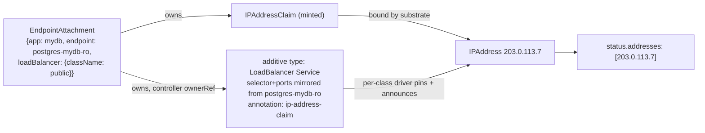

# Managed-application endpoints and `EndpointAttachment`: attaching external addresses and routes to applications

- **Title:** `Managed-application endpoints and EndpointAttachment: attaching external addresses and routes to applications`
- **Author(s):** `@lllamnyp`
- **Date:** `2026-07-27`
- **Status:** Draft

## Overview

A Cozystack managed application is reachable through the Services its operator already creates — Postgres has a `-rw` primary Service and a `-ro` replica Service, a managed Kubernetes cluster has an API Service, Redis has a master Service, a virtual machine has its one Service. These are the application's **endpoints**: named places a client can connect. Today the only way to publish one of them outside the cluster is the chart-level boolean `external: true|false`, which publishes exactly one chart-chosen endpoint, on exactly one address, from no particular pool, by five structurally different render mechanisms across fourteen charts.

This proposal adds **`EndpointAttachment`** (`local.sdn.cozystack.io/v1alpha1`, namespaced): a tenant-created resource that makes one endpoint of one application instance reachable from outside, by one of two external **data planes**, without ever touching the application's own Services or values. The mechanism field is a discriminated union with one member per data plane:

- **`loadBalancer`** — a **dedicated address**. The attachment renders one additive `type: LoadBalancer` Service and draws its address through the IP-address-management substrate (`IPAddressClass` / `IPAddressClaim` / `IPAddress`, community #35) — minting a fresh claim or binding a pre-reserved, held one. This is the AWS elastic-network-attachment shape: a tenant attaches as many addresses to an application's endpoints as they need, each with an independent lifecycle. Two consumer families are first-class here: managed databases (an address on the `-ro` replicas) and virtual machines (one or more public addresses, whole-IP 1:1 NAT included).
- **`gateway`** — a **shared-Gateway route**. The attachment binds the endpoint to a hostname (and, for HTTP, a path) on a shared tenant Gateway, rendering an `HTTPRoute` or a passthrough `TLSRoute` rather than a dedicated address. This is the tenant-facing surface the accepted SNI-consolidation design (external-database-exposure, community #20) was waiting on, generalized past databases to any route — the managed-Kubernetes API included — and reconciled with the platform's existing legacy path, the tenant-root ingress controller. *Routes: the `gateway` member* is its section.

Both members share everything above the data plane: the same resolve-and-authorize seam, the same lifecycle, the same status shape. Deleting the application garbage-collects its attachments; deleting an attachment never disturbs the application.

An **endpoint is a concept, not a resource**: for this proposal it is simply a tenant-facing Service of the application — one carrying the lineage identity labels stamped on every managed object *and* the tenant-facing marker (`internal.cozystack.io/tenantresource: "true"`) that `ApplicationDefinition.spec.services` selects. No new metadata surface is introduced; a richer named-endpoint vocabulary is sketched as future work.

`external: true` keeps working unchanged, and its sunset is explicitly gated on an address-preserving migration path.

## Scope and related proposals

- **Builds on** community #35 (IP addresses as a first-class resource) and its implementation, the address-controller (API group `local.sdn.cozystack.io/v1alpha1`). That proposal is the **allocation half**: what an address *is* — held, moved, quota'd, enumerated. This proposal is the **exposure half**: what an address is attached *to*. The two meet at exactly one point: an attachment either names an existing `IPAddressClaim` or mints one, and consumes it via the substrate's Service annotation contract (`local.sdn.cozystack.io/ip-address-claim`). The per-class drivers own everything below that annotation — pinning, announcement, association tracking. **The kind lives in #35's group family** — `local.sdn.cozystack.io`, the exposure half beside the allocation half, `SecurityGroup`'s networking family reached through the CRD-served `local.` prefix rather than the aggregated bare `sdn` — see *User-facing changes* for why that prefix is load-bearing. The attachment model stays inside #35's settled cardinality rule: N addresses on one application are N attachments, each rendering its own Service consuming its own claim — several Services each with one claim, which #35 blesses — never several claims on one Service.
- **Supplies the tenant-facing surface for** community #20 (external database exposure via Gateway API TLS-passthrough, **Accepted**). #20 collapses a tenant's fitting databases — same-engine instances included — onto the tenant Gateway's single LoadBalancer address, routed by SNI, and specifies that data plane fully (shared per-engine passthrough listeners, per-release `TLSRoute`s, SAN injection, end-to-end TLS). What #20 deliberately left to a structured-exposure model — the tenant-facing *trigger*, originally expected from #29 — is the `gateway` member designed here. #45 owns the route resource, its authorization, and its lifecycle; #20 remains the authority on the database passthrough data plane and the TLS/SAN story the `gateway` member drives. This **largely resolves** #20's ownerless-trigger gap and generalizes the same shape past databases. See *Routes: the `gateway` member*.
- **Succeeds** community #29 (structured, additive external exposure), closed in favor of the #35 direction. #29 established the goals this proposal inherits — additive multi-endpoint exposure, per-listener selection, never mutating the in-cluster baseline — but anchored them to a chart-values field whose central mechanism ("the chart renders one additive LoadBalancer Service per target") its review showed to be false for most engines, and it left the discovery-engine address write-back loop without an owner. This proposal answers both structurally: the mechanism is a controller that needs no per-engine render knowledge, and the discovery loop has a natural future owner (see *Deferred engines*).
- **Aware of** cozystack #3218, which removed `ExposureClass`/`ServiceExposure` (`network.cozystack.io`) as redundant wrappers around chart-owned Services. *Alternatives considered* explains why `EndpointAttachment` is not that mistake repeated.
- **References** `SecurityGroup` (#2922) for source-IP ACL — attachment publishes, it does not authorize connections — and the unified-TLS effort (community #19, cozystack #2811) for the PKI half of the route story: certificate issuance and TLS *termination* stay there, so the `gateway` member ships passthrough (SNI) first (for databases, the SNI hostname scheme itself is #20's, already decided).
- **Built on** Gateway API: the `gateway` member renders standard `HTTPRoute` and passthrough `TLSRoute` onto a tenant Gateway, and the mechanism union is shaped so a third data plane could join without an API break.

## Context

### What exists today

**The endpoints already exist.** Every managed application's operator or chart creates in-cluster Services with stable, role-bearing names: CloudNativePG's `<app>-rw` / `-ro` / `-r`, mariadb-operator's `<app>-primary` / `-secondary` (when replicated), Percona's `<app>-rs0` / `<app>-mongos`, spotahome's `rfrm-<app>` master / `rfrs-<app>` replicas, Strimzi's `<app>-kafka-bootstrap`, Kamaji's `kubernetes-<name>` API Service on 6443, vm-instance's single Service (headless with a sentinel port until exposed). Each kind's `ApplicationDefinition.spec.services` already selects which of these are tenant-facing, and the lineage mutating webhook stamps two label families: the identity labels `apps.cozystack.io/application.{group,kind,name}` on **every** object resolving to a managed HelmRelease, and the tenant-facing marker `internal.cozystack.io/tenantresource: "true"` on exactly the Services `spec.services` matches — together a live, machine-readable record of "this Service is a tenant-facing endpoint of that application".

**The address substrate exists.** The address-controller provides `IPAddressClass` (admin, per pool), `IPAddress` (cluster-scoped inventory), and `IPAddressClaim` (the namespaced tenant API). A claim survives the workload it was attached to; consumption is one annotation on a LoadBalancer Service, translated by per-class drivers into the backend's pin mechanism. The substrate deliberately stops there: it never creates Services and never decides what an address is *for*.

**The bridge between them is `external: true|false`** — and it is the weakest piece of the platform's networking surface:

- Fourteen charts carry the boolean; it renders through **five different mechanisms** (a chart-owned extra LB Service; an in-place ClusterIP↔LoadBalancer type flip; an operator-CR field poke with a different field path per operator; a Strimzi listener; and two charts where it is not even the LoadBalancer gate).
- The in-place type flip is unsafe — Kubernetes rejects some Service type transitions — and only one chart (vm-instance) guards it with a delete-and-recreate hook; two others carry the same latent flip unguarded.
- It publishes **one** endpoint per application. Postgres `external: true` publishes the primary; there is no way to publish the read replicas, or the primary on two addresses, or anything from a chosen pool. A VM gets exactly one external address, ever.
- There is **no address-selection surface at all**: no `loadBalancerClass`, no pool choice, no way to use a reserved address. Turning `external` off and on may change the address a customer has allow-listed.
- The boolean moonlights as the TLS default, the cert-SAN gate, and the dashboard-RBAC gate in various charts — four concerns behind one bit, differently per chart.
- Every exposure change is a Helm upgrade of the whole release.

### The problem

A tenant cannot say: *"attach a public address to my Postgres replicas"*, or *"attach this specific address I reserved last month to my new database's primary"*, or *"give this VM a second public address"*, or *"give this application an address from the partner-facing pool, and take it away next week without redeploying anything"*. The endpoints exist; the addresses exist as resources; nothing connects one to the other.

## Goals

- A tenant can attach an external address to any tenant-facing Service of a managed application — as many attachments per application as they want, each with an independent lifecycle.
- A tenant can attach one or more public addresses to a virtual machine — with whole-IP (1:1 NAT) semantics available for one of them — the live requirement the single legacy toggle cannot express.
- A tenant can publish an endpoint **by hostname** through a shared Gateway — HTTP via `HTTPRoute`, TLS/SNI via passthrough `TLSRoute` — when a dedicated address is the wrong tool (SNI consolidation, the managed-Kubernetes API, HTTP endpoints), through the same one kind.
- Attaching and detaching never mutates the application's own Services, values, or Helm release. No type flips, no upgrade round-trips.
- An attachment can mint a fresh address from a named (or default) `IPAddressClass`, or bind a pre-reserved, held `IPAddressClaim` — the elastic-IP attach/detach experience.
- A dynamically minted address dies with its attachment; a pre-reserved address always survives detachment.
- An attachment's address identity can never change under a live attachment: the fields that select the address are immutable.
- Deleting the application garbage-collects its attachments and everything they own.
- One mechanism for every engine, with no per-chart render logic and no chart schema changes.
- `external: true|false` keeps its exact observable behavior until an address-preserving migration exists.

### Non-goals

- **A hostname *reservation* resource.** The `gateway` member binds a hostname, but a hostname is **not** a platform-allocated resource the way an address is: the tenant brings it, already reserved at a registrar. There is no allocation event for the platform to model, so there is no reservable/quota'd/movable hostname object paralleling #35's `IPAddressClaim` — the "move" is a DNS re-point the tenant performs outside the platform. *Routes: the `gateway` member* makes this allocation asymmetry explicit.
- **TLS termination and certificate issuance for routes.** Owned by the unified-TLS effort (community #19, cozystack #2811). The `gateway` member ships **passthrough only** (SNI for TLS, plain `HTTPRoute` for HTTP); termination with a platform-issued certificate waits on that effort. For databases the SNI hostname scheme and the end-to-end-TLS/SAN story are #20's, already decided and consumed unchanged.
- **DNS record publication.** Pointing a hostname at a Gateway address is external-dns's or the tenant's job; the controller reports the hostname, it does not create DNS records.
- **The platform-Gateway-with-per-tenant-listeners variant.** The default is a Gateway per tenant (*Routes: the `gateway` member*). A single platform Gateway carrying per-tenant listeners is left open as a future possibility — plausibly useful in private clouds — but its hostname-isolation admission guard is sketched, not designed, here.
- **In-cluster (ClusterIP) exposure.** The endpoints already are ClusterIP Services; there is nothing to add.
- **Source-IP ACL.** `SecurityGroup` (#2922) owns who may connect; attachment owns only that something is published. The per-address ACL granularity question is stated honestly in *Security*.
- **The discovery-engine write-back loop.** Engines that advertise peer addresses in-protocol (Kafka, MongoDB replica sets, NATS) need the allocated address written back into engine configuration. Deferred, stated plainly in *Deferred engines* — not silently broken.
- **Several whole-IP addresses on one VM.** Whole-IP is 1:1 NAT between one external address and one workload interface; the default is **one whole-IP Service per application**, and today's datapath enforces exactly that (see *Design*). Widening is deliberately left open for a datapath with stateful NAT and symmetric flows — a CNI capability, with cozyplane the expected first candidate (see *Open questions*). It is the same case #35 defers as *several owned addresses on one consumer*.
- **Address allocation mechanics.** Entirely the substrate's (#35).

## Design

### The resource

```yaml
apiVersion: local.sdn.cozystack.io/v1alpha1
kind: EndpointAttachment
metadata:
  name: mydb-replicas-public
  namespace: tenant-a
spec:
  applicationRef:            # immutable; the application, in this namespace
    group: apps.cozystack.io # optional; defaults to apps.cozystack.io
    kind: Postgres
    name: mydb
  endpoint:
    serviceName: postgres-mydb-ro     # a tenant-facing Service of that application
  # mechanism union: exactly one member. loadBalancer (a dedicated address) or gateway (a shared-Gateway route).
  loadBalancer:
    className: public        # mint a claim from this IPAddressClass (omit => default class)
    # claimName: held-ip     # ...or bind a pre-reserved IPAddressClaim instead (mutually exclusive with className)
    # family: IPv4           # IPv4 | IPv6 | Dual; passed to a minted claim, validated against a referenced one
    # ports: [5432]          # optional subset of the endpoint's ports; the only port source when the
    #                        #   endpoint has nothing meaningful to mirror (a VM's sentinel-port Service)
    # method: WholeIP        # WholeIP | PortList — VM datapath modes rendering the cozy-proxy contract
    # allowICMP: true        # PortList only
  # ...or, instead of loadBalancer, a route on a shared Gateway:
  # gateway:
  #   hostname: mydb-ro.tenant-a.example.org   # tenant-supplied; NOT reserved by the platform (see below)
  #   protocol: TLSPassthrough  # TLSPassthrough (SNI) | HTTP; must match the endpoint's declared protocol
  #   # path: /                 # HTTP only
  #   # gatewayRef: {name: ...} # optional; defaults to the tenant's own Gateway
status:
  phase: Attached            # Pending | Attached | Detached — a printed summary of the conditions
  serviceName: mydb-replicas-public-x7ktq    # loadBalancer: the rendered LoadBalancer Service (generateName)
  # routeName: mydb-ro-public-x7ktq          # gateway: the rendered HTTPRoute/TLSRoute instead
  addresses:                 # loadBalancer: the bound addresses
    - "203.0.113.7"
  # url: tls://mydb-ro.tenant-a.example.org:5432  # gateway: what to connect to, instead of addresses
  conditions:                # standard metav1.Condition list: unique type, reason, message,
    - type: Resolved         #   lastTransitionTime, observedGeneration
    - type: Provisioned      # loadBalancer: claim bound + LB Service has its address;
                             #   gateway: route accepted by the Gateway
```

`spec.applicationRef` carries the full identity triple — `group` (defaulting to `apps.cozystack.io`), `kind`, `name` — matching the three lineage labels the resolver compares; it is immutable (CEL), and retargeting is delete-and-recreate. `spec.endpoint` is a struct rather than a bare string so that a future named-endpoint vocabulary (`endpoint: {name: ro}`) can join `serviceName` as an alternative member; `serviceName` itself is a plain string and is required today. **Exactly one of `loadBalancer` / `gateway` is set** (CEL); within `loadBalancer`, `className` and `claimName` are mutually exclusive (CEL), both absent meaning "mint from the default class".

**The identity fields are immutable, for both members.** `spec.applicationRef`, the `loadBalancer` address source (`className`, `claimName`, `family`), and the `gateway` identifier (`hostname`, `protocol`) are frozen by CEL: any change could silently re-mint or release the address, or re-point the hostname, a customer has allow-listed or baked into a connection string — the exact failure named in *What exists today*. Which data plane an attachment uses is likewise fixed; switching it is delete-and-recreate, and keeping an address across that is precisely what a pre-reserved claim is for. The render knobs (`ports`, `method`, `allowICMP`, a route `path`) are mutable and structurally unable to change the external identity.

**`status.phase` is a projection, never independent state**: `Pending` (created, not yet both resolved and provisioned), `Attached` (`Resolved` and `Provisioned` both true), `Detached` (previously attached; the endpoint Service is currently absent, so `Resolved=False`, the rendered Service is torn down, and the claim is kept — see *Lifecycle*). Everything machine-readable lives in the conditions, which follow `metav1.Condition` semantics — one entry per type, replaced in place, with `lastTransitionTime` and `observedGeneration`.

### What the controller does

One controller, engine-agnostic, reconciling four things per attachment:

1. **Resolve.** Look up `spec.endpoint.serviceName` in the attachment's namespace and require both label families the platform already stamps: the lineage identity labels `apps.cozystack.io/application.{group,kind,name}` matching `spec.applicationRef` on all three fields, **and** the tenant-facing marker `internal.cozystack.io/tenantresource: "true"`. The lineage labels alone are not sufficient authorization — the webhook stamps them on *every* object resolving to a managed HelmRelease, operator-internal and headless Services included — while the marker is `"true"` exactly on the Services `ApplicationDefinition.spec.services` selects, the platform's actual declaration of "tenant-facing". This is the authorization seam: a tenant can attach only to Services the platform has marked as tenant-facing endpoints of that application, never to arbitrary, internal, or foreign Services. Failure → `Resolved=False` with a reason; the attachment waits. Validation is by condition, not admission, because the Service set is dynamic (a mariadb `-secondary` Service exists only while `replicas > 1`) — eventual consistency, not admission-time races.
2. **Claim.** With `className` (or neither field): create an `IPAddressClaim` owned by the attachment — it is garbage-collected with the attachment, and the address then follows its class's reclaim policy; `family` passes through. With `claimName`: reference the existing claim in the same namespace, owning nothing — detaching leaves the address held; a `family` that conflicts with the referenced claim's family → `Provisioned=False` with a reason. This is the elastic-IP distinction: minted addresses are ephemeral conveniences, reserved addresses are durable property.
3. **Render** (for the `loadBalancer` member; the `gateway` member's render is below). Create one additive `type: LoadBalancer` Service via `generateName` (prefixed with the attachment's name) — so an attachment name can never collide with an existing Service. **The controller owner reference is the Service's identity:** the controller sets itself as controller owner and rediscovers the Service by that reference on every reconcile; an ownership label is stamped for indexing and diagnostics but is never trusted for adoption, because labels are mutable and can collide — a Service whose controller owner reference does not point at the attachment's UID is ignored, never adopted or updated. The Service **mirrors the resolved endpoint Service**: the selector is always the endpoint's, kept in sync by watching the endpoint Service (event-driven, not polled); ports come from the member's `ports` when set (a subset filter, and the only source when the endpoint has nothing meaningful to mirror), otherwise from the endpoint. Mirroring is what makes the mechanism engine-agnostic, and it is the structural answer to why #29's chart-side mechanism could not work: the controller does not need to know how CloudNativePG or mariadb-operator label their pods, it only needs to mirror the Service they already maintain. **The mirroring contract assumes the operator expresses instance role as pod labels under a static Service selector** — CloudNativePG does (the `-rw` selector is static; the operator relabels pods on switchover), so the flagship case holds. An operator that instead rewrites the *Service selector* on failover leaves the mirror stale for one watch-driven reconcile, during which external write traffic can land on a demoted primary; *Rollout* therefore gates each engine's documentation on verifying its selector model. The Service carries the substrate's consumption annotation `local.sdn.cozystack.io/ip-address-claim: <claim>`, and the controller sets `spec.loadBalancerClass` at creation to the value the claim's resolved `IPAddressClass` fixes — per #35 §5 that check is refusal-only and the field is immutable, so the creator must be right at creation, and this controller can be, because it reads the class first. The per-class driver does the rest (pin, announce, associate). `externalTrafficPolicy: Local` and node-port allocation follow the platform's existing conventions.
4. **Report.** `status.addresses` mirrors the claim's bound addresses; `status.serviceName` names the rendered Service; conditions say why anything is missing. Nothing is fabricated client-side. The controller also stamps the application's lineage labels (`apps.cozystack.io/application.*`) onto the attachment itself, so dashboards and tooling list an application's attachments with the same selector that finds its other objects — an attachment is an application add-on, not an application, and its presentation is the dashboard's call.

**VM datapath modes.** A vm-instance's tenant-facing Service is headless with a single sentinel port (`65535`) until exposed, so there is nothing to mirror: a VM attachment must set `ports` or `method` in the `loadBalancer` member (neither → `Provisioned=False` with a reason). `method: WholeIP` renders the existing cozy-proxy contract — the `service.kubernetes.io/service-proxy-name: cozy-proxy` label, the `networking.cozystack.io/wholeIP: "true"` annotation, and the sentinel port when `ports` is absent. `method: PortList` renders the same label with `wholeIP: "false"`, `networking.cozystack.io/allowICMP` from `allowICMP`, and requires `ports`. These are byte-for-byte the objects vm-instance's chart renders under `externalMethod` today — the datapath already exists; only this render was missing, and the enum deliberately reuses the chart's `externalMethod` vocabulary. **Whole-IP is 1:1 NAT, so it presumes a single backend**: the mapping is between one external address and one workload interface address, so an endpoint resolving to more than one backend has no interface to map — its external address is simply a load-balancer address, and `WholeIP` on such an endpoint is refused (`Provisioned=False`), not half-applied. **Default: at most one whole-IP Service per application**, counting a legacy `externalMethod: WholeIP` chart Service. This states the datapath's actual shape, not a caution: cozy-proxy translates statelessly — per-packet source/destination rewrites through strictly one-to-one address maps — and a second mapping for the same workload replaces the first in both directions, so a second whole-IP address today would not be ambiguous but dead. The controller refuses it with `Provisioned=False` (cross-object state, so a condition, not admission). Widening the default is left open for a more capable datapath — see *Open questions*.

**Route render (`gateway` member).** When the mechanism is `gateway`, step 3 renders a Gateway API route instead of a Service, under the same controller-ownerReference identity rule: an `HTTPRoute` for an HTTP endpoint or a passthrough `TLSRoute` for a TLS endpoint, with `spec.hostnames` set to the attachment's `hostname`, `parentRefs` attaching to the tenant Gateway's listener, and `backendRefs` the resolved endpoint Service (cross-namespace via `ReferenceGrant` where the Gateway is not in the tenant namespace). No address is minted and no `loadBalancerClass` applies — step 2 (claim) is skipped — and `Provisioned` reflects the route's acceptance by the Gateway. For a database endpoint this is exactly #20's per-release `TLSRoute` onto its shared per-engine listener; where the live data plane is the tenant-root ingress controller, the controller renders the legacy passthrough `Ingress` form instead (*Routes: the `gateway` member*). Resolve, report, and GC are otherwise identical to the `loadBalancer` path.



### Lifecycle and garbage collection

- **Application deleted** → the controller has stamped each attachment with an `ownerReference` to the application's HelmRelease (same namespace), so native garbage collection deletes the attachments, which deletes their rendered Services and any minted claims. Reserved claims (`claimName`) survive by construction. Orphaned attachments cannot accumulate.
- **Identity across delete-and-recreate is by UID, deliberately.** Kubernetes GC matches owners by UID, so the `ownerReference` binds an attachment to one application *incarnation*: recreate the application under the same name and existing attachments are collected with the old HelmRelease rather than silently re-targeting the new one — closing the reuse-after-recreate hazard by construction. The platform has no path that delete-and-recreates a tenant application's HelmRelease (the delete-and-let-the-chart-recreate migrations touch system releases only); if one ever appears, it collects attachments and minted claims with the old incarnation — and pre-reserved claims survive even that, which is one more reason durable addresses belong in claims. No finalizer or name-based fallback is added: adopting a same-name successor by name would reintroduce exactly the reuse UID anchoring exists to prevent.
- **Attachment deleted** → its Service and minted claim go with it; the application is untouched; a referenced pre-reserved claim is untouched and its address stays held.
- **Endpoint Service disappears** (e.g. mariadb scaled from 3 replicas to 1, removing `-secondary`) → the attachment **persists** and goes `Detached` (`Resolved=False`); the rendered LB Service is torn down; a minted claim is **kept**, so the address survives a scale-down bounce and reattaches when the endpoint returns. Temporary absence is a condition, not a deletion — only application deletion garbage-collects.
- **Claim already serving another attachment or Service** → the substrate's one-claim-one-workload rule applies; the attachment reports `Provisioned=False` rather than fighting for the address.

### Routes: the `gateway` member

The `loadBalancer` member gives an endpoint its *own* address. The `gateway` member instead binds the endpoint to a **hostname on a shared Gateway**: it renders a standard Gateway API `HTTPRoute` (for an HTTP endpoint) or a passthrough `TLSRoute` (for a TLS endpoint, routed by SNI), attached to a tenant Gateway listener, with the endpoint Service as the backend. It renders **no** `type: LoadBalancer` Service and mints **no** address — the Gateway already has one. Everything above the data plane is shared with `loadBalancer`: the same resolve step and tenant-facing-endpoint authorization (*What the controller does*, step 1), the same `Detached`-not-deleted lifecycle, the same GC, the same `metav1.Condition` status, differing only in that `status` reports a `url`/`routeName` instead of `addresses`.

**The union discriminates the data plane, and each member brings its own identity resource.** `loadBalancer` brings an `IPAddressClaim`. The `gateway` member's identity is a **hostname plus the Gateway's own address** — and only the latter is a platform-allocated resource (an `IPAddress`/`IPAddressClaim` under #35, typically a system-owned attachment on the tenant Gateway). The hostname is **not** such a resource, and the asymmetry is the point:

- **A hostname is registrar-allocated, not platform-allocated.** #35 exists because the platform hands out addresses from a finite pool it controls, so it needs an object to hold, quota, and arbitrate. The platform does not allocate hostnames — the tenant brings one it already owns through DNS. There is no allocation event, so there is nothing to reserve: no hostname object, no `count/` quota on names, no hold/move resource. The "move" is a DNS re-point the tenant performs at their registrar; the attachment just stops naming the old hostname and starts naming the new one.
- **Conflicts resolve without a platform arbiter.** Two attachments claiming the same hostname (and path) on one tenant's Gateway is Gateway API's own deterministic conflict resolution — oldest `creationTimestamp` wins, the loser reports its conflict in status — a tenant colliding with itself, surfaced not silently resolved. Across tenants it does not arise: tenants do not share a Gateway (below), and the ultimate arbiter of which address a hostname resolves to is DNS, which its true owner controls.

**Which endpoints can take a route is a property of the endpoint, not the attachment.** A route needs the endpoint's protocol-per-port: `HTTP` for `HTTPRoute`, direct-TLS-with-SNI for passthrough `TLSRoute`. Validation refuses the mismatches rather than rendering a route that cannot work — `HTTPRoute` to raw-protocol Postgres; passthrough `TLSRoute` to a server that negotiates TLS in-band (pre-17 Postgres STARTTLS-style, MariaDB server-speaks-first); any hostname route to a discovery engine whose clients need per-broker addresses (Kafka). The clean fits are the managed-Kubernetes API (the live case, below), HTTP dashboards, direct-TLS PostgreSQL 17+ (`sslnegotiation=direct`), Redis and sharded `mongos` with SNI. This is why endpoints need a **protocol-aware vocabulary** (per-port protocol declared in the `ApplicationDefinition`); until it exists, the `gateway` member is restricted to endpoints whose protocol the controller can determine — see *Future work* and *Open questions*.

**Relationship to #20 (the accepted SNI-consolidation design).** For databases, #20 is the data plane this member drives, not a competitor. #20 fully specifies the database passthrough mechanics — shared per-engine listeners on native ports, per-release `TLSRoute`s, SAN injection, end-to-end TLS from the operator certificate — but declared its tenant-facing *trigger* out of scope, expecting it from #29's structured-exposure model. This proposal succeeded #29, so that trigger lands here: a `gateway` attachment on a database endpoint renders the per-release `TLSRoute` onto #20's shared listener. #45 owns the resource, the authorization, and the lifecycle; #20 remains the authority on the passthrough mechanics and the TLS/SAN story. That the same member also serves non-database routes (the K8s API, HTTP endpoints) is the generalization #20's database-only scope could not make. SNI exposure for databases therefore still depends, per engine, on #20's unified-TLS convergence (the operator certificate must carry the external SAN); the K8s-API and HTTP cases do not, so they can ship first.

**Which Gateway — one per tenant, by default.** The route attaches to the **tenant's own Gateway** (the existing `TenantGateway` model, inherited like the tenant's ingress). That single assumption does all the cross-tenant isolation work: tenants never share a listener, so a tenant can only publish hostnames onto their own Gateway, and DNS arbitrates the rest. A single **platform** Gateway carrying per-tenant listeners is a coherent alternative — plausibly wanted in private clouds — but it is left open, not designed: if adopted, it needs one admission guard (a tenant may write only hostnames under its own delegated apex), which the per-tenant default makes unnecessary. The Gateway's own address is itself an `IPAddress` behind a system-owned attachment, so "where the Gateway's address comes from" has the same answer as everything else here.

**Legacy mode: the tenant-root ingress controller.** One route case is already live and predates this design: the managed-Kubernetes chart publishes the API server through an `Ingress` with `ssl-passthrough` on the tenant-root ingress controller, at host `kubernetes-<name>.<tenant>.<apex>` — a passthrough `TLSRoute` in `Ingress` clothing, on a platform-wide controller rather than a per-tenant Gateway. The platform generates that hostname from the release name and the tenant apex, so it avoids hostname conflicts itself, without the Gateway API machinery above. This proposal supports that path **to a bounded extent**, so "how is this application reachable" has one answer rather than two vocabularies:

- Where the data plane is the tenant-root ingress controller rather than a Gateway, the `gateway` member may render the legacy `Ingress` form (passthrough) instead of a `TLSRoute`, as a transitional rendering of the same attachment — same resource, same authorization, same status.
- Chart-rendered exposures not created through an attachment (the Kamaji `Ingress`, `external: true` Services) are **reported read-only** alongside an application's attachments, so an enumeration of "reachable from outside" is complete, and are migrated to attachments on the same address- (and name-) preserving path as `external` (*What this replaces*).

Legacy support is deliberately bounded: it is a compatibility and reporting surface, not a second first-class route API. New route exposure targets a Gateway.

### What this replaces, and coexistence with `external`

`EndpointAttachment` subsumes what `external: true` does (publish one endpoint on one address) and everything it cannot (choose the endpoint, choose the pool, use a reserved address, attach N addresses, detach without a Helm upgrade).

The boolean nevertheless **keeps its exact legacy behavior, untouched, in every chart**. Rewriting the five legacy render paths in place would change Service identity and therefore change addresses under existing users — the precise failure this proposal exists to end. Coexistence is safe because attachments are purely additive: they never touch the Services the legacy paths render. The deprecation sequence is:

1. `EndpointAttachment` ships; `external` is documented as legacy; new exposure needs are met with attachments.
2. An address-preserving migration lands: the legacy Service's address is imported into the substrate (an `IPAddress` with a claim, per #35's adoption path), an equivalent attachment binding that claim is created, and only then is the legacy Service released. Address identity survives.
3. After a deprecation window, `external` is removed from chart schemas with a validation error pointing at attachments — **per chart, gated on the union actually covering that chart's semantics**: database charts once the `loadBalancer` member covers them (and, for SNI exposure, the `gateway` member as #20 converges per engine); vm-instance once the VM datapath modes ship; route-shaped exposures like the managed-Kubernetes `Ingress` once the `gateway` member covers them; discovery engines not before their write-back has an owner. No chart loses its toggle while attachments have nothing equivalent to point at.

Step 2 is deliberately a gate, not a date: `external` does not sunset until migration preserves addresses.

### Deferred engines

The attachment publishes the **L4 reachability of a Service**. That is sufficient for passthrough engines — the client connects to the address and speaks the protocol (Postgres, MariaDB, Redis master, MongoDB `mongos`, OpenSearch, the initial MVP set). Two engine families need more, and are explicitly deferred rather than silently broken:

- **Discovery engines** (Kafka, MongoDB replica sets, NATS): the protocol hands clients *other* addresses (advertised listeners, `rs.conf` members, `connect_urls`), so an attachment's address must be written back into engine configuration and pods rolled. This loop is per-engine, is owned today by each operator's own external-exposure support, and is exactly the work item #29's review identified as ownerless. (#20 defers the same families for its SNI path — the advertised-address problem is mechanism-independent.) The attachment controller is the natural future owner (it knows the allocated address and the application), but designing per-engine write-back is out of scope here. Until then, documentation states plainly that attaching to a discovery engine's Services does not yield a working external endpoint.
- **Managed Kubernetes API**: the clean `gateway`-member case, and already live via legacy — the chart publishes it through a passthrough `Ingress` at `kubernetes-<name>.<tenant>.<apex>`, which the `gateway` member expresses directly (passthrough `TLSRoute`, or the legacy `Ingress` rendering). Because the client reaches it by that hostname, which the API server's certificate already covers, there is no SAN write-back to do — the route path sidesteps the dedicated-address complication entirely. The `loadBalancer` (dedicated-address) path to the same API *does* need the address in the server's SANs — a post-allocation write-back with in-tree precedent (the talos-reconcile job re-patches certSANs with the live ClusterIP) — and that remains a phase-2 item for the address path only.

### Future work (non-binding sketches)

- **A protocol-aware named endpoint vocabulary.** Today an endpoint is identified by its Service name. A cleaner future shape is a small endpoint-declaration object **templated by the application chart at deploy time**, carrying a **protocol per port** (plain TCP/UDP, HTTP, TLS-with-SNI): the chart knows at render time which endpoints exist (solving conditional endpoints like mariadb's replica-count-dependent `-secondary` naturally), can name them (`ro`, `rw`, `api`) with default markers, and can say which can take a route versus only an address. The `gateway` member needs exactly this to validate route-vs-address fit per endpoint (*Routes: the `gateway` member*); it is also the vocabulary a portal/dashboard "how do I connect" surface reads. `spec.endpoint` is a struct precisely so `{name: ro}` can be added beside `{serviceName: ...}` without a break.
- **Surfacing endpoints in application status.** Deliberately not done now: application reads are projections over HelmReleases, and each cross-object lookup added to that projection makes single reads and List operations worse. If applications gain real storage, endpoint surfacing belongs there — the `url`/`scope`/`kind` a connection surface wants (public attachments, in-cluster Services, legacy chart exposures in one list) is a projection over an application's attachments plus its declared endpoints. Until then, the lineage labels stamped on attachments (*Design*, step 4) are the enumeration surface.

## User-facing changes

- Tenants gain one kind, `EndpointAttachment`: create it naming an application and one of its endpoints, then pick a data plane — a dedicated address (`loadBalancer`, optionally an address class or a held claim; read it from `status.addresses`) or a shared-Gateway route (`gateway`, a tenant-owned hostname; read the URL from `status`). RBAC for the kind ships with the tenant namespace.
- Nothing changes for any existing application, chart value, or `external` user.
- Admins gain nothing to configure beyond what #35 already gives them (classes and pools); attachments are quotable with a stock `ResourceQuota` (`count/endpointattachments.local.sdn.cozystack.io`), though the scarce resource — addresses — is already bounded at the claim. The quota claim works because the kind is **CRD-served by the kube-apiserver**, where ResourceQuota admission runs (the existing `count/certificates.cert-manager.io` pattern) — which is exactly what the `local.` prefix marks in #35's sdn family. The bare `sdn.cozystack.io` group, served by the aggregated `cozystack-api` as `SecurityGroup` is, never sees ResourceQuota admission and would silently drop quota support; putting the kind in `local.sdn.cozystack.io` encodes the CRD-served requirement in the group name itself, so a later group tidy-up cannot lose it. This is load-bearing beyond quota: incarnation-anchored GC by `ownerReference` (see *Lifecycle*) relies on the same real storage that only the CRD-served path provides.

## Upgrade and rollback compatibility

Purely additive: a new CRD and a new controller; no chart schema changes, no mutation of existing objects. Rollback is deleting the controller and CRD — rendered Services, rendered routes, and minted claims are owned by attachments and are removed with them; pre-reserved claims, chart-rendered exposures, and everything `external`-rendered are untouched.

## Security

- **The tenant-facing-endpoint check is the authorization boundary for what may be exposed.** A tenant can attach only to Services in their own namespace whose lineage identity labels match `spec.applicationRef` on group, kind, *and* name, and which carry `internal.cozystack.io/tenantresource: "true"`. The marker is the load-bearing half: lineage labels alone also cover operator-internal and headless Services, and admitting those to a public address would leak surfaces the platform never declared tenant-facing. Attaching to unlabeled, internal, system, or foreign Services fails `Resolved`. All references (`applicationRef`, `serviceName`, `claimName`) are same-namespace by construction.
- **Who may expose to which pool** is the substrate's question: `IPAddressClass` selection, claim quota, and the admission posture against raw pin annotations are #35's surface, consumed here unchanged. This proposal adds no new path to an address that the substrate does not already govern.
- **Routes carry no new cross-tenant surface.** The `gateway` member reuses the same tenant-facing-endpoint seam for *what* may be published; for *under which hostname*, the per-tenant Gateway is the boundary — a tenant writes routes only onto its own Gateway's listeners, so it cannot bind a hostname in front of another tenant's traffic, and which address a hostname resolves to is DNS, controlled by the hostname's registrant. The platform does not adjudicate name ownership (it cannot — the registrar already did). The one place a guard is needed is the open platform-Gateway-with-per-tenant-listeners variant (*Non-goals*): there, an admission policy restricting a tenant to hostnames under its delegated apex; the per-tenant default needs none. Passthrough routes never terminate TLS, so no private key is held at the edge; terminating routes wait on the unified-TLS effort, which owns that key custody.
- **Who may connect** is `SecurityGroup`'s question (#2922). As with #29, publication carries no default-deny; the deny posture belongs to the ACL layer and its orchestrator, stated here so nobody assumes otherwise.
- **Per-address ACL is a recognized gap, not a promise.** `SecurityGroup` attaches rules per *application* — membership labels stamped on the application's pods — so two addresses on one VM today necessarily share one rule set; an attachment's `ports` narrows exposure but is port filtering, not source-IP ACL. The per-NIC model (each address carrying its own security groups) would need `SecurityGroup` to grow an attachment-scoped target. Attachments are deliberately shaped to be viable targets — namespaced, stably named, lineage-labeled — but until #2922's model grows one, consumers must assume application-level ACL granularity.
- The controller writes only objects it owns (the rendered Service, minted claims) plus ownerReferences and lineage labels on attachments; it never modifies application Services, so a compromised or buggy attachment path cannot corrupt in-cluster connectivity.

## Failure and edge cases

- **Unknown application or Service, lineage labels missing/mismatched, or the tenant-facing marker absent** → `Resolved=False` with reason; retried (eventual consistency with app deployment ordering — an attachment created seconds before its application resolves once the Service appears).
- **An address-identity field is mutated** (`applicationRef`, `className`, `claimName`, `family`) → rejected at admission by CEL; the address a client allow-listed cannot change under a live attachment.
- **Class exhausted / claim never binds** → `Provisioned=False`, mirroring the claim's `Pending`; the LB Service exists but waits, exactly like any LoadBalancer without capacity.
- **Referenced claim already associated elsewhere** → `Provisioned=False`, substrate's 1:1 rule reported, no fighting.
- **`family` conflicts with a referenced claim's family** → `Provisioned=False` with reason; nothing is rendered against the wrong family.
- **Endpoint Service deleted** → phase `Detached`: LB Service torn down, minted claim retained, `Resolved=False`; reattaches on return (see *Lifecycle*).
- **Endpoint Service's selector or ports change** → re-mirrored on the watch-driven reconcile. For operators that rewrite the Service selector on failover this window briefly points the mirror at a demoted primary — the mirroring-contract assumption in *Design*, verified per engine in *Rollout*.
- **Endpoint has only the sentinel port and neither `ports` nor `method` is set** (a VM) → `Provisioned=False` with reason; nothing meaningful exists to publish.
- **`method: WholeIP` on an endpoint resolving to more than one backend** → refused with `Provisioned=False`; 1:1 NAT has no meaning against N interfaces, and the address would be a plain load-balancer address mislabeled.
- **A second whole-IP Service for one application** (a second `method: WholeIP` attachment, or one beside a legacy `externalMethod: WholeIP` Service) → refused with `Provisioned=False`; the datapath's one-to-one NAT maps admit a single mapping per workload (see *Design*, *Open questions*).
- **`gateway` route whose `protocol` does not fit the endpoint** (`HTTPRoute` to a raw-protocol database, passthrough `TLSRoute` to an in-band-TLS server, any route to a discovery engine) → refused with `Resolved=False`/`Provisioned=False` and a reason; no route that cannot carry traffic is rendered. Determining fit needs the protocol-aware endpoint vocabulary (*Future work*); absent it, the member is limited to endpoints of known protocol.
- **Two `gateway` attachments claiming one hostname (and path) on one tenant Gateway** → Gateway API's deterministic resolution applies (oldest `creationTimestamp` wins); the loser reports its conflict in `status`. Not a platform-arbitrated reservation — a tenant colliding with itself, surfaced.
- **A `gateway` route to an endpoint that later disappears** → same as the address path: phase `Detached`, the route torn down, nothing minted to keep; reattaches on return.
- **Attachment deleted mid-provisioning** → owned objects garbage-collect; a half-bound minted claim is deleted and its address follows class reclaim policy.
- **A Service carries the ownership label but not the attachment's controller ownerReference** → ignored; the controller creates (or rediscovers) the correctly owned Service instead of adopting a stale or tenant-created one.
- **Two attachments, same endpoint, different classes** → both work; that is the point (one endpoint, N addresses).
- **`claimName` and `className` both set** → rejected by CEL at admission (a shape error that is static).

## Testing

- **Unit (controller):** resolve/deny matrix over lineage labels × the tenantresource marker (all three identity fields compared; marker absent → deny); selector+port mirroring incl. drift and `ports` subsetting; claim mint-vs-reference ownership and family validation; condition/phase transitions incl. `Detached`; GC wiring (ownerReferences on attachment, Service, minted claim); Service identity (labeled-but-unowned Service ignored, never adopted); the whole-IP rules (single backend required; at most one per application).
- **e2e (postgres, the flagship):** create app → attach `-ro` with a minted claim → external client reads from a replica on the reported address → delete attachment → address released. Then: reserve a claim → attach `-rw` with `claimName` → delete attachment → **claim still holds the address** → reattach to a different application's endpoint → same address serves the new target. That second sequence is this proposal's contract in one test.
- **e2e (mariadb):** attach `-secondary`, scale replicas 3→1 → `Detached`, LB gone, claim kept; scale back → endpoint reattaches with the same address.
- **e2e (vm-instance):** attach a second public address in `PortList` mode to a VM whose chart Service is already external → both addresses reachable on their ports; attach `method: WholeIP` to a VM with no legacy whole-IP Service → all-ports reachability via cozy-proxy; a second whole-IP attachment is refused.
- **e2e (`gateway` member, managed Kubernetes — the flagship route case):** attach the API endpoint with `protocol: TLSPassthrough` and a tenant hostname → an external client reaches the API over TLS at that hostname via the tenant Gateway → delete the attachment → the route is withdrawn, the application untouched. A `gateway` attachment on a database endpoint renders #20's per-release `TLSRoute` onto the shared listener (asserted at the route level). Protocol-mismatch refusals (`HTTPRoute` to Postgres, passthrough `TLSRoute` to an in-band-TLS server, any route to Kafka) are unit-tested.
- **GC:** delete the application → attachments, rendered Services, rendered routes, minted claims all gone; referenced reserved claim survives.
- **Coexistence:** `external: true` app with an attachment alongside — legacy Service byte-identical to pre-attachment state.

## Rollout

1. CRD + controller + the **`loadBalancer`** member + postgres and mariadb e2e; documentation marking `external` as legacy and the discovery-engine limitation. Per-engine gate before an engine's exposure is documented: verify its operator keeps a static Service selector with pod-label roles (the mirroring contract) — CloudNativePG verified; each further engine checked, and any selector-rewriting operator documented with the failover-window caveat or held back.
2. VM datapath modes (`method: WholeIP|PortList`) with the vm-instance e2e — a first-class consumer, and the proof the address mechanism is not database-shaped.
3. The **`gateway`** member: `HTTPRoute` and passthrough `TLSRoute` onto the tenant Gateway, with the **managed-Kubernetes API as the flagship** (no TLS-convergence dependency — the cert already covers the hostname), plus the legacy tenant-root-ingress rendering and the read-only reporting of chart-rendered exposures. Database SNI routes follow this, per engine, as #20's unified-TLS convergence lands for each — #45 supplies the trigger, #20 the data plane. This phase is what largely resolves #20.
4. Confirm `ApplicationDefinition` endpoint coverage per kind — the tenant-facing Service enumeration (`spec.services`) the address path needs, and the per-port protocol the route path needs (the vocabulary of *Future work*); extend where kinds under-declare.
5. Address-preserving migration tooling (substrate adoption path + attachment synthesis, and the analogous reporting-or-migration of legacy route `Ingress`es); begin `external` deprecation window only after it lands.
6. Remaining phase-2 items, each its own design: kubernetes-API certSAN write-back (for the dedicated-address path only), discovery-engine write-back, and TLS-terminating routes with the unified-TLS effort.

## Open questions

1. **Widening at-most-one whole-IP per application, when a capable CNI appears.** The shape of the widening is known in outline: with stateful (conntrack-based) NAT, reply traffic leaves through the address its connection arrived on, so secondary whole-IP addresses become ingress-plus-replies for free, and only unsolicited egress needs a designated primary mapping — the default-route analogue. Stateful NAT requires request and reply to traverse the same translating node (flow symmetry), a property today's stateless per-packet maps deliberately avoid depending on — so this is a CNI/datapath capability, with cozyplane the expected first candidate. What remains to design when such a datapath lands is only how the egress-primary is designated (an explicit marker on one attachment, or defaulting to the legacy Service's mapping). This is the datapath edge of #35's deferred *several owned addresses on one consumer* case.
2. **The platform-Gateway-with-per-tenant-listeners variant.** The default — a Gateway per tenant — is what makes cross-tenant hostname isolation free (*Routes: the `gateway` member*). A single platform Gateway hosting per-tenant listeners may be wanted, especially in private clouds (fewer addresses, one place to manage listeners). Adopting it needs a hostname-under-tenant-apex admission guard and a listener-budget story (Gateway API caps listeners at 64, the ceiling #20 already discusses). Left open deliberately: the machinery is not designed here, and nothing in the per-tenant default forecloses it.
3. **How far legacy-ingress support goes.** Two bounded options are on the table (*Routes: the `gateway` member*): render the `gateway` member as a legacy passthrough `Ingress` where the tenant-root controller is the live data plane, and/or report chart-rendered exposures read-only beside attachments. Which of these ship, and whether legacy `Ingress`es are actively migrated to `gateway` attachments or only reported until the charts move to Gateway API, is a sequencing question for the charts' own migration.

## Alternatives considered

**A chart-values `expose: []` field (community #29's shape).** Rejected twice over. Structurally: its mechanism required each chart to render the exposure, which #29's review showed impossible uniformly (most engines' Services are operator-owned, and charts cannot read allocation results back). Ergonomically: it duplicates the same field and schema across every application chart, and every attach/detach is a Helm upgrade of the release. The controller-plus-Service-mirroring mechanism needs neither.

**One data plane only — addresses, or routes, but not both.** Rejected: the two serve disjoint needs and neither subsumes the other. A shared-Gateway route cannot give an address to allow-list, hold, or move, cannot serve a client that needs a raw IP, and cannot route MariaDB (server-speaks-first) or a pre-direct-TLS Postgres client; a dedicated address cannot give the SNI consolidation #20 is accepted for, costs an IP per endpoint, and is the wrong tool for HTTP or the managed-Kubernetes API. Forcing one onto the other's cases is exactly the over-narrow `external: true` this proposal replaces. One kind, two members, the tenant (or portal) picks per endpoint.

**A separate kind for routes, beside `EndpointAttachment`.** Rejected: a route and an address share the hard parts — the tenant-facing-endpoint authorization seam, the N-per-application lifecycle, the `Detached`-not-deleted semantics, the GC, and the status shape — and differ only in the data plane. A second kind would duplicate all of that and force a user, a dashboard, and the portal to learn two nouns for one action ("publish this endpoint"). A discriminated union is the honest encoding: shared envelope, one member per data plane.

**A first-class hostname resource, parallel to #35's `IPAddressClaim`.** Rejected on an allocation asymmetry (*Routes: the `gateway` member*). #35 exists because the platform allocates addresses from a pool it owns, so they must be held, quota'd, and arbitrated as objects. Hostnames are allocated by registrars, not the platform; the tenant brings one it already owns. With no allocation event there is nothing to reserve, no scarcity to quota, and no arbiter to be — Gateway API resolves same-Gateway collisions and DNS resolves the rest. A hostname object would model a scarcity that does not exist.

**Extending `ApplicationDefinition` with a templated endpoint catalogue.** Considered as the declaration surface (`spec.endpoints[]` with Go-template Service names beside the existing `spec.services`). Rejected for now: it grows a template-string pattern already regarded as awkward, and a static catalogue over-declares conditional endpoints (mariadb's `-secondary`, everything gated on options). The existing `spec.services` + the labels it feeds already enumerate tenant-facing Services live and exactly; a richer vocabulary is future work via chart-templated declarations, which get conditionality for free.

**Reviving `ServiceExposure` (removed in cozystack #3218).** That removal was correct for what `ServiceExposure` was: a wrapper that told a chart-owned Service to be `type: LoadBalancer`, redundant with the native field. `EndpointAttachment` is not a wrapper over one Service's type: it is an N-per-application attachment with independent lifecycle, claim integration (hold/move semantics that native `loadBalancerClass` cannot express), an authorization seam over which Services may be published, and additivity that never mutates the application's objects. None of that reduces to a field on an existing Service.

**Naming the rendered Service after the attachment.** Rejected for UX: a tenant naturally names an attachment after the Service it publishes (`postgres-mydb-ro`), which would then collide with the Service itself. `generateName` + the controller-ownerRef identity remove the collision class entirely.

**Attachment owns the endpoint Service's lifecycle (ownerRef on the Service).** Rejected: a scale-down that removes an endpoint Service would silently destroy the attachment and release a minted address — a destructive outcome from a routine operation. Absence is a condition (`Detached`); only application deletion collects.

**Doing nothing.** The boolean's five render paths, the unguarded type flips, the one-endpoint-one-address ceiling, and the absence of any address-selection surface remain; the substrate (#35) stays a reservation system with nothing to attach reservations to; and the merged #20 keeps waiting for a tenant-facing trigger that nothing else is positioned to provide.

---

<!--
Inspired by KubeVirt enhancement proposals
(https://github.com/kubevirt/enhancements) and Kubernetes Enhancement
Proposals (KEPs).
-->
