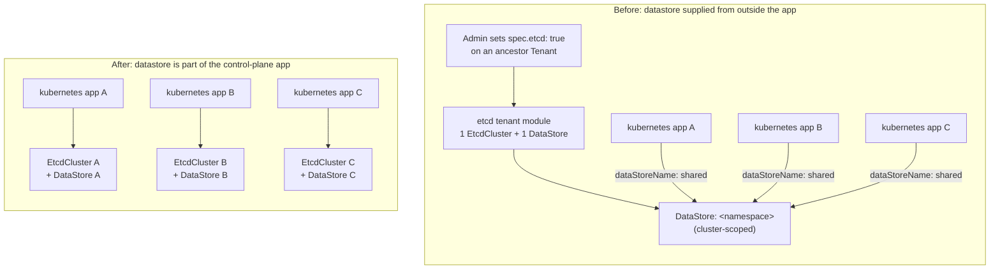

# Per-cluster etcd: the Kubernetes control-plane app owns its datastore

- **Title:** `Per-cluster etcd: give each Kubernetes control plane its own datastore`
- **Author(s):** `@myasnikovdaniil`

<!-- Proposal status and dates come from the PR and Git history.
     See README.md#proposal-status-and-dates in the parent directory. -->

## Overview

A Kubernetes control plane needs a datastore. Since the control-plane / node-pool split ([`kubernetes-nodes-split`](https://github.com/cozystack/community/pull/8), Accepted), `packages/apps/kubernetes` **is** the control-plane app — it renders the Kamaji control plane, its certificates, its konnectivity, its CSI and cloud-controller satellites, and its OIDC wiring, while worker pools live in `packages/apps/kubernetes-nodes`. Everything a control plane is made of is in that chart except the one component holding all of its state. etcd is instead supplied from outside, by an admin flipping `spec.etcd: true` on an ancestor `Tenant`.

This proposal completes the control-plane app: **`apps/kubernetes` renders its own `EtcdCluster` and its own Kamaji `DataStore`, one per cluster.** A cluster's datastore becomes as much a part of the cluster as its API server — created with it, sized with it, deleted with it, isolated to it. The end state is one etcd per one Kubernetes cluster, and no etcd running anywhere that no cluster needs.

Two consequences follow, and they are consequences rather than goals. Consumers stop being blocked on an admin pre-step, because a `Kubernetes` app no longer depends on a parameter its creator has no RBAC to set. And the tenant-module *wiring* for etcd — the `Tenant.spec.etcd` bool and the `_namespace.etcd` reference propagated down the tenant tree — has nothing left to serve, so it retires. The etcd chart itself and the standalone etcd app both survive; see Resolved question 2.

Phases 1 and 2 are implemented in [cozystack/cozystack#4817](https://github.com/cozystack/cozystack/pull/4817). The opt-in migration of existing clusters and the retirement of the tenant-module wiring are not; see Rollout.

## Scope and related proposals

The important framing point first, because this proposal is easily read as a competing packaging change:

- **[community#39](https://github.com/cozystack/community/pull/39) — Fold `extra` into `apps`.** **Companion, not competitor.** #39 answers *where packages live and how a module declares itself* — it retires the `packages/extra` directory and turns "hidden from the catalog", "one per tenant", and "shared down the tenant tree" into declarative `ApplicationDefinition` capabilities. This proposal answers a different question: *what the Kubernetes control-plane app is made of.* It adds one component to one chart. The two touch disjoint files (#39 touches directory paths, `-rd` definitions, and the Tenant chart's generic capability plumbing; this proposal touches `apps/kubernetes` templates plus the etcd-specific keys in the Tenant chart), and neither blocks the other. If both land, #39 relocates the etcd chart along with everything else in `extra/` and this proposal's shared template follows it; if only one lands, both still make sense on their own. The one place they meet is that etcd is the single tenant module whose *sharing semantics we intentionally drop* — #39 keeps sharing for monitoring, seaweedfs, ingress, and gateway, which is exactly why etcd is out of its scope and in this one.
- **[community#8](https://github.com/cozystack/community/pull/8) — Control-plane / node-pool split (Accepted, `design-proposals/kubernetes-nodes-split/`).** This proposal builds directly on it. Because worker pools moved out to `apps/kubernetes-nodes`, `apps/kubernetes` is now unambiguously the control-plane chart, and "the control plane owns its datastore" is a coherent statement about it rather than a statement about a chart that also happens to manage VMs.
- **[cozystack#3179](https://github.com/cozystack/cozystack/issues/3179) — Expose only `etcd.replicas`.** Captures the minimal-API argument. **Adopted here** (Design §2) and shipped in cozystack#4817, which is what #3179 asked for.
- **[cozystack#2859](https://github.com/cozystack/cozystack/pull/2859) / [#3270](https://github.com/cozystack/cozystack/pull/3270) — etcd-operator v1alpha2 (both merged).** This proposal targets `etcd-operator.cozystack.io/v1alpha2`, the `Available` readiness condition, and the `secretRef` TLS shape throughout.
- **[cozystack#4931](https://github.com/cozystack/cozystack/pull/4931) — `Kubernetes` backup strategy (merged).** Backs up a tenant cluster by dumping its key prefix from whatever datastore its `TenantControlPlane` names, so it covers a cluster's own etcd and a shared one alike; see Design §7.
- **[community#33](https://github.com/cozystack/community/pull/33) — ComputePlane (`packages/extra/computeplane`).** Adjacent but independent. ComputePlane wraps `apps/kubernetes`, so it inherits whatever datastore behaviour that chart has. Its README no longer lists a tenant etcd as a prerequisite.
- **Deferred / out of scope:** a SQL-backed Kamaji datastore driver (kine/PostgreSQL) per cluster. It is a real way to cut the three-replica etcd cost, but it is an orthogonal driver choice that layers on top of per-cluster *ownership* — the model proposed here is a prerequisite for it either way.

## Decisions

- [0003. The pre-delete hook releases Kamaji's datastore finalizer on a cluster's own etcd, and fails before that etcd's PKI goes if it cannot](./decisions/0003-the-pre-delete-hook-releases-kamajis-finalizer-on-an-own-etcd-and-fails-closed.md) — how deleting a cluster avoids waiting forever on an etcd that is down.
- [0002. A Cilium deny policy, not a client label, keeps other pods off a cluster's etcd](./decisions/0002-a-cilium-deny-policy-keeps-other-pods-off-a-clusters-etcd.md) — why the network fence is a deny rule.
- [0001. The live `KamajiControlPlane`, not `_namespace.etcd`, decides whether a cluster owns its etcd](./decisions/0001-the-live-kamajicontrolplane-decides-whether-a-cluster-owns-its-etcd.md) — how a new cluster is told apart from one already on a shared etcd.

## Context

This section describes `cozystack/cozystack` at [`86ad3870d1bb`](https://github.com/cozystack/cozystack/tree/86ad3870d1bb), the `main` commit cozystack#4817 merged onto. The tenant-side wiring it describes is still in place; only the `apps/kubernetes` side has changed.

A tenant Kubernetes control plane runs on the management cluster as a Kamaji `TenantControlPlane`, rendered through a CAPI `KamajiControlPlane`. Kamaji does not run etcd; it points each control plane at a Kamaji `DataStore`, and Cozystack supplies that datastore from a separately deployed etcd. The wiring:

- **etcd is a tenant module.** `packages/apps/tenant/values.yaml` exposes `etcd: false`. When a `Tenant` sets it true, `packages/apps/tenant/templates/etcd.yaml` renders a `HelmRelease` for the etcd chart in that tenant's namespace, labelled `internal.cozystack.io/tenantmodule: "true"`.
- **The etcd chart owns the datastore.** `packages/extra/etcd` renders an `EtcdCluster` (`etcd-operator.cozystack.io/v1alpha2`), its cert-manager CA/issuers/certificates, and a Kamaji `DataStore` named after the **namespace** pointing at `etcd.<namespace>.svc:2379`. `DataStore` is **cluster-scoped**.
- **Every name in that chart is the literal string `etcd`.** `EtcdCluster/etcd`; the Secrets `etcd-ca-tls`, `etcd-client-tls`, `etcd-server-tls`, `etcd-peer-tls`; the operator-owned Service `etcd`. The chart enforces this: `templates/check-release-name.yaml` calls `fail` unless `.Release.Name == .Chart.Name`. These names are load-bearing rather than cosmetic — `spec.tls` is immutable in v1alpha2 (CRD CEL `self.tls == oldSelf.tls`) and `etcd-migrate` adopts legacy clusters into exactly this `secretRef` shape, so renaming them would make every post-adoption reconcile fail. Design §1 works with this constraint instead of against it.
- **The reference propagates down the tenant tree, and is never empty.** `tenant-root` ships a hardcoded `_namespace.etcd: tenant-root` in its `cozystack-values` Secret (`packages/system/cozystack-basics/templates/cozystack-values-secret.yaml`). For nested tenants, `packages/apps/tenant/templates/namespace.yaml` inherits `_namespace.etcd` from the parent and overrides it with the current tenant only when *this* tenant sets `spec.etcd: true`; the resolved value is written to the namespace label `namespace.cozystack.io/etcd` and into descendants' `_namespace.etcd`. Consumers read it through `cozy-lib.ns-etcd` (`packages/library/cozy-lib/templates/_cozyconfig.tpl`). So every tenant resolves `_namespace.etcd` to at least `tenant-root`, **whether or not an etcd runs there**.
- **The control-plane app consumed the shared reference.** `packages/apps/kubernetes/templates/cluster.yaml` read `$etcd := .Values._namespace.etcd` and set `dataStoreName: "{{ $etcd }}"` on the `KamajiControlPlane`. With the value empty it rendered only a `<release>-awaiting-etcd` ConfigMap beacon, but a default install never leaves it empty: a new cluster instead pointed at a `DataStore/tenant-root` that exists only once an admin has turned on tenant-root's etcd. 26 templates in `packages/apps/kubernetes/templates` — the addon HelmReleases, CSI, KCCM and the cluster autoscaler among them — gated on the same value.
- **One etcd, many control planes.** Because the `DataStore` is cluster-scoped and the reference is shared subtree-wide, every `KamajiControlPlane` in a subtree carries the **same** `dataStoreName`. Kamaji multiplexes them onto the one etcd by minting a per-control-plane connection Secret (`<release>-datastore-config`) with its own credentials and key prefix. The isolation is logical — one Raft group, one disk, one `quotaBackendBytes`, one CA — not physical.
- **The network policy is subtree-wide.** `policy.cozystack.io/allow-to-etcd` on the control-plane pods is read only by the tenant's `<tenant>-ingress-etcd` policy (`packages/apps/tenant/templates/networkpolicy.yaml`), which admits descendants' control planes to the tenant's etcd. The same file's `allow-internal-communication` admits every pod in a tenant namespace to every other, and Cilium allow rules only add.

### The problem

- *"I have access to my tenant. I create a `Kubernetes` app and it never comes up. Its datastore doesn't exist until someone turns etcd on for the Tenant, and I don't own the Tenant."* The most common first-run experience for a delegated consumer is a cluster that cannot start, blocked on a parameter they have no RBAC to set.
- *"Two teams each spun up a cluster in our tenant, and now a compaction storm on one team's control plane is stalling the other's API server."* One etcd, sized and tuned exactly once, backs an unbounded number of control planes. There is no per-cluster performance envelope, and nothing about a cluster's own configuration can give it one.
- *"Our security review flagged that every cluster's control-plane state lives in one etcd behind one CA."* One etcd shared across trust boundaries is one blast radius. A noisy or compromised control plane is one logical key prefix away from its neighbours.
- *"To get real isolation we create a separate child tenant per cluster, just so each cluster gets its own etcd."* The workaround already exists in the field. It is precisely the per-cluster etcd this proposal makes the default, minus the tenant-sprawl ceremony.
- And the plain structural version, independent of any user story: **the control-plane chart does not contain the control plane's state.** Every other control-plane component is rendered by `apps/kubernetes` and versioned with it. The datastore is the one exception, and every problem above is downstream of that exception.

## Goals

- `apps/kubernetes` renders its own `EtcdCluster` and its own cluster-scoped `DataStore`, and points its `KamajiControlPlane` at them. One etcd per one Kubernetes cluster.
- etcd lifecycle is **bound to the cluster**: creating the app creates its etcd; deleting the app reaps its etcd, `DataStore`, certificates, and connection Secret.
- **No idle etcd.** With zero `Kubernetes` apps in a namespace, no `EtcdCluster`, PVC, or `DataStore` exists there. (The cluster-wide etcd-operator stays; it provisions nothing on its own.)
- A consumer who can create a `Kubernetes` app gets a working cluster with **no admin pre-step** — no ancestor `spec.etcd: true`, no wait state.
- Each cluster's control-plane state is **physically isolated**: its own Raft group, disk, quota, CA, and Service, reachable only by its own control plane and the platform.
- The user-facing surface added is **one field** (`etcd.replicas`), matching the convention the chart already follows for its other infrastructure satellites.
- Existing shared-etcd clusters keep running across the upgrade, indefinitely and without action, and migrate only when an operator chooses to migrate them.
- The etcd chart stays a single source of truth for "how a Cozystack etcd is shaped", with no duplicated `EtcdCluster` or cert-manager templates.

### Non-goals

- **Not** changing Kamaji, the etcd-operator, the CAPI stack, or the KubeVirt provisioning path. Only *where the datastore comes from* changes.
- **Not** removing the etcd chart or the standalone etcd app (Resolved question 2).
- **Not** introducing a SQL/kine datastore driver (deferred, see Scope).
- **Not** migrating live control-plane data automatically. Data movement is operator-initiated, per cluster, and never a side effect of an upgrade (Resolved question 1).
- **Not** changing package layout, directory boundaries, or how modules declare themselves — that is [#39](https://github.com/cozystack/community/pull/39).
- **Not** re-litigating the control-plane / node-pool split; this proposal assumes it.

## Design

### Before / after



### 1. One shared template, two callers

`apps/kubernetes` needs the same shapes the etcd chart already renders — an `EtcdCluster`, its cert-manager issuer/CA/certificate set, and a Kamaji `DataStore` — but under per-cluster names. The etcd chart cannot be consumed as a subchart to get them, for three concrete reasons established in Context: `check-release-name.yaml` hard-fails unless the release is named `etcd`; a subchart is rendered with the *parent's* `.Release.Name`, so it would fail that guard and then produce parent-named objects anyway; and the literal `etcd-{ca,client,server,peer}-tls` names cannot simply be made release-scoped, because adopted legacy clusters reference them through an immutable `spec.tls`.

So the shapes live in **named templates in `cozy-lib`, parameterised by name** (`packages/library/cozy-lib/templates/_etcd.tpl`), and both charts call them. `cozy-lib` is already symlinked into both charts, so there is no new dependency, no `charts/` vendoring step, and no build change. The templates are `cozy-lib.etcd.cluster`, `.certificates`, `.datastore`, `.workloadMonitor`, `.defrag`, `.vpa` and `.podScrape`, plus a `quotaBackendBytes` helper. `cozy-lib.etcd.cluster` also takes optional `labels` and `annotations`, which it renders into the `EtcdCluster`'s `spec.additionalMetadata` for the operator to copy onto every member Pod and PVC.

`packages/extra/etcd` calls them with `"etcd"` and renders byte-identical output — same `EtcdCluster/etcd`, same Secret names, same `DataStore/<namespace>`, same adoption compatibility, same immutable `spec.tls`. Nothing about the standalone chart or an adopted cluster changes. `apps/kubernetes` calls them with its own per-cluster name (§3) and gets a fresh cluster, where there is no adopted object to stay shape-compatible with and the names are therefore free.

The `KamajiControlPlane` then points at its own datastore:

```yaml
# packages/apps/kubernetes/templates/cluster.yaml
    dataStoreName: {{ include "kubernetes.etcd.dataStoreName" . | quote }}
```

Both charts keep the `secretRef` TLS shape, with the chart issuing every certificate, rather than the operator's `certManager` mode: Kamaji's `DataStore` needs the CA private key to sign each tenant's client certificate, and `secretRef` keeps that key in a Secret the chart controls. The per-cluster server certificate also carries the operator's `<name>-client` Service names.

Extracting the templates is mechanically the largest piece of work in this proposal and is behaviour-neutral by construction: Phase 1 lands the extraction alone, and the etcd chart renders byte-identically before and after it.

### 2. One new field: `etcd.replicas`

The `Kubernetes` CR gains exactly one etcd knob:

```yaml
# packages/apps/kubernetes/values.yaml
## @typedef {struct} Etcd - etcd that holds this cluster's control-plane state.
## @field {int} replicas=3 - Number of etcd members: `3` keeps quorum through the loss of one member, `1` runs a single member with no failover. Only `1` and `3` are accepted. ...
## @minimum 1
## @maximum 3

## @param {Etcd} etcd - Dedicated etcd for this cluster's control plane, rendered with the cluster and deleted with it. ...
etcd:
  replicas: 3
```

`size`, `resources`, and `storageClass` are deliberately **not** exposed, which is the point captured in [#3179](https://github.com/cozystack/cozystack/issues/3179). The chart already renders three infrastructure satellites with hardcoded resources and no values surface — `templates/kccm/manager.yaml`, `templates/cluster-autoscaler/deployment.yaml`, `templates/csi/deploy.yaml` — and draws a clean line between the control plane the user configures (`controlPlane.*.resourcesPreset`) and the machinery underneath it that the user does not. Per-cluster etcd belongs on the second side of that line: it is a control-plane implementation detail, not a control-plane user surface. Field data supports this — measured on a real tenant cluster, the satellites already cost ~1360m requested CPU and ~3.85Gi requested memory, of which `kcsi-controller` alone (760m CPU, 3200Mi memory limits across six-plus sidecars) is heavier than three etcd replicas combined, and none of it is tunable. Adding a full sizing block for etcd alone would break the convention and add UX surface for a knob nobody has asked to turn.

The internal values follow the etcd chart's defaults, so per-cluster sizing starts where shared sizing is:

- `size: 4Gi`, with `quotaBackendBytes` derived at 95% as the etcd chart does. Ample for one Kamaji datastore.
- `resources: {cpu: 1000m, memory: 512Mi}` as the starting limits. Where a VerticalPodAutoscaler runs, the VPA template sizes each member as it is recreated, up to 5000m CPU / 8Gi memory requests divided by the platform's CPU and memory allocation ratios (500m / 8Gi at the default ratios of 10 and 1), with the limits scaled in proportion.
- `version` is the etcd chart's default, from `cozy-lib.etcd.defaultVersion`; the two are bumped together.
- `storageClass` is **derived from `replicas`**, resolved at platform level rather than per app. The platform values `kubernetesEtcd.storageClassLocal` and `kubernetesEtcd.storageClassReplicated` reach the chart as `_cluster.etcd-storage-class-local` and `_cluster.etcd-storage-class-replicated`. `replicas: 3` selects the local class, since etcd replicates through Raft and storage-layer replication underneath it is wasted write amplification; `replicas: 1` selects the replicated class, so the single member survives node loss. An unset key falls back to the namespace's default StorageClass. An operator retunes their fleet in one place; a tenant does not make storage-class decisions at all.
- **The class is fixed at creation.** `spec.storage.storageClassName` is immutable on an `EtcdCluster`, so after the first render the chart reads the class back from the live object and never re-derives it: scaling 1 → 3 keeps the class the cluster started with. Dropping from 3 members to 1 is refused at render time when the live class is the one the platform names for 3 members, or is not the one it names for 1, because a single member would then hold the only copy of the control-plane state on storage that does not replicate it. An etcd created with one member keeps rendering whatever its class.

This surface is a strict subset of a fuller `{replicas, size, storageClass, resources}` block, so if a production case ever needs `size` or `resources`, widening is purely additive and breaks nothing.

`replicas` is restricted to `1` or `3`. Even numbers are actively harmful for a Raft quorum (`2` tolerates zero failures while doubling cost and halving availability), and `5+` has no plausible justification for a single tenant control plane's key space. The values schema bounds it to `1..3`, and the chart refuses `2` at render time. It is not an enum: `cozyvalues-gen` emits string members for an integer enum, which would reject the default `3`. The aggregated API does not validate an application's spec against its schema, so neither form refuses a bad value at admission; Helm's schema check and the render do.

### 3. Names, and the length budget

Two clusters can live in one namespace, so the per-cluster names must be release-scoped rather than namespace-scoped. For release `kubernetes-<name>` in namespace `<ns>`:

| Object | Name | Owner |
|---|---|---|
| `EtcdCluster`, its headless Service | `kubernetes-<name>-etcd` | this chart / etcd-operator |
| Member pods | `kubernetes-<name>-etcd-<suffix>` | etcd-operator |
| Client Service | `kubernetes-<name>-etcd-client` | etcd-operator |
| TLS Secrets | `kubernetes-<name>-etcd-{ca,client,server,peer,peer-ca}-tls` | cert-manager, issued by this chart |
| `DataStore` (cluster-scoped) | `<ns>.kubernetes-<name>` | this chart |
| Datastore endpoint | `kubernetes-<name>-etcd.<ns>.svc:2379` | — |

The `DataStore` name must be unique across the cluster, because the resource is cluster-scoped. Namespaces and release names both contain dashes — a child tenant's namespace is `<parent>-<name>` — so a dashed `<ns>-<release>` collides: Kubernetes `foo` in `tenant-a` would get `tenant-a-kubernetes-foo`, which is also the namespace, and therefore the shared `DataStore` name, of tenant `foo` under tenant `kubernetes` under `tenant-a`. A namespace cannot contain a dot, so `<ns>.<release>` collides with neither another cluster's `DataStore` nor a tenant's. Kamaji copies the `DataStore` name into a pod label value, so it is capped at 63 characters; `kubernetes.etcd.dataStoreName` truncates past that and appends an 8-character hash of the full name, so the same input gives the same name on every render.

The etcd name needs no truncation. The application name is capped at 32 characters, so `kubernetes-<name>-etcd` is at most 48. The operator derives `<cluster>-client` and `<cluster>-<suffix>` from it, which must fit in 63, so the binding ceiling is 56; `kubernetes.etcd.name` fails the render past 56 rather than rename a live object. The defrag `CronJob`, `<etcd name>-defrag`, can reach 55 characters against the apiserver's 52-character cap for CronJob names, so `cozy-lib.etcd.defrag` truncates it with a hash past 52.

### 4. New clusters, existing clusters

`_namespace.etcd` cannot tell a new cluster from an existing one, because every tenant publishes a value (Context). The chart decides from the cluster's own live `KamajiControlPlane`, looked up by release name ([decision 0001](./decisions/0001-the-live-kamajicontrolplane-decides-whether-a-cluster-owns-its-etcd.md)):

- no `KamajiControlPlane`, or one whose `spec.dataStoreName` is the cluster's own name → the cluster owns its etcd;
- one that names any other `DataStore` → that `DataStore` is kept, and the chart renders no etcd of its own.

`_namespace.etcd` is not read at all. A cluster that exists on a shared etcd renders exactly what it rendered before — same `dataStoreName`, same `policy.cozystack.io/allow-to-etcd` label, same pre-delete hook — so an upgrade rolls no control-plane pods, and it stays on that `DataStore` until an operator migrates it, even if an ancestor's `spec.etcd` later changes. Every new cluster provisions its own, including one created under an ancestor that does run a shared etcd.

The lookup reads only the chart's own object, gives the same output on every render, and its empty branch — the new-cluster render — is what offline `helm template` sees, which is the kind of `lookup` the chart guidelines allow. The same holds for reading the live `EtcdCluster`'s immutable StorageClass in §2.

Because a datastore now always exists, the `awaiting-etcd` beacon and the `_namespace.etcd` gates on the addon and satellite templates go in Phase 2, not Phase 4: they were always true for a new cluster, and a cluster on a shared etcd satisfies them as well.

### 5. Network isolation

A per-cluster etcd sits in the tenant namespace, where the tenant's own policies admit every pod in the namespace, every pod in an ancestor tenant's namespace, and the `world` entity; and Cilium allow rules only add. Retargeting a client label cannot narrow that, so the chart renders a `CiliumNetworkPolicy` named after the etcd, selecting its members, with `ingressDeny` on ports 2379 and 2380 ([decision 0002](./decisions/0002-a-cilium-deny-policy-keeps-other-pods-off-a-clusters-etcd.md)):

- pods in the tenant namespace that are neither members (`etcd-operator.cozystack.io/cluster: <etcd name>`) nor labelled `policy.cozystack.io/allow-to-etcd-cluster: <etcd name>` — the label this cluster's control-plane pods, its defrag Job and the `Kubernetes` backup strategy's dump Job carry;
- pods in any other namespace except `kube-system` and namespaces labelled `cozystack.io/system: "true"`, which is where Kamaji, its migrate Job and etcd-operator run;
- the `world` entity, so sources off the cluster, such as Proxmox workers, are denied as well.

The node's own `host` and `remote-node` traffic is not denied, and metrics on 2381 stay open. The member pods carry `cozystack.io/service: kubernetes-etcd` rather than the etcd chart's `cozystack.io/service: etcd`, so the tenant-wide `<tenant>-ingress-etcd` policy does not admit child tenants' control planes to them. The policy renders only where Cilium serves `cilium.io/v2/CiliumNetworkPolicy`. etcd authenticates its clients by certificate either way; the policy keeps everything else from reaching the ports at all.

### 6. Deletion

The pre-delete hook deletes the `TenantControlPlane` and waits for it. Kamaji's `finalizer.kamaji.clastix.io` drops the tenant's role, prefix and user from the datastore, and it completes only while that datastore is Ready and answering. For a cluster on its own etcd, all three live in the etcd this uninstall deletes next, so the hook does not let a down etcd block the uninstall ([decision 0003](./decisions/0003-the-pre-delete-hook-releases-kamajis-finalizer-on-an-own-etcd-and-fails-closed.md)):

1. If the `TenantControlPlane` outlives the wait and its `spec.dataStore` is this cluster's own `DataStore`, the hook removes that one finalizer with a JSON patch that tests it at the index it was read at, then waits again. Step 4b clears Kamaji's `finalizer.kamaji.clastix.io/datastore-secret` from `<release>-datastore-config` as before.
2. Before deleting the etcd's PKI, the hook re-reads the `TenantControlPlane`. If it cannot be read, or still holds the finalizer on the own `DataStore`, the hook fails, so the uninstall is retried with the etcd and its PKI still in place.
3. It deletes the etcd's five `Certificate`s and then their Secrets, which cert-manager issues without an owner.

Helm then removes the `EtcdCluster`, the `DataStore` and the remaining objects, and the member PVCs follow by garbage collection through the `EtcdMember`s that own them. Helm deletes release resources only after the pre-delete hook, so the etcd outlives Kamaji's normal finalisation without any ordering inside the hook.

For a cluster on a shared `DataStore`, the hook renders exactly as before: it never touches Kamaji's finalizer, the shared `EtcdCluster` or the shared `DataStore`, because they belong to an ancestor tenant's module and back every other cluster in the subtree. The extra steps and their RBAC — `patch` on this release's `TenantControlPlane`, and `delete` on the etcd's `Certificate`s and Secrets by name — render only for a cluster that owns its etcd.

### 7. Backups, monitoring and platform ordering

- **Backups.** The `Kubernetes` backup strategy ([cozystack#4931](https://github.com/cozystack/cozystack/pull/4931)), which `cozy-default` routes `apps.cozystack.io/Kubernetes` to, resolves the datastore from the `TenantControlPlane` and dumps the cluster's key prefix, so it covers a cluster's own etcd and a shared one alike. Its dump Job carries `policy.cozystack.io/allow-to-etcd-cluster: <release>-etcd`, which §5 admits and which is inert for a cluster on a shared etcd. The restore writes into whatever etcd the control plane runs on, so the strategy's Velero half needs neither the etcd's PVCs nor its TLS Secrets. The `Etcd` strategy stays keyed on the standalone `Etcd` application.
- **Monitoring.** Each cluster's etcd gets its own `WorkloadMonitor`, a `VMPodScrape` that selects its own members, and a VPA; the latter two render only where their APIs are served. Alert rules are not rendered per cluster; the `PrometheusRule` stays in the etcd chart (Open questions). The etcd chart's `VMPodScrape` selects `app.kubernetes.io/instance: etcd` rather than `app.kubernetes.io/name: etcd`, because etcd-operator stamps the latter on every member it runs, so a tenant etcd would otherwise also scrape the cluster etcds in its namespace.
- **Defrag.** Each cluster's etcd runs the etcd chart's defrag CronJob. Its image goes through `cozy-lib.image`, pinned to the multi-architecture index digest, so a configured registry mirror applies.
- **Platform ordering.** `cozystack.kubernetes-application` `dependsOn` `cozystack.etcd-operator`, so the application is offered only once the operator that serves `EtcdCluster` is installed.

## User-facing changes

- **Consumers:** creating a `Kubernetes` app yields a working cluster with no admin pre-step. One new field, `etcd.replicas`, defaulting to `3`.
- **Admins:** etcd stops being something to pre-provision per tenant. `Tenant.spec.etcd` keeps working for clusters already on a shared etcd, and is deprecated and then removed in Phases 3 and 4. Two new platform values, `kubernetesEtcd.storageClassLocal` and `kubernetesEtcd.storageClassReplicated`, select the etcd StorageClasses fleet-wide.
- **Resource accounting:** a cluster's etcd counts against its own tenant's `resourceQuotas` rather than an ancestor's. `NOTES.txt` and the app README state the footprint up front — three members with 1000m/512Mi limits to start with and a 4Gi PVC each, plus the VPA ceiling — so the cost is visible before creation, not discovered afterwards (Resolved question 5).
- **Dashboard and observability:** each cluster gets its own etcd `WorkloadMonitor` and `VMPodScrape` instead of one shared set per subtree, so etcd metrics attribute to a cluster. It gets no alert rules of its own yet (Open questions).
- **Docs:** `packages/apps/kubernetes/README.md` describes the cluster's own etcd, the case of a cluster that keeps its tenant's shared one, the VPA sizing and the backup path. The website still needs the two platform values, the `etcd.replicas` field, and removal of the advice to set `etcd: true` on a Tenant for a cluster; tenant docs gain the migration runbook once it is supported.

## Upgrade and rollback compatibility

**Nothing migrates on upgrade.** New clusters self-provision. Existing clusters keep the `DataStore` their live `KamajiControlPlane` names (§4) and render exactly what they rendered before, for as long as the operator leaves them alone. There is no automatic data movement anywhere in this proposal, and the platform never restarts a tenant's kubelets on its own initiative.

**Numbered platform migration.** A report-only migration (`packages/core/platform/images/migrations/migrations/63`, migration 63 → 64 in cozystack#4817) lists every `KamajiControlPlane` whose `DataStore` its own release did not render, judged by Helm's release annotations on the `DataStore`, with that `DataStore`'s endpoints. It writes nothing but the version stamp. This is the signal Phase 4 waits on. Using a numbered migration to move data would be wrong for the reasons in step 6 below.

**Migrating an existing cluster** is an operator-initiated, per-cluster, scheduled-maintenance operation, and is not implemented yet. The mechanism is a live datastore switch; Resolved question 1 has the evidence, and a run on a cluster with Talos workers measured about 20s of data copy and 43s from patch to Ready, with reads uninterrupted ([SerjioTT's run](https://github.com/cozystack/community/pull/25#issuecomment-5521452050)). The runbook:

1. **Opt in.** The chart renders the cluster's own `EtcdCluster`, certificates and `DataStore` beside the shared one, without switching `dataStoreName`. Wait for `Available=True`. How the operator opts in is open (Open questions).
2. **Snapshot the source etcd.** This is the rollback path and is not optional.
3. **Pre-flight reachability from the cluster's namespace, not Kamaji's.** Kamaji's migrate Job runs in Kamaji's namespace and can reach any etcd, so the copy succeeds toward a target the control-plane pods cannot dial; the new apiserver generation then crash-loops and the cluster stays write-frozen. Run `nc -zv <target> 2379` from a pod carrying the control plane's labels in the cluster namespace. For the per-cluster target this holds by construction, but the check stays because rollback goes the other way.
4. **Switch.** Point `KamajiControlPlane.spec.dataStoreName` at `<ns>.<release>`; the CAPI provider re-projects it onto the `TenantControlPlane`. Kamaji freezes writes while it copies, with a five-minute default budget that `kamaji.clastix.io/migration-timeout` adjusts; the annotation can go on the `KamajiControlPlane`, because the provider copies annotations to the `TenantControlPlane`. Delete any leftover `migrate-<TCP UID>` Job in Kamaji's namespace first: a leftover with identical arguments is taken as success and switches the datastore without copying, and one with different arguments is recreated with the freeze already installed.
5. **Verify a write, not status.** Kamaji freezes the cluster with a `kamaji-freeze` `ValidatingWebhookConfiguration` inside the guest, and removes it only when the `TenantControlPlane` status is exactly `Ready`. Node leases are exempt and reads are untouched, so nodes and `kubectl get` look healthy while writes fail. The success criterion is a canary write through the guest API. If `kamaji-freeze` is still in the guest after the `TenantControlPlane` is `Ready`, delete it.
6. **Restart every worker's kubelet, one node at a time.** Until it restarts, a kubelet keeps running existing pods but never starts a newly bound one, so the cluster looks healthy and silently stops starting workloads. The per-node check is a new pod starting on that node. A graceful Talos reboot keeps the node Ready or nearly so and restarts its pods in place. The operator has no path to the workers' Talos API — the chart has a per-cluster `talos-ca` Issuer but issues no client credentials from it — so the fallback is `virtctl restart` per VM (Open questions). Any pod-based restarter must be deployed before the switch, because a deaf kubelet will not start it. This step is the reason migration is a maintenance operation rather than a platform migration: rolling a tenant's kubelets is a tenant-visible availability event that the platform must not perform unannounced.
7. **Retain and reclaim.** Retain the source prefix and the snapshot for a defined cool-off period, then reclaim them. Kamaji does not clean the old prefix after a migration.

**Rollback.** Before migration, trivially: revert the chart and the cluster is still on the shared etcd, because nothing moved. After migration, one-way in practice — reversing means running the same procedure in the other direction against the retained snapshot. Step 2's snapshot exists precisely so that this is possible-but-deliberate rather than impossible.

## Security

- **Removes a shared trust boundary.** Each cluster gets its own etcd CA, Service, certificates, and PVCs. A shared `DataStore` is often an ancestor tenant's, so the control plane dials across namespaces. A per-cluster control plane dials only its own etcd, in its own namespace.
- **Network fence.** The `CiliumNetworkPolicy` in Design §5 denies the etcd ports to every pod in the tenant namespace except the members and this cluster's labelled clients, to pods in other tenant namespaces whatever labels they set, and to `world`. A tenant can label its own pods freely, so the label only admits pods in the cluster's namespace; only the namespace rule keeps another tenant's pods out.
- **Blast radius shrinks from subtree to cluster.** A compromised or resource-exhausted etcd affects exactly one Kubernetes cluster. A compaction storm no longer has neighbours.
- **No new tenant-supplied trust surface.** The only new input is an integer restricted to `1` or `3`. There is no way to point a control plane at an arbitrary external datastore.
- **Secrets:** per-cluster CA / server / peer / client Secrets are issued by cert-manager exactly as the tenant module does, one set per cluster instead of one per subtree. Kamaji's per-control-plane `<release>-datastore-config` Secret is unchanged. The pre-delete hook gains `patch` on the cluster's own `TenantControlPlane` and `delete` on its own etcd `Certificate`s and Secrets, by name, and only for a cluster that owns its etcd.
- **Residual risk during migration:** between steps 1 and 7 a cluster's data exists in two places. The retained source prefix and snapshot are a deliberate availability trade and should be reclaimed on a defined schedule rather than kept indefinitely.

## Failure and edge cases

- **Two `Kubernetes` apps in one namespace** → each renders `<release>-etcd` and `DataStore/<ns>.<release>`; no collision. The old single `DataStore/<namespace>` could not name two clusters distinctly at all.
- **A cluster `foo` in `tenant-a` beside a tenant `foo` under `tenant-a-kubernetes`** → `DataStore/tenant-a.kubernetes-foo` and `DataStore/tenant-a-kubernetes-foo` are different objects.
- **A long application name** → the app name is capped at 32 characters, so the etcd name stays inside 56; the `DataStore` and defrag `CronJob` names are truncated deterministically with a hash, so a re-render never renames a live object.
- **An ancestor turns its `spec.etcd` on or off** → no existing cluster moves; each stays on the `DataStore` its live `KamajiControlPlane` names (§4).
- **Cluster deletion, own etcd never became `Available`** → the hook releases Kamaji's finalizer from the `TenantControlPlane` (§6) and the uninstall completes.
- **Cluster deletion, the finalizer cannot be released** → the hook fails before deleting the etcd's PKI, Helm keeps the release, and the uninstall is retried with the etcd still in place.
- **Cluster deletion, legacy shared etcd** → the hook does not touch the shared `EtcdCluster`, the shared `DataStore` or Kamaji's finalizer. A helm-unittest case pins that negative, because getting it wrong destroys other tenants' clusters.
- **etcd not `Available` when Kamaji reconciles** → the control plane stays not-ready and Flux retries. Same asynchronous-readiness loop as before, no hard failure.
- **`replicas: 2`** → the render fails with an explanatory message. **`replicas: 5`** → Helm's values-schema check rejects it. The aggregated API accepts both, so the error surfaces on the HelmRelease rather than at admission.
- **3 → 1 on node-local storage** → the render fails rather than leave the only copy of the state on one node (§2). 1 → 3 keeps the class the etcd started with.
- **Migration interrupted mid-flight** → the source prefix and the step-2 snapshot both still exist; the cluster keeps serving from whichever `dataStoreName` is currently set. Re-runnable after deleting the leftover migrate Job (step 4).
- **Freeze left behind after a successful migration** → reads and node heartbeats look healthy while writes fail; step 5's canary write catches it.
- **Kubelet restart skipped after migration** → nodes stay Ready, but no newly bound pod starts. This is the failure mode step 6 exists to prevent.
- **Tenant quota too small for the new etcd** → the etcd member pods fail admission against the namespace `ResourceQuota` and the cluster does not come up, with the quota error surfaced on the pods. Publishing the footprint in `NOTES.txt` is what turns this from a surprise into a precondition.

## Testing

- **`cozy-lib` extraction (Phase 1 gate):** the etcd chart renders byte-identically before and after the extraction, across its value combinations, and its helm-unittest suite (`packages/extra/etcd/tests/`) passes unchanged.
- **Helm unit tests, `packages/apps/kubernetes/tests/etcd_test.yaml`:** names and the `DataStore` endpoint; a `dataStoreName` matching that `DataStore`; two clusters in one namespace; the 63-character `DataStore` cap and the 52-character defrag `CronJob` cap at the longest app name, stable across renders; StorageClass choice and stickiness; the refused and the allowed drops to one member; the refusal of `2`; the network policy, including its `world` deny; the hook's extra steps and RBAC. For an existing cluster: it stays on the shared `DataStore`, ignores a changed `_namespace.etcd`, keeps the shared-etcd label, and renders no etcd and no extra hook steps.
- **Delete hook, `hack/kubernetes-pre-delete-hook.bats`:** the hook script run against a stub `kubectl`, for both branches — a `TenantControlPlane` on a shared `DataStore` is reported and left alone; one on its own etcd is released and the run completes; a rejected release or an unreadable `TenantControlPlane` fails before Step 8.
- **Platform migration, `hack/migration-63-shared-etcd-report.bats`:** the report lists exactly the clusters on a `DataStore` their own release did not render, and writes only the version stamp.
- **e2e, `hack/e2e-chainsaw/kubernetes-latest` and `kubernetes-previous`:** the install no longer turns on tenant-root's etcd, so a cluster can only come up on its own. Each suite asserts the control plane names `<ns>.<release>` and its etcd reaches `Available`; `kubernetes-latest` runs the defrag CronJob once and asserts the Job completes, then probes the client port from three pods — a labelled pod in the cluster's namespace must connect, while an unlabelled one there and a labelled one in `tenant-root` must be refused. Teardown waits until the `EtcdCluster`, the `DataStore`, the member PVCs and the Secrets are gone.
- **Not yet covered:** an upgrade lane that installs the previous release and keeps a cluster on a shared etcd across the upgrade (until then the shared branch is covered by unit tests with a stubbed lookup only); the migration runbook end to end, gating its support; the deny policy from a guest worker VM and from off the cluster; deleting a cluster whose etcd never became `Available`; the quota case; a `Kubernetes` backup and restore of a cluster that owns its etcd.

## Rollout

1. **Phase 1 — extract, no behaviour change.** Move the etcd shapes into `cozy-lib` named templates; `packages/extra/etcd` calls them and renders byte-identical output. Nothing user-visible ships. *Shipped in cozystack#4817.*
2. **Phase 2 — per-cluster etcd for new clusters.** `apps/kubernetes` renders its own etcd, certificates, `DataStore`, network policy and monitoring; adds `etcd.replicas` and the platform StorageClass values; keeps existing clusters on their shared `DataStore`; extends the delete hook with both branches; removes the `awaiting-etcd` beacon and the `_namespace.etcd` gates; adds the `etcd-operator` dependency and the report-only migration; ships the sizing and quota notes. *Shipped in cozystack#4817.*
3. **Phase 3 — migrate and deprecate.** Implement the opt-in, prove the migration runbook with an e2e including the kubelet restart, and document it as supported. Mark `Tenant.spec.etcd` and the etcd tenant-module catalog entry deprecated; new tenants stop offering it. Stop shipping the hardcoded `_namespace.etcd: tenant-root`.
4. **Phase 4 — remove plumbing.** Once the migration report shows no cluster on a shared etcd, delete `apps/tenant/templates/etcd.yaml`, the `etcd` tenant value, the `_namespace.etcd` propagation, the `namespace.cozystack.io/etcd` label and the `<tenant>-ingress-etcd` policy that reads it, the `cozy-lib.ns-etcd` helper and its tests, and the shared-`DataStore` branch of `apps/kubernetes`. Keep the etcd-operator, the etcd chart, and the standalone etcd app.

Phases 1 and 2 are the proposal's core. Phases 3 and 4 can trail by a release or more, and Phase 4 in particular is gated on evidence rather than on a date: without a supported migration, a cluster leaves a shared etcd only by being recreated.

## Open questions

- **How an operator opts a cluster into migration** (runbook step 1): a chart-internal value, or an annotation the chart reads. Either has to make the chart render the own etcd beside the shared one without switching `dataStoreName`.
- **An operator `talosconfig`.** Issuing one from the per-cluster `talos-ca` alongside the admin kubeconfig would make runbook step 6 a kubelet restart instead of a VM reboot. It is a separate credential with its own exposure question.
- **Alert rules for a cluster's own etcd.** The etcd chart's `PrometheusRule` is not rendered per cluster.

## Resolved questions

**1. Does the CAPI `KamajiControlPlane` support a live datastore switch?** **Yes.** The Kamaji control-plane provider projects `KamajiControlPlane.spec.dataStoreName` onto `TenantControlPlane.spec.dataStore` from inside a `controllerutil.CreateOrUpdate` mutate function (`controllers/kamajicontrolplane_controller_tcp.go`, `if kcp.Spec.DataStoreName != "" { tcp.Spec.DataStore = kcp.Spec.DataStoreName }`), so it re-projects on **every** reconcile rather than only at creation, and the field carries no immutability marker. Changing it therefore reaches Kamaji's own datastore-migration flow. That flow is not free: Kamaji's guide states the control plane "is put in read-only mode to avoid misalignments between source and destination datastores", with a five-minute default budget under `kamaji.clastix.io/migration-timeout`, and requires "restarting the `kubelet.service` on all the tenant worker nodes" afterwards. **Decision:** migration is an operator-initiated, per-cluster, scheduled-maintenance runbook — never an unattended numbered platform migration, because the platform must not roll a tenant's kubelets unannounced. The numbered migration only reports which clusters remain. The same projection is why a chart upgrade must never change a live cluster's `dataStoreName` (§4). #2859's choice of snapshot-and-adopt is no evidence against the live path: #2859 was adopting *operator API versions* for existing etcd clusters, an unrelated problem.

**2. Is anyone using etcd as a standalone app, and does it survive?** **It survives, and the question does not need answering first.** Only the *tenant-module wiring* retires — the `Tenant.spec.etcd` bool and the `_namespace.etcd` propagation. The chart and its `ApplicationDefinition` remain, so etcd stays installable as an ordinary app for any datastore purpose unrelated to a Kubernetes control plane, and no existing standalone deployment is disturbed. Deciding *which directory* it lives in and *how* it declares itself is [#39](https://github.com/cozystack/community/pull/39)'s question, not this one — which is exactly the division of labour described in Scope.

**3. Default replicas: 1 or 3?** **3.** Defaulting to `1` would ship non-HA control planes to anyone who does not read the field, which is the wrong direction for a safe default. A user who wants a throwaway cluster can set `replicas: 1` explicitly and gets a replicated StorageClass underneath it as a partial safety net (§2).

**4. Subchart or shared library?** **Shared library — named templates in `cozy-lib`, parameterised by name.** The subchart route is blocked by three concrete facts, not by taste: `packages/extra/etcd/templates/check-release-name.yaml` calls `fail` unless `.Release.Name == .Chart.Name`; a subchart renders with the parent's release name, so it fails that guard and would then emit parent-named objects; and the literal `etcd-*` Secret names cannot be made release-scoped for existing clusters, because `etcd-migrate` adopted them into an immutable `spec.tls` that references those exact names. The library route sidesteps all three, needs no `Chart.yaml` dependency or vendoring step because `cozy-lib` is already symlinked into both charts, and keeps one source of truth for the etcd shape. Cost: `cozy-lib` gains resource-emitting templates alongside its helpers, which is a mild widening of what that chart is for. Accepted, and worth it against the alternative of duplicating the `EtcdCluster` and cert-manager shapes in two places.

**5. Should the etcd footprint be surfaced?** **Yes** — in `NOTES.txt` and the app README, stated in concrete numbers rather than as a caveat (§ User-facing changes). Per-cluster etcd counts against the tenant's own quota, and with a minimal values surface this is a documentation change rather than an API one.

## Alternatives considered

- **Keep etcd shared, one per tenant, better documented.** Rejected: N clusters on one etcd within a tenant solves neither the isolation nor the self-service problem. It renames the workaround.
- **Require the consumer to create an `etcd` app before the `Kubernetes` app.** Rejected: worse than before — two apps, an explicit ordering the user must know, a dangling etcd when the cluster is deleted, and it re-exposes the very concept being retired. Also, it would leave the control-plane chart still not containing the control plane's state, which is the actual defect.
- **Expose the full `{replicas, size, storageClass, resources}` block.** Rejected: it breaks the chart's existing convention that infrastructure satellites are hardcoded and only the control plane proper is tunable, and it adds four knobs for a component the user should not be sizing. The minimal surface is a strict subset, so growing into the fuller block later needs no breaking change ([#3179](https://github.com/cozystack/cozystack/issues/3179)).
- **Per-cluster SQL/kine datastore instead of etcd.** A genuine way to cut the three-replica cost, but an orthogonal driver decision that layers on top of per-cluster ownership rather than replacing it. Deferred.
- **Automatic migration of every shared-etcd cluster on upgrade.** Rejected twice over: moving live control-plane data without opt-in is unsafe, and the kubelet restart on every tenant worker node makes it an availability event the platform has no business triggering on its own.
- **Delete the etcd chart and inline everything into `apps/kubernetes`.** Rejected: duplicates the `EtcdCluster` and cert-manager shapes and orphans the standalone use case, including the `Etcd` backup strategy built around that chart's fixed names.
- **Wait for [#39](https://github.com/cozystack/community/pull/39) and treat etcd as one more capability migration.** Rejected. #39 generalises how modules are declared and where they live; the modules it covers are the ones whose *sharing must be preserved*. etcd is the one module whose sharing is the defect. Folding it into #39 would mean either holding a control-plane fix behind a repository-wide reorganisation, or expressing "this component stops being shared and moves inside another app" as a capability flag, which it is not. The two proposals are companions: one moves packages, the other completes an app.

---

<!--
Inspired by KubeVirt enhancement proposals
(https://github.com/kubevirt/enhancements) and Kubernetes Enhancement
Proposals (KEPs).
-->
