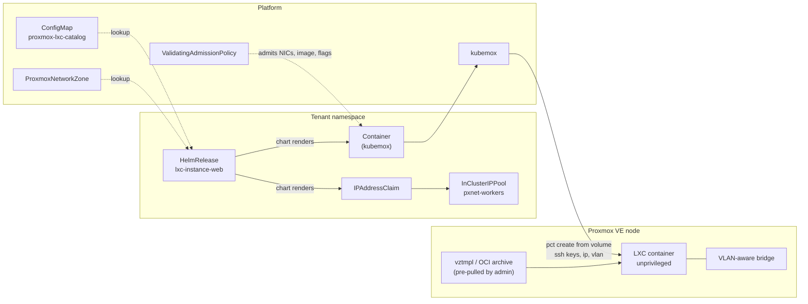
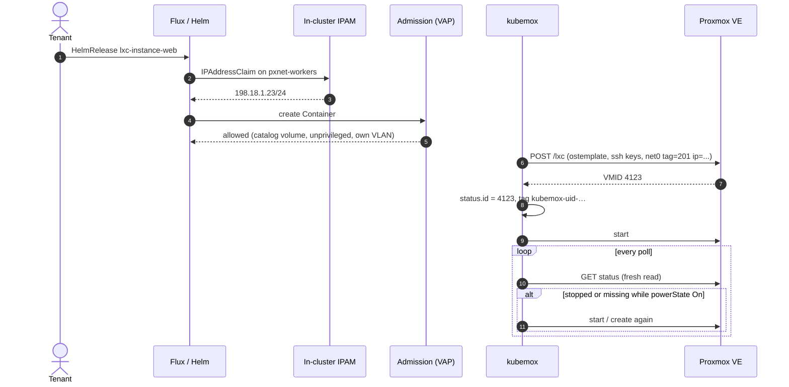

# Proxmox LXC containers for tenants

- **Title:** `Proxmox LXC containers for tenants: an lxc-instance application on kubemox`
- **Author(s):** `@themoriarti`

## Overview

On a Proxmox-backed installation a tenant can get a Kubernetes cluster today, and a virtual machine once the Proxmox VM work lands, but not a system container. LXC containers start in seconds, share the hypervisor kernel and cost a fraction of a VM's memory, which suits small long-lived services: a bastion, a DNS or mail relay, a CI runner, a legacy daemon that wants a whole OS but not a whole VM.

This proposal adds a tenant application, `lxc-instance`, that renders one kubemox `Container` per release. The tenant names an image from a platform catalog, a size, networks of its own namespace and SSH keys. The platform owns the hypervisor node, the storage, the bridge, the VLAN, the address and the image file. kubemox already creates, starts, resizes and deletes containers, but a live test on a lab found that it cannot yet be given to tenants: two objects can bind one container, an out-of-band stop or delete is never repaired, a delete can stop the whole operator, and a container cannot be put on a tenant VLAN or given an address or keys. The proposal lists the kubemox changes that close these gaps and puts them before the application in the rollout.

## Scope and related proposals

- Parent: cozystack/cozystack#3481 (Proxmox as a substrate). cozystack/community#98 lists LXC containers as a non-goal of the support tier; this proposal is where they are handled. It does not change the tiers.
- Networks: cozystack/community#104. An `lxc-instance` NIC is a network of the tenant's namespace from a `ProxmoxNetworkZone`; the address comes from that network's `InClusterIPPool`, and the admission policy of #104 is extended to cover `Container` NICs.
- Packaging: kubemox is not part of Cozystack today. A prototype packages it as an optional system package for Proxmox-backed virtual machines (`packages/system/proxmox-vm`, `vm-instance` and `vm-disk` with `substrate: proxmox`, branch `feat/proxmox-vm-substrate` of themoriarti/cozystack). That work will be proposed separately; this proposal assumes the package and adds containers to it.
- kubemox upstream: the VM-side changes are open as alperencelik/kubemox#96 and #100–#107. The container-side changes listed under [kubemox changes](#3-kubemox-changes) are new PRs against the same project.
- Deferred:
  - mount points (persistent volumes that survive an image change) and backups;
  - a console and start/stop/restart through the API (the VM console proxy can grow container subresources later);
  - live migration between hypervisors;
  - more than one hypervisor node per installation for containers (placement);
  - per-tenant Proxmox credentials.

## Decisions

## Context

### What kubemox does today

kubemox (alperencelik/kubemox, v0.7.x) has a `Container` kind (`api/proxmox/v1alpha1/container_types.go`, short name `lxc`, cluster-scoped upstream, namespaced with #96). Its spec has a target node, a connection reference, `deletionProtection`, `enableAutoStart`, `cloneMode` (`Full` or `Linked`) and a `template` with:

- `name`: a template container on the node to clone from, or
- `image`: an OCI reference and a file-based storage. kubemox calls `oci-registry-pull` (Proxmox VE 9.1+) and creates the container from the pulled archive;
- `cores`, `memory`, `disk[]` (storage, size) and `network[]` (bridge, model).

There is no field for SSH keys, a password, an address, a gateway, a VLAN tag, DNS, `unprivileged`, `features`, mount points, a power state, a resource pool or tags.

### What was verified, and how

A single-node Proxmox VE 9.2.21 lab with a ZFS pool, kubemox v0.7.0 plus the fork patches above (build `b7e612b` of themoriarti/kubemox `integration`), one API token with `PVEVMAdmin` on `/vms`, `PVEDatastoreUser` on the pools, `Datastore.AllocateTemplate` on the file storage and `SDN.Use` on the bridges in use. Five containers: two from `nginx:1.27-alpine`, one from `redis:7.2-alpine`, and a full and a linked clone of an unprivileged Ubuntu 22.04 template container.

| Check | Result |
|---|---|
| OCI pull by the operator token | Refused (`not authorized to access endpoint`). `oci-registry-pull` needs `Sys.AccessNetwork` on the node. After an admin pulled the images under the file names kubemox derives from the reference, kubemox found them and created the containers. |
| Create from OCI image | Running in about a minute; a second container from the same image reuses the archive on the storage. Containers are unprivileged (the Proxmox VE 9 default), the entrypoint and environment come from the image, nginx and redis answer. |
| Clone from a template container | Full and linked clones on ZFS. Four objects applied together (two OCI, two clones) were all running 96 seconds later. `cores` and `memory` are applied after the first start. `template.disk` and `template.network` are ignored: the clone keeps the template's rootfs size, storage and bridge. |
| Resize a running container | `cores` and `memory` applied in about a second, no restart. |
| Change the OCI reference | The container is destroyed and created again from the new image in 46 seconds, under the same VMID. The rootfs is new and the DHCP address changed. |
| Stop the container from Proxmox | Not started again for 12 minutes with `enableAutoStart: true`. The object reported `running` until the cached client was rebuilt 7 minutes later, then `stopped`. The container started 40 seconds after an unrelated spec change. |
| Container deleted behind the object's back (by the next row) | Not created again for 11 minutes. Created 40 seconds after a spec change. |
| Two objects with the same `spec.name` | The second object bound the first one's container and set its cores and memory to its own values. Deleting the second object destroyed the container of the first. |
| `deletionProtection: true` | The object is deleted, the container stays. |
| Delete five objects at once, one of them protected | The four unprotected containers were deleted. Twice, the finalizer update after a successful delete hit a conflict; the retry found no container, returned with the package mutex held, and the `Container` controller stopped. The operator had to be restarted each time. |
| Status | No IP address in status (the operator reads it but does not write it). `state` and `uptime` are only as fresh as the cached object (below). |

### Why these failures happen

- **Identity is the hostname.** Every lookup goes through `GetContainerID(name, node)`, which takes the first container on the node with that hostname (`pkg/proxmox/containers.go`). Nothing records which object owns which VMID.
- **The cached container is never refreshed.** The Proxmox client is cached per connection; a token-authenticated client never expires (`cachedClientFresh`, `pkg/proxmox/connection.go`), and the container object cached in it is dropped only by kubemox's own start and delete. The watcher therefore compares the spec with a stale object.
- **Drift is cores and memory only.** `ContainerDesiredState` (`pkg/proxmox/fetcher.go`) has two fields. A stopped or missing container is not drift, so no reconcile runs, and auto-start lives inside reconcile.
- **The delete path leaks a mutex.** `DeleteContainer` takes a package-level `sync.Mutex` shared with the VM and disk code and returns on two error paths without releasing it. A missing container is one of them. The lab saw the `Container` controller stop; by the code, every VM or disk operation that takes the same mutex stops with it.
- **The OCI path writes the NIC itself.** `net0FromSpec` (`pkg/proxmox/container_oci.go`) always renders `ip=dhcp` on the first network and ignores the model and every other network.

### The problem

- A tenant who wants a small Linux service on Proxmox has to ask for a VM, with its boot time and memory, or run it in a Kubernetes cluster it does not otherwise need.
- kubemox `Container` cannot be offered to tenants as it is: one tenant can take over another tenant's container by naming it, out-of-band changes are not repaired, a delete can halt the operator for every other container, and a container cannot be placed on a tenant VLAN with an address and keys.

## Goals

- A tenant gets a running unprivileged system container from a catalog image, on a network of its own namespace, with a static address from that network's pool and its SSH keys installed, by writing one `lxc-instance` release.
- A tenant cannot choose a node, a storage, a bridge, a VLAN, an address, an image file, an OCI reference or container features.
- Two releases never share a Proxmox container, in one namespace or across namespaces.
- A container stopped or deleted outside Kubernetes is started or created again within one watcher interval.
- Deleting a release whose container is already gone completes and does not block other objects.
- The operator token needs no `Sys.AccessNetwork` and no right outside the VM, storage and bridge paths it has today.
- Nothing changes for installations that do not enable the package.

### Non-goals

- No Kubernetes-style application containers for tenants. OCI images are a source for system containers when the platform puts them in the catalog; they are not a way to run arbitrary images.
- No privileged containers and no tenant-chosen `features`.
- No new controller in Cozystack. Container lifecycle stays in kubemox.
- No Proxmox SDN objects (see #104).

## Design

### 1. Objects and ownership

| Object | Scope | Written by | Read by |
|---|---|---|---|
| `ConfigMap proxmox-lxc-catalog` | `cozy-public` | admin (package values) | `lxc-instance` chart (`lookup`) |
| `HelmRelease lxc-instance-<name>` | tenant namespace | tenant (dashboard or API) | Flux |
| `IPAddressClaim lxc-instance-<name>-<network>` | tenant namespace | `lxc-instance` chart | in-cluster IPAM |
| `Container lxc-instance-<name>` | tenant namespace | `lxc-instance` chart | kubemox, tenant (read-only) |
| `ProxmoxNetworkZone`, `InClusterIPPool` | as in #104 | as in #104 | chart, admission |

Tenants get no write rule on `proxmox.alperen.cloud`. The aggregated `cozy:tenant:view` role gets `get`, `list` and `watch` on `containers` in the tenant namespace so the dashboard can show state.



### 2. Catalog

The admin lists what tenants may run, per node. Images are files on a storage of that node: a `vztmpl` archive, or an OCI archive the admin pulled. The chart never passes a reference that would make the hypervisor download anything.

```yaml
apiVersion: v1
kind: ConfigMap
metadata: {name: proxmox-lxc-catalog, namespace: cozy-public}
data:
  catalog.yaml: |
    connection: platform              # cluster-scoped ProxmoxConnection
    node: pve1                        # one node in phase 1
    storageClasses:
      replicated: {storage: main}     # rootfs storage, content rootdir
    images:
      ubuntu-24.04:
        volume: local:vztmpl/ubuntu-24.04-standard_24.04-2_amd64.tar.zst
        features: nesting=1           # systemd 255+ wants nesting; set by the admin, never by the tenant
      alpine-nginx:
        volume: local:vztmpl/docker-io-library-nginx-1-27-alpine.tar   # OCI archive pulled by the admin
```

### 3. kubemox changes

Each change is one upstream PR with unit tests, in this order. The application depends on all of K1–K5.

| # | Change | Fixes |
|---|---|---|
| K1 | Identity by VMID. kubemox writes `status.id` when it creates a container and from then on addresses it only by VMID. It tags the container with the object's UID (`kubemox-uid-<uid>`). A lookup by hostname happens only when `status.id` is empty, and adopts a container only when it carries the same UID tag; otherwise the object gets a `NameConflict` condition and nothing is changed. | shared containers |
| K2 | Fresh reads. The watcher's fetcher reads the container from the API on every poll instead of the cached object; the cache keeps only node and VMID lookups. | stale status |
| K3 | Drift includes power state and existence. `ContainerDesiredState` gets `Running` (from `enableAutoStart` or K6's power state) and `Exists`; a missing container or a stopped one that should run triggers reconcile. | no auto-start, no re-create |
| K4 | No mutex leak. `DeleteContainer` releases the mutex with `defer`, and treats "not found" as deleted. The same fix applies to the VM and disk paths that share the mutex. | operator halt |
| K5 | Create from a volume with guest settings. `template.osTemplate` (a volume ID: `vztmpl` or OCI archive), `unprivileged`, `features`, `sshPublicKeys`, `nameserver`, `searchDomain`, and per NIC `vlan`, `ip` (CIDR or `dhcp`), `gateway`, `mtu`, `firewall`. All are applied on create; NIC changes are applied to a running container through `config`. The OCI path stops rendering the NIC itself. On the clone path `disk[0].size` grows the rootfs and the NIC fields are applied after the clone. | no VLAN, no address, no keys |
| K6 | Power state. `spec.powerState: On | Off` as for VMs, replacing the restart-on-stop meaning of `enableAutoStart` when set. | tenant cannot stop |
| K7 | Status. `status.ipAddress` from the interfaces call, `uptime` refreshed on each poll, a `Ready` condition. | dashboard |

### 4. The application

`packages/apps/lxc-instance`, rendered only when the package is enabled. Values:

```yaml
## @param image Name of an image in the platform LXC catalog
image: ubuntu-24.04
## @param resources.cpu Number of cores
## @param resources.memory Memory, rounded up to MiB
resources: {cpu: 1, memory: 1Gi}
## @param rootfs.size Root filesystem size, whole GiB
## @param rootfs.storageClass A storage class from the catalog
rootfs: {size: 8Gi, storageClass: replicated}
## @param networks Networks of this namespace (ProxmoxNetworkZone), the first one is eth0
networks: [{name: workers}]
## @param sshKeys Public keys for root
sshKeys: []
## @param running Whether the container should run
running: true
```

The chart renders an `IPAddressClaim` per network against `pxnet-<network>`, waits for the address (the release is not ready until the claim is bound), and renders:

```yaml
apiVersion: proxmox.alperen.cloud/v1alpha1
kind: Container
metadata:
  name: lxc-instance-web
  namespace: tenant-a
spec:
  name: tenant-a-web-7f3c2            # <namespace>-<release>-<hash>, 63 chars max, unique on the cluster
  nodeName: pve1
  connectionRef: {name: platform}
  powerState: On                      # K6
  deletionProtection: false
  template:
    osTemplate: local:vztmpl/ubuntu-24.04-standard_24.04-2_amd64.tar.zst   # K5
    unprivileged: true                # K5
    features: nesting=1               # from the catalog entry
    cores: 1
    memory: 1024
    disk: [{storage: main, size: 8}]
    network:
    - {bridge: vmbr1, vlan: 201, ip: 198.18.1.23/24, gateway: 198.18.1.1, mtu: 1500}   # K5, from the zone and the claim
    sshPublicKeys: ["ssh-ed25519 AAAA... user@host"]                                   # K5
```



### 5. Admission

The `ValidatingAdmissionPolicy` of #104 is extended to `containers.proxmox.alperen.cloud` in tenant namespaces. It refuses a `Container` unless:

- `spec.template.unprivileged` is `true` and `template.name` and `template.image` are unset (no clone of an arbitrary container, no registry pull);
- `spec.template.osTemplate` and `features` match an entry of the catalog for `spec.nodeName`;
- every NIC is the bridge of the zone with the VLAN of a network of the request's namespace, with an address inside that network;
- `spec.connectionRef.name` is the catalog's connection and `spec.name` starts with `<namespace>-`.

Objects written by the platform's own Helm releases pass the same checks; a tenant cannot write the kind at all.

## User-facing changes

- Tenants: a new application `LXC Instance` in the dashboard and API, with the values above, when the admin enables it. Status shows the state and the address.
- Admins: a package flag, the catalog in package values, and the duty to keep catalog files present on the node (pull OCI images and download `vztmpl` archives themselves).

## Upgrade and rollback compatibility

The package is opt-in and adds a new application; nothing existing changes. Removing the package leaves `Container` objects and their Proxmox containers in place, as for any application whose operator is removed. K1 needs a one-time adoption on upgrade for containers created by older kubemox: an object without `status.id` adopts the container with its hostname and writes the tag; that is the only time a hostname lookup can bind.

## Security

- **Shared kernel.** An LXC container runs on the hypervisor's kernel. A kernel escape from a container compromises the node and every VM on it, which is a weaker boundary than a VM. The package is off by default, and the documentation says so before the switch.
- **Unprivileged only.** Admission refuses a privileged container and any `features` not in the catalog. Root in the container maps to an unprivileged range on the host.
- **No hypervisor downloads on behalf of tenants.** The operator token keeps no `Sys.AccessNetwork`. Images are files the admin placed on the node; a tenant names a catalog entry, not a reference.
- **No tenant writes to kubemox kinds.** The connection is cluster-scoped and carries a token with VM-admin rights on `/vms`; only the platform's releases write `Container`, and admission checks them anyway.
- **Networks** as in #104: a tenant NIC is on its own VLAN with an address from its own pool. Without K5 a container could only use an untagged bridge with DHCP; that is why K5 comes before the application.
- **SSH keys** are public keys in Helm values; no secret is stored.

## Failure and edge cases

- Two releases render the same `spec.name` → admission refuses the second (prefix rule and Helm name uniqueness); a `Container` written by hand with another object's name → K1 refuses adoption and sets `NameConflict`.
- Container stopped from the Proxmox UI while `powerState: On` → started again on the next poll (K2, K3).
- Container destroyed from the Proxmox UI → created again on the next poll with the same address (the claim is still bound); its data is gone, as for any rootfs.
- Release deleted after the container was destroyed by hand → kubemox treats "not found" as deleted, removes the finalizer; other objects keep reconciling (K4).
- Catalog image removed from the node → create fails with a condition naming the volume; existing containers are not affected.
- Image changed in the release → the container is created again from the new image (data on the rootfs is lost); the chart documents this until mount points exist.
- IP pool exhausted → the claim stays pending, the release is not ready, no container is created.
- The node is down → objects report the connection error in conditions; nothing is moved to another node.

## Testing

- kubemox: unit tests per change against a fake Proxmox API (adoption refused on a foreign UID tag; fetcher reads through the cache; drift on a stopped and on a missing container; delete of a missing container returns without holding the mutex; NIC rendering with VLAN and static address on both paths).
- Chart: helm-unittest for rendering from the catalog, the claim, the name hash and refusal of unknown images, storage classes and networks.
- Admission: the e2e cells of #104 extended with `Container` NICs, privileged flag, foreign VLAN and non-catalog volume, on the regular e2e lane without Proxmox.
- Proxmox lane (#98): create from a `vztmpl` image and from an OCI archive; reach the container on its address with the tenant key; resize live; stop and destroy from Proxmox and see it come back; two releases in two tenants with the same name; delete a release whose container is gone, then create another one in the same run.

## Rollout

1. kubemox K1–K5 upstream, released, and vendored into the package.
2. `lxc-instance` with `vztmpl` images, one node, static addresses, SSH keys. Off by default. Without K6 there is no `running` value: containers always run.
3. K6 and K7; OCI archives in the catalog; dashboard details page.
4. Later, each with its own proposal or decision record: mount points and backups, console and power subresources, placement over several nodes.

## Open questions

- Name: a separate `lxc-instance` application, or a `kind: container` switch in `vm-instance` with `substrate: proxmox`? A separate application keeps the VM values free of fields that mean nothing for a container.
- Should the package flag be per tenant (an allow-list in the catalog) rather than per installation, given the shared-kernel boundary?
- Should OCI archives be offered at all in the first release, or only `vztmpl` system images?
- Clone from template containers (fast linked clones on ZFS, one template per node) or create from a volume (no template per node, keys and network at create)? This proposal picks create from a volume and keeps clone for later.
- How should container cores and memory count against tenant quotas?

## Alternatives considered

**Give tenants kubemox `Container` directly.** Rejected: the connection and its token are shared, the kind addresses containers by hostname, and every field that matters for isolation (node, storage, bridge) would be tenant input.

**VMs only.** `vm-instance` with `substrate: proxmox` covers the same services at the cost of a kernel, firmware and boot per instance. The proposal keeps VMs as the answer for anything that needs its own kernel, and offers containers where the admin accepts the shared one.

**A Cozystack controller for containers.** Rejected: kubemox already owns the lifecycle and the VM work already depends on it; fixing it upstream serves both.

**Clone from per-tenant template containers.** Rejected for the first release: a template per image per node, no way to set keys at clone time, and the clone path ignores disk and network today.

**Proxmox SDN vnets for container networks.** Deferred with #104: the same zone, VLANs and pools serve VMs, clusters and containers.
