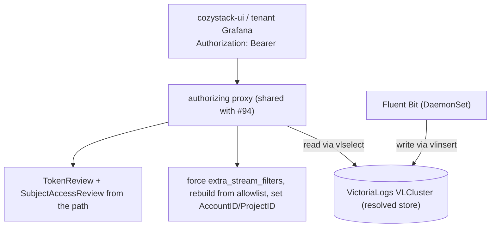

# Tenant application logs via the authorizing proxy

- **Title:** `Tenant application logs via the authorizing proxy`
- **Author(s):** `@IvanHunters`

## Overview

Clients running managed applications, databases, and VMs on Cozystack want to read their logs in the dashboard, including the logs of a pod or application that has already been deleted (post-mortem, for incident analysis), without opening Grafana and without deploying their own monitoring stack. The logs are collected into VictoriaLogs, but a tenant has no way to read them: the dashboard has no log viewer, and VictoriaLogs is reachable only through Grafana.

This proposal serves the logs read path from the **same stateless authorizing proxy as the metrics proposal (cozystack/community#94)**, in front of `vlselect`. The client sends LogsQL; the proxy validates the bearer token with a `TokenReview`, authorizes the request with a `SubjectAccessReview` against the Kubernetes resources we already have (`apps.cozystack.io` for one application, `cozystack.io` for a whole namespace), forces the tenant's scope into the query, and returns VictoriaLogs' native response unchanged (NDJSON on the streaming endpoints), flushing after every line on a live tail. There is no `cozystack-api` change, no new API group, and no Kubernetes envelope. Metrics live under the matching `.../metrics/` paths of #94.

An earlier draft of this proposal (in this same PR) served logs as a top-level `logs.cozystack.io` virtual resource from `cozystack-api`. That shape was chosen because logs must survive their parent and a subresource cannot. Now that metrics (#94) is a proxy rather than a subresource, that asymmetry is gone: post-mortem survival comes from the lineage labels in §6, not from the resource shape, so logs join metrics behind the proxy. The previous shapes are in Alternatives.

## Scope and related proposals

- **Companion to the metrics proposal** (cozystack/community#94). Both are read paths behind the same authorizing proxy and share the same paths, RBAC scheme, application-scope model, and store resolver.
- **Complements, does not replace, Grafana.** Grafana stays the place for deep log exploration; this serves an embedded per-resource / per-namespace log view for tenants who do not run their own Grafana.
- **Alert management is a separate proposal.** Deferred.
- **Depends on a separate Fluent Bit forgery fix.** The crafted-namespace forgery in §6 is live in cozystack today and deserves its own fix (a `Merge_Log_Key` change) independent of this proposal; Phase 1 depends on that fix having landed (see §6 and Rollout).
- **Broader monitoring and RBAC work, kept compatible but not solved here.** Where node-level data is scraped, which write-path control closes the shared-store trust gap, and how per-application grants are shipped are separate work; this proposal stays compatible with them without depending on their outcome.

## Prior art

- **The metrics proxy (cozystack/community#94).** The identity, RBAC, paths, application-scope, and store-resolution model are shared; read #94 for them. This proposal adds the logs read path to the same proxy.
- **VictoriaLogs query API.** `vlselect` serves LogsQL at `/select/logsql/{query,hits,stats_query_range,tail}` (and `field_values`, `stream_field_values`, `facets`), scoped by `extra_filters` / `extra_stream_filters` (ANDed and propagated into subqueries) and by `AccountID`/`ProjectID` headers for its account dimension. `tail` is live tailing.
- **Upstream `pods/log`.** The per-application log subresource mirrors upstream's `pods/log`, which the Kubernetes `view` role grants; escalating reads (`pods/exec`, `pods/attach`, `pods/portforward`, `secrets`) live at `edit`. Cozystack mirrors that split, with VM console and VNC at `use`.
- **cozystack log collection.** Fluent Bit collects container logs into VictoriaLogs; the `monitoring-agents` tenant-log-routing rule routes a namespace's logs to the owning `VLCluster` (a tenant other than the root target, otherwise `tenant-root`).

## Decisions

<!-- Filled in as implementation proceeds; records live under this
proposal's decisions/ directory, numbered from 0001, linked newest first.
Empty while the proposal is still intent. -->

## Context

- **Log store: VictoriaLogs.** The `packages/system/monitoring` chart deploys a `VLCluster` per `logsStorages` entry (default `generic`), at two levels through the same Monitoring chart: `tenant-root` hosts the platform store, and any tenant with `tenant.spec.monitoring: true` (default `false`) runs its own `VLCluster`. The read endpoint is `vlselect-<name>.<tenant-ns>.svc:9471`, queried at `/select/logsql/*`. VictoriaLogs multi-tenancy (`AccountID`/`ProjectID`) is not used today: everything is written at account/project 0.
- **Collection: Fluent Bit.** A Fluent Bit DaemonSet (`packages/system/monitoring-agents`) tails container logs, Kubernetes events, and kube audit logs. The stream fields it keeps are `log_source`, `stream`, `kubernetes_pod_name`, `kubernetes_container_name`, `kubernetes_namespace_name`; other Kubernetes metadata, including pod labels (so application identity), is stripped and does not reach VictoriaLogs. Guest Kubernetes clusters ship their container logs to the parent's `vlinsert` and set `kubernetes_namespace_name` from inside the guest.
- **Routing: logs are stored in the owning stack at collection.** Fluent Bit's tenant-log-routing rule sends a namespace's logs to the `VLCluster` of the tenant that owns its monitoring (the `namespace.cozystack.io/monitoring` value when it names a tenant other than the root target, otherwise `tenant-root`). So, unlike the resource metrics in #94, a tenant's own logs are already in its own stack when it runs one, and exactly one store answers for a namespace.
- **Tenant RBAC and OIDC groups.** The `cozy:tenant:{view,use,admin,super-admin}` ClusterRoles are bound per tenant namespace to `<tenant>-{view,use,admin,super-admin}` groups plus ancestor subjects. `cozy:tenant:view:base` grants `apps.cozystack.io` `resources: ["*"]`, and an RBAC resource wildcard also matches subresources. The group-based path relies on the management apiserver passing a flat OIDC `groups` claim without a prefix.
- **Dashboard.** `cozystack-ui` is a pure SPA (no BFF) that talks to the Kubernetes API through an in-pod nginx proxy. It has no log viewer today.

### The problem

- A tenant wants to read the logs of its database, VM, or app from the dashboard, including the logs of a pod that has already restarted or an application that was deleted during an incident. There is no log viewer and no endpoint the SPA could call.
- Telling the client to open Grafana does not work for clients who do not run their own Grafana or monitoring stack.
- Reaching `vlselect` directly from the SPA (for example via `services/<vlselect>/proxy`) is unsafe: coarse authz and no forced namespace scope, so against a shared store it reads every mapped namespace's logs.

## Goals

- A tenant can read the logs of a resource it owns, over a chosen time window, and follow them live, rendered in the dashboard, with the live tail surviving past 60 seconds.
- Logs of a deleted pod or application remain readable (post-mortem) within VictoriaLogs retention, through the namespace endpoint; the application endpoint additionally shows them once the §6 identity labels are present.
- A tenant can never read another namespace's logs, enforced server-side by a forced scope the client cannot override; a tenant holding a grant for a single application cannot read another application's logs in the same namespace through any endpoint.
- The dashboard consumes VictoriaLogs' native responses with a standard client, with no Kubernetes envelope around the stream.
- Minimal implementation: the same proxy as metrics, no `cozystack-api` change.

### Non-goals

- Not alerting on logs (separate proposal).
- Not a replacement for Grafana.
- Not metrics (the sibling proposal).
- Not logs for resources inside guest Kubernetes clusters (different authorization model); out of scope.

## Design

### 1. Shape and paths

The logs read path is served by the same stateless authorizing proxy as metrics (#94), in front of `vlselect`, on two Kubernetes-shaped roots with the VictoriaLogs API (`select/logsql/{query,hits,stats_query_range,tail}`, and the picker endpoints `field_values`, `stream_field_values`, `facets`) under each:

| Scope | Root served by the proxy |
| --- | --- |
| one application | `/apis/apps.cozystack.io/v1alpha1/namespaces/<ns>/<plural>/<name>/log/` |
| whole namespace | `/apis/cozystack.io/v1alpha1/namespaces/<ns>/logs/` |

- The **proxy**, not kube-apiserver, serves these paths. The dashboard's nginx needs a location for them ahead of `/apis`, with `proxy_buffering off` and the long timeouts the `/apis` watch location already uses; otherwise flush-per-line on `tail` will not reach the browser.
- The client sends LogsQL; the proxy adds the scope and returns VictoriaLogs' native response unchanged (`query` and `tail` stream JSON lines, `hits` a JSON object, `stats_query_range` a Prometheus-compatible matrix). On `tail` it flushes after every line.



### 2. Authorization

`TokenReview`, then one `SubjectAccessReview` whose attributes come from the path and not the HTTP method:

| Scope | SubjectAccessReview |
| --- | --- |
| one application | `verb=get`, `group=apps.cozystack.io`, `resource=<plural>`, `subresource=log`, `name=<name>`, `namespace=<ns>` |
| whole namespace | `verb=list`, `group=cozystack.io`, `resource=logs`, `namespace=<ns>` |

- The per-application subresource is `log`, mirroring upstream's `pods/log`. `get <plural>/log` matches the view role's `apps.cozystack.io` wildcard today, and narrows cleanly when an application package ships `resources: [postgreses/log]` (optionally limited by `resourceNames`), with no proxy change.
- The namespace-wide check needs one explicit rule for `logs` in `cozystack.io`, aggregated into `view`.
- **RBAC level: `view`.** Upstream grants `pods/log` at `view`; the escalating reads are at `edit`. Cozystack mirrors that, so log-read is at `view`, not `use`. The object does not have to exist; the review is by name, which is what makes post-mortem work.
- **The proxy's own permissions:** `create` on `tokenreviews` and `subjectaccessreviews`; `get`/`list` on ApplicationDefinitions (for the plural-to-Kind mapping of §3); read on namespaces (for store resolution).

### 3. Scope

Always:

```text
extra_stream_filters={kubernetes_namespace_name="<ns>"}
```

On the application root, the proxy additionally scopes to one application by its **identity labels** (the same labels as #94, `apps_cozystack_io_application_{group,kind,name}`, the lineage keys sanitized as kube-state-metrics sanitizes them), set on every line at collection time by §6:

```text
extra_stream_filters={apps_cozystack_io_application_kind="<Kind>",apps_cozystack_io_application_name="<name>"}
```

- Because the §6 identity labels and the application endpoint ship together (Phase 2), the application scope is a plain equality match, with no pod lookup. The identity fields are stream fields (added to `_stream_fields` in §6), so the scope uses `extra_stream_filters`, the same mechanism as the namespace scope and what VictoriaLogs indexes on. Lines from before Phase 2 do not carry the labels; they stay reachable through the namespace endpoint, which Goals and Failure cases treat as the fallback.
- `<plural>` must be a kind of `apps.cozystack.io`, `<name>` a DNS-1123 subdomain; values are quoted. Anything else is `400`. The proxy maps `<plural>` to the title-cased lineage `Kind` by reading the ApplicationDefinitions (the same mapping as #94), in one place, and uses the mapped value in `apps_cozystack_io_application_kind`, never the raw plural.
- The upstream request is built from scratch: only allowlisted parameters (`query`, `start`, `end`, `limit` (clamped), `step`, each picker endpoint's own parameters (`field` for `field_values` and `stream_field_values`, and the `facets` options), and on `tail` only `since` or `start_offset`, both capped) and no client headers. VictoriaLogs takes the tenant from `AccountID` / `ProjectID` headers; the proxy always sets them. Client `extra_filters` / `extra_stream_filters` are dropped. `/select/tenant_ids` and every non-allowlisted path are not proxied.
- **Bounded time window.** For `query`, `hits`, `stats_query_range`, and the picker endpoints the proxy requires or derives a finite `[start, end]` and clamps the maximum span; VictoriaLogs otherwise uses the oldest stored timestamp when `start` is omitted and would scan the whole retention. It also clamps `step` so that `hits` and `stats_query_range`, which return one bucket per `step`, cannot produce an unbounded number of buckets over the span (the same cap on points as #94). Inverted ranges are rejected with `400`. The `tail` resume cap (§5) is a separate bound.
- Queries using `options(ignore_global_time_filter=true)` are rejected, detected by a plain substring match on `ignore_global_time_filter` anywhere in `query`, subqueries included: it disables the time bounds the proxy relies on, and on `tail` it rescans the whole retention every tick.
- Platform sources are out of reach: kube-apiserver audit and Kubernetes events carry no `kubernetes_namespace_name` in the current pipeline, so the stream filter excludes them.

### 4. Store resolution

Resolve a namespace to its `VLCluster` with **exactly the rule the collector uses** (`monitoring-agents` tenant-log-routing: the `namespace.cozystack.io/monitoring` value names the owning store when it names a tenant other than the root target, otherwise `tenant-root`), ideally from one shared definition so reads and writes cannot disagree. Because logs are routed to the owning store at collection, a tenant with its own monitoring is served from its own stack today, and exactly one store answers. The "empty label" case practically never happens: `tenant-root`'s own value is hard-coded, so every namespace inherits a non-empty label. If the label changes during the retention window, records already written to the previous store are not copied, so routing should be treated as immutable for the retention period, or the proxy must keep routing history and query both stores (open question).

### 5. Live tail

- `tail` is VictoriaLogs live tailing with the scope applied. VictoriaLogs rejects pipes that compute stats, reorder, or drop lines; the proxy passes its `400` through.
- `tail` has no absolute start: it starts at `now - offset - start_offset`. To resume after a disconnect the client sends `since=<last _time>`; the proxy sets `start_offset = (now - offset) - since`, capped (proposed: 15 min). A reconnect later than the cap resumes at the cap, not at `since`: the older gap is not replayed on `tail` and needs a separate historical `query`. Client `start`/`end` on `tail` are ANDed into each tick as usual.
- Lines around the resume point may repeat. Delivery is at-least-once; VictoriaLogs does not define `(_stream_id, _time)` as a per-entry identity (entries in one stream can share a `_time`), so a client dedup on that pair is best-effort at the boundary, not a uniqueness guarantee. Queries whose pipes drop these fields (`fields`, `delete`) get no deduplication at all.
- `tail` goes through the proxy only, so there is no request-timeout cut. The proxy caps open tails per user and in total and closes a tail after a configurable idle period.

### 6. Application identity at collection (collection change)

Fluent Bit keeps the lineage labels `apps.cozystack.io/application.{group,kind,name}` as `apps_cozystack_io_application_{group,kind,name}` (a second `nest` lift on `kubernetes_labels`, renamed before `Remove_wildcard kubernetes_`, like the three kept fields today) and adds them to `_stream_fields`. These give the application scope of §3 its labels, with the same names as #94. The lineage webhook sets the labels on pods whose owning application it resolves. This is the Phase 2 collection change.

**Related forgery fix, shipped separately.** `Merge_Log On` with no `Merge_Log_Key` lets a pod's own JSON log line add top-level keys to the record: a line such as `{"kubernetes":{"namespace_name":"<other>"}}` yields a second `kubernetes` map that the `nest` lift lifts next to the real one, so a forged `kubernetes_namespace_name` can route a line into another tenant's store that that tenant's Grafana already shows today. The same way, a line setting `kubernetes.labels` could forge another application's identity labels, so this fix also protects the application scope above. This is live in cozystack independent of this proposal, so it deserves its own fix: set `Merge_Log_Key` (for example `Merge_Log_Key log_processed`) so a parsed line lands under one key and cannot add top-level keys. That fix carries a breaking field-schema note: fields of JSON log lines searched at the top level today (for example `level`) become `log_processed.<field>`; in-repo charts do not read them, but any external dashboard or LogsQL query that does must migrate to `log_processed.<field>`. Phase 1 of this proposal depends on that fix having landed; a test asserts a crafted line cannot appear under another namespace.

## User-facing changes

- **Dashboard:** a log view on application / database / VM detail pages (application root) and a namespace-level log view (namespace root), with follow (live tail), rendered from VictoriaLogs' native responses. A pod and container picker uses the `field_values` / `stream_field_values` / `facets` endpoints under the same scope. This is the first log viewer in `cozystack-ui`.
- **API:** the same proxy as metrics, under the `log/` and `logs/` roots; no `kubectl get --raw` and no new served API group.
- **RBAC:** one aggregated rule (`list logs` in `cozystack.io`) for the namespace scope at `view`; the per-application scope rides the existing `apps.cozystack.io` grant.

## Upgrade and rollback compatibility

- Additive: proxy endpoints, one aggregated ClusterRole rule, and (in Phase 2) a Fluent Bit configuration change for the lineage labels. `cozystack-api` is untouched; no new served API group.
- The separate `Merge_Log_Key` fix (§6) moves parsed JSON-log fields under `log_processed`; in-repo charts do not read them, but any external dashboard or LogsQL query reading a top-level JSON field (for example `level`) is a breaking field-schema change and needs migration to `log_processed.<field>`.
- Rollback: remove the proxy endpoints and the rule; revert the Phase 2 Fluent Bit change. The dashboard degrades to "no logs" (today's state).

## Security

- **Forced namespace scope** (`extra_stream_filters={kubernetes_namespace_name="<ns>"}`) is the baseline isolation hinge, injected server-side with the upstream request rebuilt from an allowlist (client `extra_filters`/`extra_stream_filters`, `AccountID`/`ProjectID` headers, and non-allowlisted paths are dropped). The application endpoint is an isolation boundary for a `resourceNames`-narrowed grant: such a user cannot read another application's logs in the same namespace through any endpoint, including the picker endpoints. A test asserts it.
- **Write-path trust.** Guest Kubernetes clusters ship to the parent's `vlinsert` without authentication and set `kubernetes_namespace_name` from inside the guest, so a guest can write lines labelled with another namespace. A guest writes only into its own tenant's owning store, so a forged line can only surface under namespaces that share that store. The namespace scope keeps reads isolated but does not prove origin; the fix is a write-path control chosen in the broader work (Open questions), and exposure timing is a rollout decision, not a dependency of this design.
- **The separate forgery fix (§6)** closes the crafted-`kubernetes_namespace_name` vector; Phase 1 depends on it.
- **Platform logs** (audit, events) carry no `kubernetes_namespace_name`, so the stream filter excludes them from tenant reads.
- **Why not `services/proxy` to `vlselect`:** coarse authz, no forced scope.
- **OIDC prerequisite:** the group-based authorization path requires the flat `groups` claim without a prefix, as the existing tenant RBAC does.

## Failure and edge cases

- Namespace resolves to its owning store (§4); the "empty label" no-store case practically never happens.
- Target resource deleted: logs still stream (post-mortem) within retention; the SAR passes on permission, not existence. The application endpoint selects by the §6 identity labels; for lines predating those labels it falls back to the namespace endpoint.
- Caller lacks the permission for the requested scope: 403 before any query.
- Client tries to drop or widen the scope (`extra_filters`, `extra_stream_filters`, `AccountID` header, a `| union` / `:in(...)` subquery, `options(ignore_global_time_filter=true)`): impossible; the request is rebuilt from an allowlist and such queries are rejected.
- Range, or a `tail` resume older than the cap: clamped or rejected; the older gap needs a separate historical `query`.
- `vlselect` unreachable: a backend error distinct from "no logs".

## Testing

- A `tail` stream outlives 60 s end to end.
- A client `extra_filters`, an `AccountID` header, a `| union` / `:in(...)` subquery, or `options(ignore_global_time_filter=true)` cannot return lines outside the scope.
- A user holding only a grant for one application (via `resourceNames`) cannot read another application's logs in the same namespace through `query`, the picker endpoints, or `tail`.
- A `<name>` with LogsQL metacharacters is rejected with `400`.
- Logs of a deleted application, and of a restarted pod, are readable through the application endpoint once the §6 labels are present, and through the namespace endpoint otherwise.
- A query with an omitted, over-wide, or inverted `start`/`end` is clamped or rejected rather than scanning the whole retention.
- Resume with `since` within the cap returns the lines after the cut; a resume older than the cap starts at the cap and does not replay the older gap.

## Rollout

- **Phase 1: the proxy endpoints (namespace scope) and the RBAC rule.** Serve the two roots on the shared proxy with the forced `extra_stream_filters`, and ship the aggregated `list logs` rule at `view`. This phase depends on the separate `Merge_Log_Key` forgery fix (§6) having landed. The guest-cluster write-path risk is documented; the go/no-go on exposing before that control lands is decided here, not gated by this design.
- **Phase 2: the collection change (§6) and the application scope.** The Fluent Bit `apps_cozystack_io_application_*` labels and the `/apis/apps.cozystack.io/.../<plural>/<name>/log/` root.
- **Phase 3: the dashboard log viewer** with live tail and the pod/container picker.

## Open questions

- **Which write-path control** closes the shared-store trust gap (shared with #94); part of the broader work.
- **Guest clusters (Kamaji)** are out of scope; a dedicated follow-up can address guest-internal logs.

## Alternatives considered

- **A top-level `logs.cozystack.io` resource in `cozystack-api`** (the previous draft in this PR). `get`/`list` with `follow` is not long-running on kube-apiserver (which decides by verb and by subresource name only) and is cut at `--request-timeout`; every `cozystack-api` rollout cuts all open streams, and it rolls out on each `ApplicationDefinition` change; it needs two authorization gates and a scheme-aware parameter codec. Post-mortem reads come from the collection change (§6) instead of the resource shape, so the proxy loses nothing by not being a resource.
- **A `log` subresource per application kind in `cozystack-api`.** A subresource named `log` is long-running by name, so `follow` survives kube-apiserver, but it keeps the rollout and shared-failure-domain costs and makes LogsQL part of the permanent `apps.cozystack.io` contract.
- **A deep link to Grafana / the VictoriaLogs UI.** Low effort and good for clients who already run Grafana, but rejected as the primary because the target audience is clients who do not; worth shipping as a complementary convenience.
- **VictoriaLogs native multitenancy (`AccountID`/`ProjectID`).** Could isolate tenants inside one store, but cozystack writes everything at account 0 and isolates by separate stores plus namespace, so adopting it is a larger change to the whole logging pipeline; out of scope.

---

<!--
Inspired by KubeVirt enhancement proposals
(https://github.com/kubevirt/enhancements) and Kubernetes Enhancement
Proposals (KEPs).
-->
