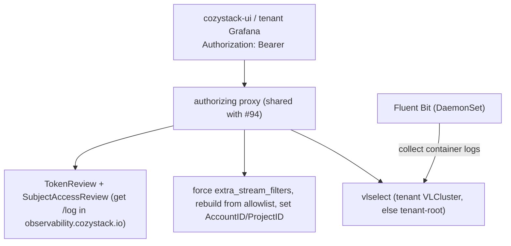

# Tenant application logs via the authorizing proxy

- **Title:** `Tenant application logs via the authorizing proxy`
- **Author(s):** `@IvanHunters`
- **Date:** `2026-10-22`
- **Status:** Review

## Overview

Clients running managed applications, databases, and VMs on Cozystack want to read their logs in the dashboard, including the logs of a pod or application that has already been deleted (post-mortem, for incident analysis), without opening Grafana and without deploying their own monitoring stack. The logs are collected into VictoriaLogs, but a tenant has no way to read them: the dashboard has no log viewer, and VictoriaLogs is reachable only through Grafana.

This proposal serves the logs read path from the **same stateless authorizing proxy as the metrics proposal (cozystack/community#94)**, in front of `vlselect`. The client sends LogsQL; the proxy validates the bearer token with a `TokenReview`, authorizes the namespace with a `SubjectAccessReview` against the same `observability.cozystack.io` virtual group (a `*/log` subresource), forces the tenant's scope into the query, and returns VictoriaLogs' native response unchanged (NDJSON on the streaming endpoints), flushing after every line on a live tail. There is no `cozystack-api` change, no new API group served, and no Kubernetes envelope. Metrics live under the sibling `.../metrics/api/v1/...` prefix of the same scope.

An earlier draft of this proposal (in this same PR) served logs as a top-level `logs.cozystack.io` virtual resource from `cozystack-api`. That shape was chosen because logs must survive their parent and a subresource cannot. Now that metrics (#94) is a proxy rather than a subresource, that asymmetry is gone: post-mortem survival comes from the collection change in §6, not from the resource shape, so logs join metrics behind the proxy. The previous shapes are in Alternatives.

## Scope and related proposals

- **Companion to the metrics proposal** (cozystack/community#94). Both are read paths behind the same authorizing proxy and the same `observability.cozystack.io` group (`*/metrics` and `*/log`), with the same identity, RBAC, and application-scope model.
- **Complements, does not replace, Grafana.** Grafana stays the place for deep log exploration; this serves an embedded per-resource / per-namespace log view for tenants who do not run their own Grafana.
- **Alert management is a separate proposal.** Deferred.
- **Includes a collection change.** Unlike the earlier draft, this proposal changes Fluent Bit so logs carry application identity and so a crafted log line cannot forge its namespace (see §6); it is in scope here.

## Prior art

- **The metrics proxy (cozystack/community#94).** The identity, RBAC, virtual-resource, application-scope, and store-resolution model are shared; read #94 for them. This proposal adds the logs read path to the same proxy.
- **VictoriaLogs query API.** `vlselect` serves LogsQL at `/select/logsql/{query,hits,stats_query_range,tail}`, scoped by `extra_filters` / `extra_stream_filters` (ANDed and propagated into subqueries) and by `AccountID`/`ProjectID` headers for its account dimension. `tail` is live tailing.
- **cozystack log collection.** Fluent Bit collects container logs into VictoriaLogs; the `namespace.cozystack.io/monitoring` label routes a namespace's logs to the owning `VLCluster` (the tenant's own, else `tenant-root`).

## Decisions

<!-- Filled in as implementation proceeds; records live under this
proposal's decisions/ directory, numbered from 0001, linked newest first.
Empty while the proposal is still intent. -->

## Context

- **Log store: VictoriaLogs.** The `packages/system/monitoring` chart deploys a `VLCluster` per `logsStorages` entry (default `generic`), at two levels through the same Monitoring chart: `tenant-root` hosts the platform store, and any tenant with `tenant.spec.monitoring: true` (default `false`) runs its own `VLCluster`. The read endpoint is `vlselect-<name>.<tenant-ns>.svc:9471`, queried at `/select/logsql/*`. VictoriaLogs multi-tenancy (`AccountID`/`ProjectID`) is not used today: everything is written at account/project 0.
- **Collection: Fluent Bit.** A Fluent Bit DaemonSet (`packages/system/monitoring-agents`) tails container logs, Kubernetes events, and kube audit logs. The stream fields it keeps are `log_source`, `stream`, `kubernetes_pod_name`, `kubernetes_container_name`, `kubernetes_namespace_name`; other Kubernetes metadata, including pod labels (so application identity), is stripped and does not reach VictoriaLogs. Guest Kubernetes clusters ship their container logs to the parent's `vlinsert` and set `kubernetes_namespace_name` from inside the guest.
- **Tenancy model (shared with metrics).** Routing follows the `namespace.cozystack.io/monitoring` label: Fluent Bit routes a namespace's logs to the `VLCluster` of the nearest ancestor that has its own monitoring (the tenant itself when it does), and to `tenant-root` otherwise. Within one `VLCluster` the logs of all mapped namespaces sit together, distinguished by the `kubernetes_namespace_name` stream field.
- **Tenant RBAC and OIDC groups (shared with metrics).** Four aggregated ClusterRoles `cozy:tenant:{view,use,admin,super-admin}` are bound per tenant namespace to `<tenant>-{view,use,admin,super-admin}` groups plus ancestor subjects. The `apps.cozystack.io` grant in these roles is a resource wildcard, which also matches subresources, so `<plural>/logs` in `apps.cozystack.io` cannot gate log-read; a separate group is needed.
- **Dashboard.** `cozystack-ui` is a pure SPA (no BFF) that talks to the Kubernetes API through an in-pod nginx proxy. It has no log viewer today.

### The problem

- A tenant wants to read the logs of its database, VM, or app from the dashboard, including the logs of a pod that has already restarted or an application that was deleted during an incident. There is no log viewer and no endpoint the SPA could call.
- Telling the client to open Grafana does not work for clients who do not run their own Grafana or monitoring stack.
- Reaching `vlselect` directly from the SPA (for example via `services/<vlselect>/proxy`) is unsafe: coarse authz and no forced namespace scope, so against a shared store it reads every mapped namespace's logs.

## Goals

- A tenant can read the logs of a resource it owns, over a chosen time window, and follow them live, rendered in the dashboard, with the live tail surviving past 60 seconds.
- Logs of a deleted pod or application remain readable (post-mortem) as long as they are within VictoriaLogs retention, through the namespace endpoint; application-scoped post-mortem additionally needs the §6 lineage labels or a resolvable pod, so for windows older than metrics retention and predating §6 it falls back to the namespace endpoint.
- A tenant can never read another namespace's logs, enforced server-side by a forced scope the client cannot override.
- The dashboard consumes VictoriaLogs' native responses with a standard client, with no Kubernetes envelope around the stream.
- Minimal implementation: the same proxy as metrics, no `cozystack-api` change.

### Non-goals

- Not alerting on logs (separate proposal).
- Not a replacement for Grafana.
- Not metrics (the sibling proposal).
- Not logs for resources inside guest Kubernetes clusters (different authorization model); out of scope.

## Design

### 1. Shape: the read path behind the authorizing proxy

The logs read path is served by the same stateless authorizing proxy as metrics (#94), in front of `vlselect`:

```text
GET /namespaces/<ns>/log/select/logsql/{query,hits,stats_query_range,tail}
GET /namespaces/<ns>/<plural>/<name>/log/select/logsql/{query,hits,stats_query_range,tail}
```

The client sends LogsQL; the proxy adds the scope and returns VictoriaLogs' native response unchanged, with each endpoint's own content type: `query` and `tail` stream JSON lines, `hits` returns a JSON object, and `stats_query_range` returns Prometheus-compatible matrix JSON. On `tail` the proxy flushes after every line. No `cozystack-api` change, no new API group served, no Kubernetes envelope. Metrics live under the sibling prefix `.../metrics/api/v1/...` of the same scope.



### 2. Authorization

`TokenReview`, then one `SubjectAccessReview` (`verb=get`, `group=observability.cozystack.io`), the same group as #94:

| Request | SubjectAccessReview |
| --- | --- |
| `/namespaces/<ns>/log/...` | `resource=namespaces`, `subresource=log`, `name=<ns>`, `namespace=<ns>` |
| `/namespaces/<ns>/<plural>/<name>/log/...` | `resource=<plural>`, `subresource=log`, `name=<name>`, `namespace=<ns>` |

The group is virtual: it exists only in RBAC and in the review; nothing is registered in the Kubernetes API. It replaces the two gates of the earlier draft: `cozy:tenant:view:base` grants `apps.cozystack.io` `resources: ["*"]`, which also matches subresources, so a check on `<plural>/logs` in `apps.cozystack.io` is always allowed for `view` and cannot gate log-read.

Proposed default, by analogy with `virtualmachineinstances/console` and `/vnc`, which Cozystack grants at `use`:

```yaml
- apiGroups: [observability.cozystack.io]
  resources: ["*/log"]
  verbs: [get]
# in a ClusterRole labelled rbac.cozystack.io/aggregate-to-tenant-use
```

Logs can carry credentials (connection strings, failed-auth lines), and `cozy:tenant:view` does not grant `pods/log` today, so log-read defaults to `use`. Moving it to `view` is a one-line change if maintainers prefer it. The object does not have to exist; the review is by name, which is what makes post-mortem work.

### 3. Scope

Always:

```text
extra_stream_filters={kubernetes_namespace_name="<ns>"}
```

Application scope adds, per non-empty branch:

```text
extra_filters=(cozystack_app_kind:=<Kind> cozystack_app_name:=<name>) or kubernetes_pod_name:in(<pods>)
```

- `<pods>` are the application's pods over the request window, from the label values API on `kube_pod_labels` (same lookup as the metrics application scope), capped. The pod branch covers lines collected before the §6 change; an empty list is omitted.
- The `<pods>` lookup reads `tenant-root`'s VictoriaMetrics even when the logs live in a tenant `VLCluster`; for windows beyond metrics retention only the `cozystack_app_*` branch applies. So application-scoped post-mortem has a bounded reach: a line written before the §6 labels existed and older than metrics retention carries neither `cozystack_app_*` nor a resolvable pod, and the application endpoint cannot select it. Such lines stay reachable through the namespace endpoint; the post-mortem guarantee is narrowed accordingly (see Goals and Failure cases).
- `<plural>` must be a kind of `apps.cozystack.io`, `<name>` a DNS-1123 subdomain; values are quoted. Anything else is `400`. The proxy maps `<plural>` to the lineage `Kind` by reading the ApplicationDefinitions (the same mapping as #94's application scope) and uses the mapped value in `cozystack_app_kind`, never the raw plural.
- The upstream request is built from scratch: only allowlisted parameters (`query`, `start`, `end`, `limit` (clamped), `step`, and on `tail` only `since` or `start_offset`, both capped) and no client headers. VictoriaLogs takes the tenant from `AccountID` / `ProjectID` headers; the proxy always sets them. Client `extra_filters` / `extra_stream_filters` are dropped. `/select/tenant_ids` and every non-allowlisted path are not proxied.
- **Bounded time window.** For `query`, `hits`, and `stats_query_range` the proxy requires or derives a finite `[start, end]` and clamps the maximum span; VictoriaLogs otherwise uses the oldest stored timestamp when `start` is omitted and would scan the whole retention. Inverted ranges are rejected with `400`. The `tail` resume cap (§5) is a separate bound and does not restrict a client's `start`/`end` on the other endpoints.
- Queries using `options(ignore_global_time_filter=true)` are rejected, detected by a plain substring match on `ignore_global_time_filter` anywhere in `query`, subqueries included: it disables the time bounds the proxy relies on, and on `tail` it rescans the whole retention every tick.
- Platform sources are out of reach: kube-apiserver audit and Kubernetes events carry no `kubernetes_namespace_name` in the current pipeline, so the stream filter excludes them.

### 4. Store resolution

As in #94: `namespace.cozystack.io/monitoring` names the `VLCluster`; empty means `tenant-root`. Logs of a tenant with its own monitoring are moved there, not copied, so exactly one store answers. If the label changes during the retention window, records already written to the previous `VLCluster` are not copied, so logs from before the change are not visible through the new store; routing should be treated as immutable for the retention period, or the proxy must keep routing history and query both stores (open question).

### 5. Live tail

- `tail` is VictoriaLogs live tailing with the scope applied. VictoriaLogs rejects pipes that compute stats, reorder, or drop lines; the proxy passes its `400` through.
- `tail` has no absolute start: it starts at `now - offset - start_offset`. To resume after a disconnect the client sends `since=<last _time>`; the proxy sets `start_offset = (now - offset) - since`, capped (proposed: 15 min). A reconnect later than the cap resumes at the cap, not at `since`: the older gap is not replayed on `tail` and needs a separate historical `query`. The proxy does not promise gap-free resume beyond the cap. Client `start`/`end` on `tail` are ANDed into each tick as usual.
- Lines around the resume point may repeat. Delivery is at-least-once; VictoriaLogs does not define `(_stream_id, _time)` as a per-entry identity (entries in one stream can share a `_time`), so a client dedup on that pair is best-effort at the boundary, not a uniqueness guarantee, and a stable per-entry cursor is needed if exactly-once matters. Queries whose pipes drop these fields (`fields`, `delete`) get no deduplication at all.
- `tail` goes through the proxy only, so there is no request-timeout cut. The proxy caps open tails per user and in total and closes a tail after a configurable idle period.

### 6. Filtering to an application, and the write-path hardening (collection change)

Fluent Bit keeps the lineage labels `apps.cozystack.io/application.{group,kind,name}` as `cozystack_app_group`, `cozystack_app_kind`, `cozystack_app_name` (a second `nest` lift on `kubernetes_labels`, renamed before `Remove_wildcard kubernetes_`, like the three kept fields today) and adds them to `_stream_fields`. These give the application scope of §3 its labels. The webhook sets these labels on pods whose owning application it resolves.

**Hardening.** `Merge_Log On` adds the JSON keys of an application's own log line to the top level of the record, ahead of the filter's own `kubernetes` map and without deduplication. A line such as `{"kubernetes":{"namespace_name":"<other>"}}` therefore yields a second `kubernetes` map; the `nest` lift lifts every map under that key, so a forged `kubernetes_namespace_name` (and `kubernetes_labels`) sits next to the real one, first, and `rewrite_tag` routes on it. `log_source`, `tenant`, and `cluster` can be forged the same way, since `Add` never overwrites. Set `Merge_Log_Key` (for example `Merge_Log_Key log_processed`) so a parsed line lands under one key and cannot add top-level keys; this also covers `K8S-Logging.Parser`. This hardening is a read-isolation prerequisite and lands in Phase 1, before the proxy is exposed; it does not depend on the lineage labels or the application scope (which are Phase 2), because without it any pod can forge `kubernetes_namespace_name` and surface in another namespace's view that Phase 1 already serves. Trade-off, a breaking field-schema change: fields of JSON log lines searched at the top level today (for example `level`) become `log_processed.<field>` in VictoriaLogs; in-repo charts do not read them, but any external dashboard or LogsQL query that reads a top-level field must move to `log_processed.<field>` or run a dual-read during migration. A test asserts that a crafted line cannot appear under another namespace or application.

## User-facing changes

- **Dashboard:** a log view on application / database / VM detail pages (application scope) and a namespace-level log view, with follow (live tail), rendered from VictoriaLogs' native responses. This is the first log viewer in `cozystack-ui`.
- **API:** the same proxy as metrics, under the `log/` prefix; no `kubectl get --raw` and no new served API group.
- **RBAC:** one aggregated rule (`*/log` in `observability.cozystack.io`) at `use`, reaching tenant groups automatically.

## Upgrade and rollback compatibility

- Additive: proxy endpoints, one aggregated ClusterRole rule, and a Fluent Bit configuration change. `cozystack-api` is untouched; no new served API group.
- The collection change (§6) moves parsed JSON-log fields under `log_processed`; in-repo charts and queries do not read them, but any external dashboard or LogsQL query reading a top-level JSON field (for example `level`) is a breaking field-schema change and needs migration to `log_processed.<field>` (see §6).
- Rollback: remove the proxy endpoints and the rule; revert the Fluent Bit change. The dashboard degrades to "no logs" (today's state).

## Security

- **Forced namespace scope** (`extra_stream_filters={kubernetes_namespace_name="<ns>"}`) is the isolation hinge, injected server-side with the upstream request rebuilt from an allowlist (client `extra_filters`/`extra_stream_filters`, `AccountID`/`ProjectID` headers, and non-allowlisted paths are dropped).
- **Write-path trust.** Guest Kubernetes clusters ship to the parent's `vlinsert` without authentication and set `kubernetes_namespace_name` from inside the guest. The namespace scope keeps reads isolated, but it does not prove where a line came from: a guest cluster can write lines that show up under another namespace. Same class as the write-path gap in #94; the fix is on the write path, and it gates proxy exposure.
- **Crafted log lines** cannot forge their namespace once `Merge_Log_Key` is set (§6); a test asserts it.
- **Platform logs** (audit, events) carry no `kubernetes_namespace_name`, so the stream filter excludes them from tenant reads.
- **Why not `services/proxy` to `vlselect`:** coarse authz, no forced scope.

## Failure and edge cases

- Namespace has no dedicated store (empty label): resolves to `tenant-root` where the logs are; the common case, not a failure.
- Target resource deleted: logs still stream (post-mortem) within retention; the SAR passes on permission, not existence; the application scope matches by `cozystack_app_*` labels and the earlier pods' names. For a window older than metrics retention and predating the §6 labels, the application endpoint cannot select those lines, but the namespace endpoint still returns them.
- Caller lacks `get <res>/log` in `observability.cozystack.io`: 403 before any query.
- Client tries to drop or widen the scope (`extra_filters`, `extra_stream_filters`, `AccountID` header, a `| union` / `:in(...)` subquery, `options(ignore_global_time_filter=true)`): impossible; the request is rebuilt from an allowlist and such queries are rejected.
- `tail` resume with `since`: returns the lines after the cut, with duplicates only at the boundary.
- `vlselect` unreachable: a backend error distinct from "no logs".

## Testing

- A `tail` stream outlives 60 s end to end.
- A client `extra_filters`, an `AccountID` header, a `| union` / `:in(...)` subquery, or `options(ignore_global_time_filter=true)` cannot return lines outside the scope.
- A `<name>` with LogsQL metacharacters is rejected with `400`.
- A crafted JSON line from a host pod carrying another namespace's `kubernetes_namespace_name` does not show up under that namespace.
- Logs of a deleted application, and of a restarted pod, are readable through the application scope within retention.
- A query with an omitted, over-wide, or inverted `start`/`end` is clamped or rejected rather than scanning the whole retention.
- Resume with `since` within the cap returns the lines after the cut, with duplicates only at the boundary; a resume older than the cap starts at the cap and does not replay the older gap.

## Rollout

- **Phase 1: the proxy endpoints (namespace scope), the RBAC rule, and the `Merge_Log_Key` hardening.** Serve `/namespaces/<ns>/log/...` on the shared proxy with the forced `extra_stream_filters`, ship the aggregated `*/log` rule at `use`, and set `Merge_Log_Key` in Fluent Bit before exposing the proxy. `Merge_Log_Key` is a read-isolation prerequisite (without it a crafted line forges `kubernetes_namespace_name` and surfaces in another namespace's view) and depends on neither the lineage labels nor the application scope, so it belongs here, not in Phase 2. Land the guest-cluster write-path control in the same phase.
- **Phase 2: the lineage labels (§6) and the application scope.** The Fluent Bit `cozystack_app_*` labels and the `/namespaces/<ns>/<plural>/<name>/log/...` endpoints.
- **Phase 3: the dashboard log viewer** with live tail.

## Open questions

- **Log-read RBAC level:** proposed `use` (logs can carry credentials); `view` is a one-line change if maintainers prefer it.
- **Which write-path control** closes the shared-store trust gap (shared with #94).
- **Guest clusters (Kamaji)** are out of scope; a dedicated follow-up can address guest-internal logs.

## Alternatives considered

- **A top-level `logs.cozystack.io` resource in `cozystack-api`** (the previous draft in this PR). `get`/`list` with `follow` is not long-running on kube-apiserver (which decides by verb and by subresource name only) and is cut at `--request-timeout`; every `cozystack-api` rollout cuts all open streams, and it rolls out on each `ApplicationDefinition` change; it needs two authorization gates and a scheme-aware parameter codec. Post-mortem reads come from the collection change (§6) instead of the resource shape, so the proxy loses nothing by not being a resource.
- **A `log` subresource per application kind in `cozystack-api`.** A subresource named `log` is long-running by name, so `follow` survives kube-apiserver, but it keeps the rollout and shared-failure-domain costs and makes LogsQL part of the permanent `apps.cozystack.io` contract.
- **A deep link to Grafana / the VictoriaLogs UI.** Low effort and good for clients who already run Grafana, but rejected as the primary because the target audience is clients who do not; worth shipping as a complementary convenience.
- **VictoriaLogs native multitenancy (`AccountID`/`ProjectID`).** Could isolate tenants inside one store, but cozystack writes everything at account 0 and isolates by separate stores plus namespace, so adopting it is a larger change to the whole logging pipeline; out of scope.

---

<!--
Inspired by KubeVirt enhancement proposals
(https://github.com/kubevirt/enhancements) and Kubernetes Enhancement
Proposals (KEPs).
-->
