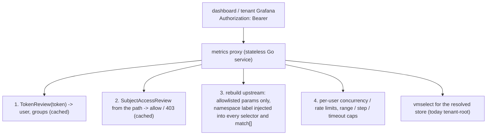

# Tenant resource-consumption metrics via an authorizing proxy

- **Title:** `Tenant resource-consumption metrics via an authorizing proxy`
- **Author(s):** `@IvanHunters`

## Overview

Clients running managed databases and VMs on Cozystack want to see their own real consumption (CPU, memory, network) directly in the dashboard, without opening Grafana and without deploying their own per-tenant monitoring stack. The data already lives in VictoriaMetrics, but a tenant has no way to read it: the dashboard is a pure SPA, there is no per-tenant query path into VictoriaMetrics, and a VM or database detail page shows status and controls but no consumption graph over time. The requirement that makes this a platform feature is that **Kubernetes identity and RBAC** decide who may read which tenant's metrics: the same tokens, the same tenant groups, the same view < use < admin rollup, the same ancestor access.

That requirement is about authentication and authorization, not about routing query traffic through the control plane. This proposal puts a **small stateless authorizing proxy in front of `vmselect`**. The proxy validates the bearer token the dashboard already holds with a `TokenReview`, authorizes the request with a `SubjectAccessReview` against the Kubernetes resources we already have (`apps.cozystack.io` for one application, `cozystack.io` for a whole namespace), forces the tenant's `namespace` label into every selector of the query, and reverse-proxies the native Prometheus request to `vmselect`, returning the Prometheus JSON unchanged. Identity and policy stay Kubernetes; only the query bytes stay out of the API server. It also serves an optional per-application scope so an application page shows only that application's series. The logs read path (cozystack/community#95) sits behind the same proxy with the matching paths.

An earlier draft of this proposal (in this same PR) routed metrics through `cozystack-api`, first as a standalone `metrics.cozystack.io` API server with a `MetricQuery` kind, then as a `metrics` subresource on `apps.cozystack.io`. Both are now in Alternatives with the reasons the proxy is preferred.

## Scope and related proposals

- **Companion to the logs (cozystack/community#95) and alerts (#96) proposals.** Metrics and logs are read paths behind the same authorizing proxy and share the same paths and RBAC scheme; alert management is read-write CRUD and stays a Kubernetes resource.
- **Complements, does not replace, Grafana.** Grafana stays the place for deep exploration; this serves embedded, basic per-resource graphs for tenants who do not run their own Grafana.
- **Billing is out of scope.** This exposes measured consumption for graphs; it does not meter, price, or produce invoices.
- **Broader monitoring and RBAC work, kept compatible but not solved here.** Where node-level series are scraped and how they reach per-tenant stacks, how application identity ends up on series, who may write into which store, and how per-application grants are shipped are separate work on the monitoring stack and RBAC. This proposal stays compatible with them (see the resolver in Design 5, the identity labels in 4a, and the write-path risk in 6) without depending on their outcome.

## Prior art

- **`kube-rbac-proxy` (identity and RBAC).** A small proxy that authenticates a request with `TokenReview` and authorizes it with `SubjectAccessReview` against a configured resource attribute, then forwards it. It is the "ask Kubernetes who you are and whether you may" step, with no API server of its own.
- **`prom-label-proxy` (single-label enforcement).** A proxy that injects one mandatory label matcher into a Prometheus/VictoriaMetrics request and rejects attempts to override it. It enforces a single label and retains other request parameters, so it does not cover the OR-of-branches of the application scope nor the parameter stripping below; those need the Go service.
- **OpenShift per-project metrics.** OpenShift serves per-namespace metrics to users holding the project `view` role through this same pattern (an authorizing proxy enforcing a namespace label), rather than a Kubernetes aggregated API. This is the deployed precedent the proposal follows.
- **cozystack tenant RBAC.** The tenant chart binds aggregated ClusterRoles `cozy:tenant:{view,use,admin,super-admin}` (labels `rbac.cozystack.io/aggregate-to-tenant-<level>`) to the `<tenant>-<level>` Keycloak groups and ancestor subjects. A new aggregated rule reaches those groups with no tenant-chart change; `backup-controller` ships such tenant ClusterRoles the same way.

## Decisions

<!-- Filled in as implementation proceeds; records live under this
proposal's decisions/ directory, numbered from 0001, linked newest first.
Empty while the proposal is still intent. -->

## Context

- **Metrics stack: VictoriaMetrics.** A cluster-wide `vmagent` (`selectAllByDefault: true`) scrapes cAdvisor, kubelet, node-exporter, kube-state-metrics, and the control plane, remote-writing to the `tenant-root` VMCluster by default. Each VMCluster exposes a Prometheus-compatible read API at `vmselect-<name>.<ns>.svc:8481/select/0/prometheus/`.
- **Where the resource metrics live today: `tenant-root`.** The series these graphs need (cAdvisor, kube-state-metrics, `kubevirt_vmi_*`) come from node-level, cluster-wide scrapes that remote-write to `tenant-root`. A tenant with its own monitoring (`tenant.spec.monitoring: true`, default `false`) runs a `vmagent` with `selectAllByDefault: false` that scrapes only the app scrape objects in namespaces pointing at it, so its own store does **not** hold cAdvisor/KSM/`kubevirt_vmi_*` today. Giving per-tenant stacks these series is part of the broader work; until then the resolver in Design 5 points every namespace at `tenant-root`.
- **Tenant RBAC and OIDC groups.** The `cozy:tenant:{view,use,admin,super-admin}` ClusterRoles are bound per tenant namespace to `kind: Group` subjects `<tenant>-{view,use,admin,super-admin}` (from the Keycloak operator) plus ancestor subjects, with the view < use < admin < super-admin rollup. `cozy:tenant:view:base` grants `apps.cozystack.io` `resources: ["*"]`, and an RBAC resource wildcard also matches subresources. The group-based path relies on the management apiserver passing a flat OIDC `groups` claim without a prefix.
- **Dashboard.** `cozystack-ui` is a pure SPA (no BFF): an in-pod nginx proxies `/api`, `/apis`, `/k8s` to `kubernetes.default.svc`, with oauth2-proxy (OIDC) or a built-in token-proxy (non-OIDC) in front. There is no charting library, no Prometheus proxy, and no Grafana embed in the bundle.

### The problem

- A tenant opens a database or VM page and wants "how much CPU / RAM / network has this been using". There is no such graph and no endpoint the SPA could call to build one.
- Telling the client to open Grafana does not work for the target audience: clients who do not run their own Grafana and should not have to deploy and pay for a full monitoring stack just to read basic usage.
- Reaching `vmselect` directly from the SPA (for example via the kube-apiserver `services/<vmselect>/proxy` subresource) is unsafe: it authorizes coarsely and cannot constrain the query, so against the shared `tenant-root` store it reads every tenant's series.

## Goals

- A tenant can retrieve time-series consumption for a resource it owns (a managed app / database / VM), over a chosen range, and the dashboard renders it as a graph.
- A tenant can never read another tenant's series, enforced server-side by a forced namespace matcher the client cannot override; a tenant holding a grant for a single application cannot read another application's series in the same namespace through any endpoint.
- Authorization uses Kubernetes identity and RBAC: the same bearer token the dashboard already sends, validated by `TokenReview`, authorized by `SubjectAccessReview` on resources we already have, reaching the existing tenant groups and ancestor access.
- The dashboard consumes a Prometheus-compatible response with a standard client, with no second API or client to maintain.
- Minimal implementation: one small stateless proxy, no new Kubernetes API surface, no change to `cozystack-api`.

### Non-goals

- Not billing, metering, or invoices.
- Not alert-rule or alert-routing management (separate proposal).
- Not a replacement for Grafana or for `metrics.k8s.io`.
- Not a new durable store; retention and downsampling stay in VictoriaMetrics.
- Not a new API server or served API group; the proxy serves Kubernetes-shaped paths and authorizes against existing resources.
- Not metrics for resources inside guest Kubernetes clusters (Kamaji); a different authorization model, out of scope.

## Design

### 1. Shape: an authorizing proxy in front of `vmselect`

A small stateless Go service sits between the caller and `vmselect`. It does identity and RBAC with Kubernetes, forces the tenant scope into the query, and reverse-proxies the native Prometheus request. `kube-rbac-proxy` plus `prom-label-proxy` inspire the two halves, but the application scope needs an OR of label branches and strict parameter stripping that `prom-label-proxy` does not do, so the implementation is one Go service performing all steps; it is still far less code than a Kubernetes API server or subresource with its tests.

### 2. Endpoints and paths

The proxy serves two Kubernetes-shaped roots, with the native Prometheus API (`api/v1/query`, `query_range`, `series`, `labels`, `label/<name>/values`) under each:

| Scope | Prometheus root served by the proxy |
| --- | --- |
| one application | `/apis/apps.cozystack.io/v1alpha1/namespaces/<ns>/<plural>/<name>/metrics/` |
| whole namespace | `/apis/cozystack.io/v1alpha1/namespaces/<ns>/metrics/` |

- The **proxy** serves these paths, not kube-apiserver: the dashboard's nginx routes them to the proxy ahead of its general `/apis` rule. The version segment matches each group's current version and plays no part in authorization.
- A `POST` query, which Grafana sends by default, carries the same authorization as a `GET` (Design 3), so it is not subject to the Kubernetes rule that a POST through the API server authorizes as `create`.
- The response is the `vmselect` Prometheus JSON, unchanged.

### 3. Authorization

- **Identity.** `TokenReview` validates the bearer token the dashboard already holds, covering OIDC and ServiceAccount tokens alike, because kube-apiserver answers with its own authenticators. The proxy caches the result briefly.
- **Policy.** The proxy derives the `SubjectAccessReview` attributes from the path, not the HTTP method, and caches the decision briefly:

| Scope | SubjectAccessReview |
| --- | --- |
| one application | `verb=get`, `group=apps.cozystack.io`, `resource=<plural>`, `subresource=metrics`, `name=<name>`, `namespace=<ns>` |
| whole namespace | `verb=list`, `group=cozystack.io`, `resource=metrics`, `namespace=<ns>` |

- **Per-application checks work today and narrow cleanly.** `get <plural>/metrics` matches the view role's `apps.cozystack.io` wildcard. When an application package later ships its own rule (`resources: [postgreses/metrics]`, optionally limited by `resourceNames`), the proxy needs no change, and the check then authorizes exactly the applications a user may read.
- **The namespace-wide check needs one explicit rule** for `metrics` in `cozystack.io`, aggregated into `view`. `view` lists its `cozystack.io` resources explicitly, so nothing else matches it by accident.
- **This is Kubernetes RBAC**, asked the same way an aggregated API server would ask it through delegated authorization; only the query traffic stays out of the API server. No new API group is introduced.
- **The proxy's own permissions:** `create` on `tokenreviews` and `subjectaccessreviews` (`system:auth-delegator`); `get`/`list` on ApplicationDefinitions (for the plural-to-Kind mapping of 4a); read on namespaces (for the resolver of Design 5).

### 4. Isolation: a forced namespace matcher the caller cannot widen

- **Namespace is the baseline boundary.** The series carry `namespace` (cAdvisor has `namespace`/`pod`/`container`; `kubevirt_vmi_*` has `namespace`/`name`), and the enforced scope is always the `namespace` label, which is exactly the boundary the tenant roles are bound on. The application scope (4a) narrows within it and, for a user whose grant is limited to one application, is itself an isolation boundary.
- **Built from scratch.** The proxy does not pass the caller's query through and append a filter: VictoriaMetrics OR-s repeated `extra_filters[]` values, so a caller-supplied `extra_filters[]={namespace=~".+"}` would widen the scope. The proxy copies only allowlisted parameters (`query`, `start`, `end`, `step`, `time`, `match[]`, a clamped `timeout`), injects the `namespace="<ns>"` matcher (and, on the application root, the application scope) into every selector and every `match[]` server-side, and drops any caller-supplied `extra_filters` / `extra_filters[]` / `extra_label`, from both the URL and POST form data.

### 4a. Application scope

On the application root, the proxy additionally scopes the query to one application. The scope is defined by **what it returns**: the application's series within the namespace.

- **Where series carry the application's identity labels, it matches on them.** The labels are `apps_cozystack_io_application_{group,kind,name}`, the lineage keys sanitized the way kube-state-metrics sanitizes label names. Exporter series inside an application's pods get these by a scrape-time relabel from the pod's lineage labels (a `scrapeClass` on the cluster-wide and tenant `VMAgent`s that copies the lineage labels onto the series); this is the core mechanism, not an add-on. Node-level series such as cAdvisor and kube-state-metrics do not carry them yet; platform-side enrichment for those is part of the broader work.
- **Until a series carries the labels, a pod/PVC lookup covers it, and becomes a fallback once it does.** The proxy resolves the application's pods and PVCs over the request window from `kube_pod_labels` / `kube_persistentvolumeclaim_labels` (via the label-values API, so pods gone before `end` are included) and ORs a `pod=~"^(<pods>)$"` branch and a `persistentvolumeclaim=~"^(<pvcs>)$"` branch, each also carrying `namespace="<ns>"`. An empty list omits its branch (never `pod=~"^()$"`, which would match series without a `pod` label). Lists are capped; above the cap the proxy answers `422` and asks for a shorter range.
- **Kind versus plural.** Lineage labels carry the title-cased kind (`Postgres`); paths and RBAC use the plural (`postgreses`). The proxy maps one to the other through ApplicationDefinitions, in one place, reused by the label match and the lookup.
- **No kind-specific branches.** A VM's host-side CPU, memory, and pod-network usage is covered by the pod branch through its `virt-launcher` pod; guest-view `kubevirt_vmi_*` series join the scope once they carry the identity labels. The proxy holds no per-kind knowledge.
- **Lookup window.** A fixed `[start - <lookback cap>, end]` window is used for the pod/PVC lookup; every lookup error only narrows the result, so the exact per-expression lookback is not needed. The upstream request is still rebuilt from the allowlist of 4; client `extra_filters` / `extra_label` are dropped, and on the label APIs a `match[]` is always sent so an `-search.ignoreExtraFiltersAtLabelsAPI`, if ever enabled, cannot return names outside the scope.

### 5. Store resolution

Design 5 resolves each request namespace to a store. **Today every namespace resolves to `tenant-root`**, because that is where the resource series are (Context); shortterm or longterm is chosen by range (shortterm when the whole range fits its retention, else longterm, defaulting to shortterm for live graphs). When the broader work gives per-tenant stacks these series, only this resolver changes; the rest of the proxy does not.

### 6. Write-path trust (a documented risk)

The forced namespace matcher keeps reads safe, but a `namespace` label in the shared `tenant-root` store does not prove where a series came from. `tenant-root`'s `vminsert` accepts remote-write at account 0 from tenant workloads, and nested Kubernetes clusters write their metrics there by design with agents their tenants administer. So a tenant can write series labelled with another tenant's `namespace`. That cannot leak data, but it can make another tenant's graphs show fabricated numbers or push their queries over the series limits. The fix is a write-path control (a `vmauth` on the write path, per-writer accounts, or similar); which one is open (see Open questions) and part of the broader work. This proposal documents the risk; the go/no-go on exposing the proxy before the control lands is a rollout decision, not a dependency of this design.

### 7. Query cost

`tenant-root`'s `vmselect` also serves platform Grafana, alerting, opencost, VPA, and KEDA, so tenant raw-PromQL competes with autoscaling and alerting. Defaults and where each is enforced:

- In the proxy, per request: max range (proposed 30d), minimum `step` or a cap on points per series (proposed 11000 points), a clamped `timeout` (proposed 30s), per-user concurrency (proposed 10) and a request rate limit.
- As `vmselect` flags (global): `-search.maxSeries`, `-search.maxQueryDuration`.
- Worth considering: a separate `vmselect` for tenant queries so they do not share a limit pool with platform autoscaling and alerting.

### 8. Deployment

One small stateless Go service plus a Service, running in a platform namespace (`cozy-monitoring`). The dashboard's nginx routes the two roots to it ahead of `/apis`; a tenant's Grafana reaches it through the tenant namespace's allow-listed egress to `cozy-system`/platform services, as the dashboard already does for `vlselect`. No change to `cozystack-api`, and no new Kubernetes API surface.

## User-facing changes

- **Dashboard:** a consumption graph section on database and VM detail pages, using the same token and a standard Prometheus client against the proxy. Per-application graphs use the application root; "all my databases" uses the namespace root. This needs a charting approach added to `cozystack-ui`, which has none today.
- **Tenant Grafana:** can use the proxy as a datasource. A forwarded user identity works only if Grafana's token was issued for the audience the apiserver's OIDC config expects; otherwise it uses a ServiceAccount token and RBAC applies per datasource, not per user.
- **RBAC:** one new aggregated rule (`list metrics` in `cozystack.io`) for the namespace scope; the per-application scope rides the existing `apps.cozystack.io` grant. No new group to manage.

## Upgrade and rollback compatibility

- Additive: one stateless Deployment, a Service, two nginx paths, and one aggregated ClusterRole rule. Existing clusters, manifests, and APIs are unaffected, and `cozystack-api` is untouched.
- The proxy is an implementation detail behind a URL. It can be swapped freely later (for example once the metrics store gains native multi-tenancy) without removing Kubernetes API surface that clients depend on, which a subresource could not.
- Rollback: remove the Deployment, Service, paths, and rule; the dashboard degrades to "no graph" (today's state).

## Security

- **Identity and policy are Kubernetes.** `TokenReview` and `SubjectAccessReview` on `apps.cozystack.io`/`cozystack.io`; the proxy stores no credentials of its own for callers and holds only its own ServiceAccount to reach `vmselect`.
- **Forced namespace matcher** is the baseline isolation hinge: injected server-side into every selector and `match[]`, with the upstream request rebuilt from an allowlist (URL and POST form) so a caller cannot smuggle `extra_filters` / `extra_filters[]` / `extra_label` to widen scope.
- **The application endpoint is a boundary for a narrowed grant.** A user whose grant is limited (via `resourceNames`) to one application cannot read another application's series in the same namespace, through `query`, `series`, or the label endpoints. A test asserts this.
- **Input.** `<plural>` must be a kind of `apps.cozystack.io`, `<name>` a DNS-1123 subdomain; all values entering filters are quoted and regex-escaped.
- **Write-path trust** is a documented weakness of the shared store (Design 6): a tenant can write another namespace's label. It cannot leak data but can fabricate or inflate another tenant's series; the fix is a write-path control chosen in the broader work, and exposure timing is a rollout decision.
- **Why not `services/proxy` to `vmselect`:** coarse authz, no forced matcher; it reads every tenant's series on the shared store.
- **OIDC prerequisite:** the group-based authorization path requires the management apiserver to pass the configured flat `groups` claim without a prefix; this is the same assumption the existing group-based tenant RBAC relies on.

## Failure and edge cases

- Current state: every namespace resolves to `tenant-root` (Design 5); when per-tenant stacks receive the series, the resolver changes and a tenant with its own stack is served from it.
- `vmselect` unreachable: surface a backend error distinct from "no data".
- Caller lacks the permission for the requested scope: 403 before any query runs.
- Caller tries to drop or widen the namespace matcher (`extra_filters`, `extra_filters[]`, `extra_label`, extra `match[]`): impossible; the request is rebuilt from an allowlist with the matcher injected.
- Application scope with no pods or PVCs: the empty branch is not sent, so it returns only the application's own labelled series, never the whole namespace.
- Range, step, or lookback out of bounds: rejected by the cost limits (`422`).
- Token invalid or expired: `TokenReview` fails, 401.

## Testing

- **Unit:** the namespace matcher is always injected into every selector and `match[]` and cannot be overridden by any caller parameter (`extra_filters`, `extra_filters[]`, `extra_label`, in URL and POST form); the allowlist drops everything else; cost limits clamp range/step/timeout.
- **Per-application boundary:** a user holding only a grant for one application (via `resourceNames`) cannot read another application's series in the same namespace through `query`, `series`, or the label endpoints.
- **Application scope:** an application without PVCs (or without pods) does not see neighbour series (the empty branch is not sent); a `<name>` such as `a"} or {namespace=~".+` is rejected with `400`; an expression on a restarted application returns the series of its earlier pods within the lookback window.
- **Integration:** `TokenReview` + `SubjectAccessReview` allow `<tenant>-view` in the tenant namespace and deny a foreign tenant; a POST query is authorized the same as a GET.
- **e2e:** two tenants against the shared `tenant-root` store; tenant A reads only A's series; a VM/database graph renders end to end in the dashboard; a tenant's Grafana datasource against the proxy returns only that tenant's series.

## Rollout

- **Phase 0 (prerequisites).** `kubevirt_vmi_*` scraped once into `tenant-root` by the KubeVirt package's own scrape object (the outcome requested in the review on cozystack/cozystack#4219); for v1 VM graphs the `virt-launcher` pods' container series are enough anyway. Add `persistentvolumeclaims=[*]` to kube-state-metrics `--metric-labels-allowlist` (today `pods=[*],deployments=[*]`) so the PVC lookup of 4a works.
- **Phase 1: the proxy plus RBAC (namespace scope).** Ship the stateless Go service, the two nginx paths and the Service, and the one aggregated `list metrics` rule. The write-path risk (Design 6) is documented; the go/no-go on exposing before the write-path control lands is decided here.
- **Phase 1b: the application scope (4a)** plus the `scrapeClass` relabel that puts the identity labels on exporter series.
- **Phase 2: dashboard graphs.** Add a Prometheus client and charts to `cozystack-ui`.

## Open questions

- **A separate `vmselect` for tenant queries** versus sharing `tenant-root`'s, given that it also serves platform Grafana, alerting, opencost, VPA, and KEDA (Design 7).
- **Which write-path control** closes the shared-store trust gap: `vmauth` on the write path, per-writer accounts, or another mechanism (Design 6); part of the broader work.
- **Per-kind panels.** The application endpoint answers per-kind PromQL for container and volume metrics, since the dashboard sends the same queries to any kind's endpoint; kind-specific panels (for example engine-level database metrics) still need an owner.
- **Guest clusters (Kamaji)** are out of scope; a dedicated follow-up can address guest-internal metrics.

## Alternatives considered

- **A `metrics` subresource on `apps.cozystack.io` applications** (a previous draft in this PR). A `rest.Connecter` on each application kind in `cozystack-api`, reverse-proxying to `vmselect`. Rejected: it routes every chart refresh through kube-apiserver, the aggregator, and `cozystack-api`, where it counts against API Priority and Fairness, is subject to the non-long-running request timeout (60s), and may be audited with the PromQL in the URL; it shares a failure domain with all application CRUD, so graphs drop out during each `cozystack-api` rollout and a slow `vmselect` holds connections in the server that serves all application reads and writes; a Kubernetes path can carry a Prometheus tail only under a connect subresource of a specific object, so it needs one datasource per object and does not cover the `labels`/`series` endpoints Grafana needs; Grafana's default POST authorizes as `create`, which the tenant view role does not grant; and the subresource becomes a permanent part of the `apps.cozystack.io` contract, visible in discovery and hard to remove later. The proxy avoids all of these while using the same RBAC.
- **A standalone `metrics.cozystack.io` aggregation API with a `MetricQuery` kind** (an earlier draft in this PR). Rejected: it wraps every response in a kube `apiVersion`/`kind` envelope, forces a second kube-style client, and adds an API server and its tests, for no benefit over returning native Prometheus JSON.
- **A deep-link button to Grafana** (open the right dashboard with the right metrics preselected). Low effort and good for clients who already run Grafana, but rejected as the primary because the target audience is exactly the clients who do not. Worth shipping as a complementary convenience.
- **`vmauth` alone in front of VictoriaMetrics.** `vmauth` can force per-tenant isolation via `extra_filters`, but it authenticates with its own tokens or a JWT, not Kubernetes RBAC, so it would need per-tenant credentials or an OIDC-JWT-to-tenant mapping and a second auth path in the dashboard. The authorizing proxy keeps Kubernetes identity (`TokenReview`) and policy (`SubjectAccessReview`) instead, so the dashboard reuses the token it already has. `vmauth` remains the right tool on the write path (Design 6).

---

<!--
Inspired by KubeVirt enhancement proposals
(https://github.com/kubevirt/enhancements) and Kubernetes Enhancement
Proposals (KEPs).
-->
