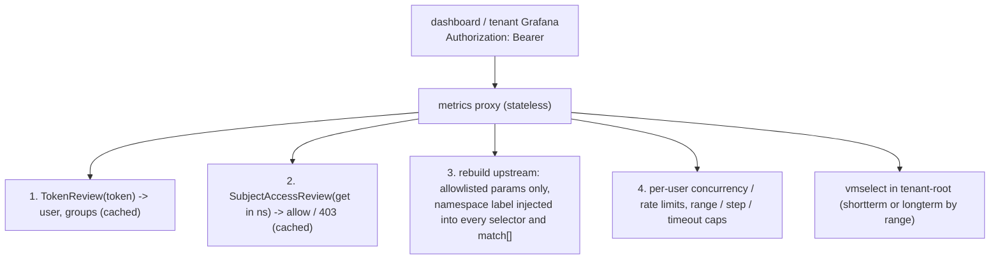

# Tenant resource-consumption metrics via an authorizing proxy

- **Title:** `Tenant resource-consumption metrics via an authorizing proxy`
- **Author(s):** `@IvanHunters`
- **Date:** `2026-10-14`
- **Status:** Review

## Overview

Clients running managed databases and VMs on Cozystack want to see their own real consumption (CPU, memory, network) directly in the dashboard, without opening Grafana and without deploying their own per-tenant monitoring stack. The data already lives in VictoriaMetrics, but a tenant has no way to read it: the dashboard is a pure SPA, there is no per-tenant query path into VictoriaMetrics, and a VM or database detail page shows status and controls but no consumption graph over time. The requirement that makes this a platform feature is that **Kubernetes identity and RBAC** decide who may read which tenant's metrics: the same tokens, the same tenant groups, the same view < use < admin rollup, the same ancestor access.

That requirement is about authentication and authorization, not about routing query traffic through the control plane. This proposal puts a **small stateless authorizing proxy in front of `vmselect`**. The proxy validates the bearer token the dashboard already holds with a `TokenReview`, authorizes the namespace with a `SubjectAccessReview`, forces the tenant's `namespace` label into every selector of the query, and reverse-proxies the native Prometheus request to `vmselect`, returning the Prometheus JSON unchanged. Identity and policy stay Kubernetes; only the query bytes stay out of the API server. Off-the-shelf parts cover it: `kube-rbac-proxy` (TokenReview + SubjectAccessReview) in front of `prom-label-proxy` (label enforcement), or one small Go service doing the same steps.

An earlier draft of this proposal (in this same PR) routed metrics through `cozystack-api`, first as a standalone `metrics.cozystack.io` API server with a `MetricQuery` kind, then as a `metrics` subresource on `apps.cozystack.io`. Both are now in Alternatives with the reasons the proxy is preferred.

## Scope and related proposals

- **Companion to the logs (cozystack/community#95) and alerts (#96) proposals.** Metrics and logs are read paths and use a proxy; alert management is read-write CRUD and stays a Kubernetes resource.
- **Complements, does not replace, Grafana.** Grafana stays the place for deep exploration; this serves embedded, basic per-resource graphs for tenants who do not run their own Grafana.
- **Billing is out of scope.** This exposes measured consumption for graphs; it does not meter, price, or produce invoices.
- **Foundational dependency: write-path multi-tenancy for the metrics store.** A `namespace` label in the shared store is trusted today; closing that is a prerequisite tracked below (see Security and Rollout).

## Prior art

- **`kube-rbac-proxy` (identity and RBAC).** A small sidecar/standalone proxy that authenticates a request with `TokenReview` and authorizes it with `SubjectAccessReview` against a configured resource attribute, then forwards it. It is exactly the "ask Kubernetes who you are and whether you may" step, with no API server of its own.
- **`prom-label-proxy` (label enforcement).** A proxy that injects a mandatory label matcher into a Prometheus/VictoriaMetrics request, across `query`, `query_range`, `series`, and the label endpoints, and rejects attempts to override it. It is the "force the tenant scope" step.
- **OpenShift per-project metrics.** OpenShift serves per-namespace metrics to users holding the project `view` role through this same pattern (an authorizing proxy enforcing a namespace label), rather than a Kubernetes aggregated API. This is the deployed precedent the proposal follows.
- **cozystack tenant RBAC.** The tenant chart binds aggregated ClusterRoles `cozy:tenant:{view,use,admin,super-admin}` (labels `rbac.cozystack.io/aggregate-to-tenant-<level>`) to the `<tenant>-<level>` Keycloak groups and ancestor subjects. A new aggregated rule naming a virtual resource reaches those groups with no tenant-chart change; `backup-controller` ships such tenant ClusterRoles the same way.

## Decisions

<!-- Filled in as implementation proceeds; records live under this
proposal's decisions/ directory, numbered from 0001, linked newest first.
Empty while the proposal is still intent. -->

## Context

- **Metrics stack: VictoriaMetrics.** A cluster-wide `vmagent` (`selectAllByDefault: true`) scrapes cAdvisor, kubelet, node-exporter, kube-state-metrics, and the control plane, remote-writing to the `tenant-root` VMCluster by default. Each VMCluster exposes a Prometheus-compatible read API at `vmselect-<name>.<ns>.svc:8481/select/0/prometheus/`.
- **Where the resource metrics live: `tenant-root`.** The series these graphs need (cAdvisor, kube-state-metrics, `kubevirt_vmi_*`) come from node-level, cluster-wide scrapes that remote-write to `tenant-root`. A tenant with its own monitoring (`tenant.spec.monitoring: true`, default `false`) runs a `vmagent` with `selectAllByDefault: false` that scrapes only the app scrape objects in namespaces pointing at it, so its own store does **not** hold cAdvisor/KSM/`kubevirt_vmi_*`. For the metrics in this proposal the store is therefore always `tenant-root` (shortterm or longterm chosen by range), regardless of whether the tenant runs its own stack.
- **Tenant RBAC and OIDC groups.** The `cozy:tenant:{view,use,admin,super-admin}` ClusterRoles are bound per tenant namespace to `kind: Group` subjects `<tenant>-{view,use,admin,super-admin}` (from the Keycloak operator) plus ancestor subjects, with the view < use < admin < super-admin rollup. The group-based path relies on the management apiserver passing a flat OIDC `groups` claim without a prefix.
- **Dashboard.** `cozystack-ui` is a pure SPA (no BFF): an in-pod nginx proxies `/api`, `/apis`, `/k8s` to `kubernetes.default.svc`, with oauth2-proxy (OIDC) or a built-in token-proxy (non-OIDC) in front. There is no charting library, no Prometheus proxy, and no Grafana embed in the bundle.

### The problem

- A tenant opens a database or VM page and wants "how much CPU / RAM / network has this been using". There is no such graph and no endpoint the SPA could call to build one.
- Telling the client to open Grafana does not work for the target audience: clients who do not run their own Grafana and should not have to deploy and pay for a full monitoring stack just to read basic usage.
- Reaching `vmselect` directly from the SPA (for example via the kube-apiserver `services/<vmselect>/proxy` subresource) is unsafe: it authorizes coarsely and cannot constrain the query, so against the shared `tenant-root` store it reads every tenant's series.

## Goals

- A tenant can retrieve time-series consumption for a resource it owns (a managed app / database / VM), over a chosen range, and the dashboard renders it as a graph.
- A tenant can never read another tenant's series, enforced server-side by a forced namespace matcher the client cannot override.
- Authorization uses Kubernetes identity and RBAC: the same bearer token the dashboard already sends, validated by `TokenReview`, authorized by `SubjectAccessReview`, reaching the existing tenant groups and ancestor access through one aggregated ClusterRole rule.
- The dashboard consumes a Prometheus-compatible response with a standard client, with no second API or client to maintain.
- Minimal implementation: one small stateless proxy (off-the-shelf parts), no new Kubernetes API surface, no change to `cozystack-api`.

### Non-goals

- Not billing, metering, or invoices.
- Not alert-rule or alert-routing management (separate proposal).
- Not a replacement for Grafana or for `metrics.k8s.io`.
- Not a new durable store; retention and downsampling stay in VictoriaMetrics.
- Not a new Kubernetes API group or subresource (see Alternatives for why those were dropped).
- Not metrics for resources inside guest Kubernetes clusters (Kamaji); a different authorization model, out of scope.

## Design

### 1. Shape: an authorizing proxy in front of `vmselect`

A small stateless proxy sits between the caller and `vmselect`. It does identity and RBAC with Kubernetes, forces the tenant scope into the query, and reverse-proxies the native Prometheus request.

The proxy is reachable two ways, both of which carry the user's own token: a path behind the dashboard's existing nginx (next to `/apis`) for the SPA, and an in-cluster Service for a tenant's Grafana datasource. It can be assembled from `kube-rbac-proxy` plus `prom-label-proxy`, or written as one small Go service; either is far less code than a Kubernetes API server or subresource with its tests.

### 2. Endpoints

`GET|POST /namespaces/<ns>/api/v1/{query,query_range,series,labels,label/<name>/values}`. These are the native VictoriaMetrics read endpoints the dashboard and a Grafana datasource need (a Grafana metric browser needs `labels`, `label/<name>/values`, and `series`). The proxy does its own authentication and authorization, so a POST query, which Grafana sends by default, is fine: it is not subject to the Kubernetes rule that a POST through the API server authorizes as `create`. The response is the `vmselect` Prometheus JSON, unchanged.

### 3. Authorization

- **Identity.** `TokenReview` validates the bearer token the dashboard already holds, covering OIDC and ServiceAccount tokens alike, because kube-apiserver answers with its own authenticators. The proxy caches the result briefly.
- **Policy.** `SubjectAccessReview` asks RBAC whether that user, with their groups, may `get` a **virtual resource** (one that no API server serves) in the request namespace. The grant is a single aggregated ClusterRole rule naming that resource, labeled `rbac.cozystack.io/aggregate-to-tenant-view`, so it reaches the `<tenant>-view` groups and ancestor subjects through the existing bindings, with no tenant-chart change. The proxy caches the decision briefly.
- Because the rule is its own, metrics-read can be gated separately from app-read later (a benefit the dropped subresource lacked, since it rode the `apps.cozystack.io` wildcard). Ancestor access comes for free from the existing bindings.

This is authorized by Kubernetes RBAC exactly as much as an aggregated API server would be, which asks the same two questions through delegated authorization; only the query traffic stays out of the API server.

### 4. Isolation: a forced namespace matcher the caller cannot widen

- **Namespace only.** The enforced scope is the `namespace` label. The series carry `namespace` (cAdvisor has `namespace`/`pod`/`container`; `kubevirt_vmi_*` has `namespace`/`name`), but no release or application label, and the only generic link from an application to its pods is a join with `kube_pod_labels` that a label matcher cannot express. Namespace is also exactly the boundary the tenant roles are bound on. Per-application scoping is then a matter of which `pod`/`name` the dashboard's query selects inside the tenant's namespace, which is safe because tenant roles are namespace-wide.
- **Built from scratch.** The proxy does not pass the caller's query through and append a filter: VictoriaMetrics OR-s repeated `extra_filters[]` values, so a caller-supplied `extra_filters[]={namespace=~".+"}` would widen the scope. The proxy copies only allowlisted parameters (`query`, `start`, `end`, `step`, `time`, `match[]`, a clamped `timeout`), injects the `namespace="<ns>"` matcher into every selector and every `match[]` server-side, and drops any caller-supplied `extra_filters` / `extra_filters[]` / `extra_label`. `prom-label-proxy` does exactly this across the query and label endpoints.

### 5. Store resolution

Always `tenant-root` (see Context), with shortterm or longterm chosen by range: shortterm when the whole requested range fits its retention (fresher, higher resolution), otherwise longterm, defaulting to shortterm for live graphs. There is no per-tenant-stack resolution, because the resource metrics are not in a tenant's own stack.

### 6. Write-path trust (foundational)

The forced namespace matcher keeps reads safe, but a `namespace` label in the shared `tenant-root` store does not prove where a series came from. `tenant-root`'s `vminsert` accepts remote-write at account 0 from tenant workloads, and nested Kubernetes clusters write their metrics there by design with agents their tenants administer. So a tenant can write series labelled with another tenant's `namespace`. That cannot leak data, but it can make another tenant's graphs show fabricated numbers or push their queries over the series limits. Closing it is a write-path control, not a read-path one: a `vmauth` on the write path, per-writer accounts, or similar. This is the foundational multi-tenancy prerequisite, called out here and in Rollout.

### 7. Query cost

`tenant-root`'s `vmselect` also serves platform Grafana, alerting, opencost, VPA, and KEDA, so tenant raw-PromQL competes with autoscaling and alerting. Concrete limits, and where each is enforced:

- In the proxy, per request: max range, a minimum `step` or a cap on points per series, a clamped `timeout`, and per-user concurrency and rate limits.
- As `vmselect` flags (global, so they bound everyone): max series per query, max query duration.
- Worth considering: a separate `vmselect` for tenant queries so they do not share a limit pool with platform autoscaling and alerting.

### 8. Deployment

One small stateless Deployment plus a Service, reachable on a path behind the dashboard's nginx and as an in-cluster Service for Grafana. No change to `cozystack-api`, and no new Kubernetes API surface. The virtual resource exists only as a name in RBAC and the `SubjectAccessReview`.

## User-facing changes

- **Dashboard:** a consumption graph section on database and VM detail pages, using the same token and a standard Prometheus client against the proxy. Per-application graphs are queries scoped by `pod`/`name` inside the tenant's namespace; "all my databases" is the same endpoint with a wider query, so no second mechanism is needed. This needs a charting approach added to `cozystack-ui`, which has none today.
- **Tenant Grafana:** can use the proxy endpoint as a datasource, one per namespace, with the user's forwarded identity or a ServiceAccount token.
- **RBAC:** one new aggregated ClusterRole rule, reaching tenant groups automatically; no new group to manage.

## Upgrade and rollback compatibility

- Additive: one stateless Deployment, a Service, an nginx path, and one aggregated ClusterRole rule. Existing clusters, manifests, and APIs are unaffected, and `cozystack-api` is untouched.
- The proxy is an implementation detail behind a URL. It can be swapped freely later (for example once the metrics store gains native multi-tenancy) without removing Kubernetes API surface that clients depend on, which a subresource could not.
- Rollback: remove the Deployment, Service, path, and rule; the dashboard degrades to "no graph" (today's state).

## Security

- **Identity and policy are Kubernetes.** `TokenReview` and `SubjectAccessReview` against a namespaced virtual resource; the proxy stores no credentials of its own for callers and holds only its own ServiceAccount to reach `vmselect`.
- **Forced namespace matcher** is the isolation hinge: injected server-side into every selector and `match[]`, with the upstream request rebuilt from an allowlist so a caller cannot smuggle `extra_filters` / `extra_label` to widen scope. A test must assert that a caller passing `extra_filters`, `extra_filters[]`, and `extra_label` cannot read beyond its namespace.
- **Per-application name is the caller's query, not an enforced scope.** Because the enforced boundary is the namespace, a malformed or crafted `pod`/`name` in the dashboard's query cannot cross the namespace; the dashboard should still use an exact label match or escape regex metacharacters so a name like `my.vm` does not accidentally match another pod in the same namespace.
- **Write-path trust** is an open weakness of the shared store (Design 6): a tenant can write another namespace's label. It cannot leak data but can fabricate or inflate another tenant's series; the fix is a write-path control, tracked as the foundational prerequisite.
- **Why not `services/proxy` to `vmselect`:** coarse authz, no forced matcher; it reads every tenant's series on the shared store.
- **OIDC prerequisite:** the group-based authorization path requires the management apiserver to pass the configured flat `groups` claim without a prefix; this is the same assumption the existing group-based tenant RBAC relies on.

## Failure and edge cases

- Tenant has its own monitoring stack but its resource metrics are not there: handled, because the store is always `tenant-root` (Design 5), not the tenant's own `vmselect`.
- `vmselect` unreachable: surface a backend error distinct from "no data".
- Caller lacks the `get <virtual resource>` permission in the namespace: 403 before any query runs.
- Caller tries to drop or widen the namespace matcher (`extra_filters`, `extra_filters[]`, `extra_label`, extra `match[]`): impossible; the request is rebuilt from an allowlist with the matcher injected.
- Range or step out of bounds: rejected by the cost limits.
- Token invalid or expired: `TokenReview` fails, 401.

## Testing

- **Unit:** the namespace matcher is always injected into every selector and `match[]` and cannot be overridden by any caller parameter (`extra_filters`, `extra_filters[]`, `extra_label`); the allowlist drops everything else; cost limits clamp range/step/timeout.
- **Integration:** `TokenReview` + `SubjectAccessReview` allow `<tenant>-view` in the tenant namespace and deny a foreign tenant; a POST query is authorized the same as a GET.
- **e2e:** two tenants against the shared `tenant-root` store; tenant A reads only A's series; a VM/database graph renders end to end in the dashboard; a tenant's Grafana datasource against the proxy returns only that tenant's series.

## Rollout

- **Phase 0 (prerequisite): scrape per-VM metrics.** Confirm on a live cluster whether `kubevirt_vmi_*` (cpu/memory/network/storage) are collected, by querying `vmselect` for one of them or checking for the KubeVirt scrape object (the virt-operator `ServiceMonitor` lands in its `monitorNamespace`, `tenant-root`, converted to a `VMServiceScrape`); if not, add the scrape. Per-VM network is the blocking gap today. This phase is useful on its own.
- **Phase 1: the proxy plus RBAC.** Ship the stateless proxy (`kube-rbac-proxy` + `prom-label-proxy`, or one small Go service), the nginx path and in-cluster Service, and the one aggregated ClusterRole rule naming the virtual resource.
- **Phase 2: dashboard graphs.** Add a Prometheus client and charts to `cozystack-ui`.
- **Foundational, parallel:** a write-path control so the shared store's `namespace` label is trustworthy (Design 6).

## Open questions

- **Who owns the per-kind PromQL** (CNPG pods, `kubevirt_vmi_*`, Redis, and so on): the SPA shipping a query set per application kind, or a query declared on the `ApplicationDefinition`. The proxy is agnostic; this is a dashboard-side decision to settle before Phase 2.
- **A separate `vmselect` for tenant queries** versus sharing `tenant-root`'s, given that it also serves platform Grafana, alerting, opencost, VPA, and KEDA (Design 7).
- **Which write-path control** closes the shared-store trust gap: `vmauth` on the write path, per-writer accounts, or another mechanism (Design 6).
- **The virtual resource's name** used in the RBAC rule and `SubjectAccessReview` (a detail, settled in implementation).
- **Guest clusters (Kamaji)** are out of scope; a dedicated follow-up can address guest-internal metrics.

## Alternatives considered

- **A `metrics` subresource on `apps.cozystack.io` applications** (a previous draft in this PR). A `rest.Connecter` on each application kind in `cozystack-api`, reverse-proxying to `vmselect`. Rejected: it routes every chart refresh through kube-apiserver, the aggregator, and `cozystack-api`, where it counts against API Priority and Fairness, is subject to the non-long-running request timeout (60s), and may be audited with the PromQL in the URL; it shares a failure domain with all application CRUD, so graphs drop out during each `cozystack-api` rollout and a slow `vmselect` holds connections in the server that serves all application reads and writes; a Kubernetes path can carry a Prometheus tail only under a connect subresource of a specific object, so it needs one datasource per object (or a placeholder object per namespace) and does not cover the `labels`/`series` endpoints Grafana needs; Grafana's default POST authorizes as `create`, which the tenant view role does not grant on `apps.cozystack.io`; the object in the path cannot enforce anything finer than the namespace anyway (the series carry no release/app label); a `Tenant` object lives in its parent's namespace, so `tenants/<name>/metrics` would be readable by ancestors but not the tenant itself; and the subresource becomes a permanent part of the `apps.cozystack.io` contract, visible in discovery and hard to remove later. The proxy avoids all of these and the RBAC is the same one aggregated rule.
- **A standalone `metrics.cozystack.io` aggregation API with a `MetricQuery` kind** (an earlier draft in this PR). Rejected: it wraps every response in a kube `apiVersion`/`kind` envelope, forces a second kube-style client, and adds an API server and its tests, for no benefit over returning native Prometheus JSON.
- **A deep-link button to Grafana** (open the right dashboard with the right metrics preselected). Low effort and good for clients who already run Grafana, but rejected as the primary because the target audience is exactly the clients who do not. Worth shipping as a complementary convenience.
- **`vmauth` alone in front of VictoriaMetrics.** `vmauth` can force per-tenant isolation via `extra_filters`, but it authenticates with its own tokens or a JWT, not Kubernetes RBAC, so it would need per-tenant credentials or an OIDC-JWT-to-tenant mapping and a second auth path in the dashboard. The authorizing proxy keeps Kubernetes identity (`TokenReview`) and policy (`SubjectAccessReview`) instead, so the dashboard reuses the token it already has. `vmauth` remains the right tool on the write path (Design 6).

---

<!--
Inspired by KubeVirt enhancement proposals
(https://github.com/kubevirt/enhancements) and Kubernetes Enhancement
Proposals (KEPs).
-->
